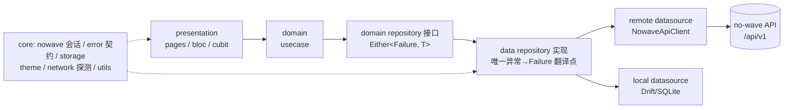
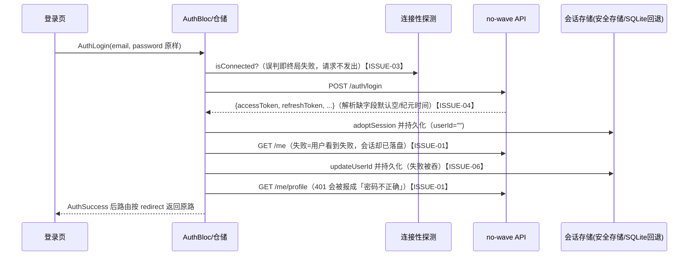

# flutter-blog 全面代码审查报告（2026-11-02）

> 审查对象：[`BrainEno/flutter-blog`](https://github.com/BrainEno/flutter-blog) `main` @ `5c0ef3a`（Merge PR #96）
> 审查方式：静态审查（逐文件阅读登录链路 + 全库结构化扫描）+ 本地可运行测试实跑 + GitHub Issue/PR/CI 状态核对。
> 沙箱限制：无 Flutter/Dart SDK，`flutter analyze` / `flutter test` 的结论引用 2026-11-02 当日 main 分支 CI 实际结果（见 §9），未把任何未运行的检查写成已通过。
> 本文与既有的 [`docs/code-audit.md`](code-audit.md)（2026-10 健壮性审查）、[`docs/nowave-api-gap-audit.md`](nowave-api-gap-audit.md)（API 差距审计）互为补充；两处已记录的未决风险在本文汇总为可执行 Issue。

---

## 0. 执行摘要

这是一个名为 **belog** 的 Flutter 博客客户端，正从早期 Supabase 后端迁移并演进为自托管 **no-wave** 后端（`apps/api`，REST `/api/v1`）的移动端。客户端的功能完整度已经不低：四标签阅读流、Markdown/结构化正文只读渲染、离线缓存与按账号隔离的本地草稿、点赞收藏、评论、关注、作者发现、朗读、阅读历史、数据导出、中英双语与明暗主题。

代码层面的总体判断：**工程素养明显高于同类个人项目**——错误契约、会话代际围栏（session fence）、refresh 单飞、401 单次重放防跨账号、诊断缓冲、发布门禁等都做得相当扎实，测试规模（101 个 Dart 测试文件、约 671 个用例）与 CI 矩阵（6 条 workflow）完整。2026-11-02 当日 main CI 全绿。

但以「可发布产品」标准衡量，还有一批明确问题，本报告共整理为 **15 个待办 Issue（§7，每个含详情证据、解决思路、验收标准与一键预填充链接）**，其中登录相关占 8 个。现存 7 个开放 Issue 中，**3 个可以立即关闭**（#88、#59、#61），1 个接近完成建议收尾后关（#24），3 个必须保留（#63、#21、#18），详见 §8。

**关于「现在的登录问题」的结论（重点）**：今天连续合并的 #92–#96 与开放中的 PR #97 都围绕同一个现场——本机 Android 模拟器登录本地后端被报「无法连接到网络」。代码侧的误判机制已经定位：主线上的前置连接性探测把 **3 秒探测超时当成离线**，登录请求在发出前就被拦截（§5.1）。修复在 [PR #97](https://github.com/BrainEno/flutter-blog/pull/97)，但截至本报告生成时它**尚未合并且 CI 有两项失败**（format、flutter-test，其余 job 仍在运行）。另一半可能性在环境侧（后端只绑 `::1`、Windows 防火墙、WSL/Docker 端口未发布），§5.2 给出了可直接照做的二分定位表。除此之外，登录链路还有 7 个潜藏的健壮性问题（半登录状态、意图未串行化、token 解析静默降级、空 userId 登录、持久化失败被吞、瞬时故障被登出、登录页 UX 基线缺失），它们在生产环境会表现为「偶发登不上 / 登录保持不住 / 误报密码错」，已全部列入 §7。

### 多维度评分（主观评级，依据见 §6）

| 维度 | 评级 | 一句话结论 |
|---|---|---|
| 架构合理程度 | B+（7.5/10） | feature-first 简化整洁架构 + 会话围栏设计出色；usecase 薄层、core→feature 反向依赖、428 行手工 DI 拉低分数 |
| 健壮性 | B（7/10） | 错误契约/单飞刷新/离线降级完善；登录原子性、并发串行化、持久化失败可见性是主要短板 |
| 安全 | B+（7.5/10） | token 安全存储、零客户端密钥、日志脱敏、敏感写不重放；Android 系统备份可能把本地库带走未处理 |
| UI / UX | B-（6.5/10） | no-wave 视觉系统成型且有双语/大字测试；登录/注册页仍未对齐新设计，表单基线（autofill 等）缺失 |
| 测试与 CI | A-（8.5/10） | 671 Dart 用例 + 63 Python/脚本用例 + 多平台编译与发布校验；缺集成冒烟、golden 与真机验收 |
| 文档 | A-（8.5/10） | README 与审计文档异常诚实、带快照 SHA 与验证边界；个别注释已过期 |
| 发布就绪度 | C+（5.5/10） | 包名/版本/名称未定版、无深链接收、无找回密码、隐私政策仍是草案 |

---

## 1. 代码规模

仓库创建于 2025-01-17，默认分支约 **325 次提交**；GitHub 语言占比 Dart 约 1.48 MB（其余为 Python 90 KB、Shell 49 KB、C++/Swift/Kotlin 等平台壳）。当前共 **551 个被跟踪文件**，文本总量约 **67,940 行**（含 `pubspec.lock`、Xcode 工程等流水账行数）。有意义的代码量拆解如下：

| 区域 | 文件数 | 行数 | 说明 |
|---|---|---|---|
| `lib/` 手写 Dart | 205 | 21,308 | 其中代码行约 17,909（空白 1,614、注释 1,785） |
| `lib/` 生成 Dart（旧 Isar `.g.dart`） | 3 | 3,991 | 仅供一次性数据导入，已被 analyzer 排除 |
| `lib/l10n/*.arb` | 2 | 824 | 中/英各 325 条文案 |
| `test/` | 104 | 21,832 | 101 个 `_test.dart`（单元 77 + Widget 24），约 671 个 `test`/`testWidgets` 用例 |
| `tool/` | 37 | 6,179 | CI/发布/打包脚本（Python+Shell）及其测试，外加旧 Isar 夹具的复制生成码约 3,985 行 |
| `scripts/` | 17 | 1,596 | 本地启动脚本（PowerShell/Shell/Python）与 mock 测试 |
| `.github/workflows/` | 6 | 1,261 | CI、移动包、发布、本地脚本、桌面朗读、人手构建 |
| 平台壳 `android/ios/macos/windows` | 136 | ≈4,767 | 大部分为 Xcode/Gradle 生成物；**无 `web/` 与 `linux/`** |
| 文档 | 14 | ≈1,280 | README 436 行（34 KB）+ `docs/` 13 篇 |

`lib/` 内部体积分布（Dart，含生成码）：`features/blog` 86 文件 10,579 行、`features/user` 39 文件 3,528 行、`features/auth` 22 文件 2,060 行、`core/storage` 4,753 行（其中旧生成码占约 3,991）、`core/nowave` 1,225 行、`router` 约 600 行、`init_dependencies.dart` 428 行。最大的手写单文件是编辑页（853 行）、API 客户端（681 行）、文章远端数据源（667 行）、自研 Markdown 渲染（580 行）——都不算离谱，但编辑页接近需要拆分的体量。运行时直接依赖 20 个 pub 包（含 `flutter_localizations`）、开发依赖 7 个；无仓库级 LICENSE 文件（只有字体 OFL 许可证随包）。

两个规模上的浪费点值得顺手清理（ISSUE-11）：仓库里躺着一份**过期且会误导人的 `coverage/lcov.info`**（2,661 行，内容指向已删除的 `destination_view.dart` 乃至拼写错误的旧目录 `bog_upload`，算得覆盖率 1.1%，明显是陈年偏跑产物）；旧 Isar 生成码在 `lib/` 与 `tool/legacy_isar_fixture/` 各存一份近 4,000 行（有意为之以做夹具真实性，但使生成码总量翻倍）。

---

## 2. 设计思路（架构总览）

### 2.1 分层：feature-first 的简化整洁架构

- 三个业务 feature（`auth`、`blog`、`user`）各自闭环 `data/domain/presentation`；`core/` 提供跨 feature 基础设施；组合根是手写的 `lib/init_dependencies.dart`（GetIt，428 行），页面作用域 Bloc 由 `go_router` 路由在创建页面的同时创建、随页面销毁，只有 `ThemeBloc/AuthBloc/AppUserCubit` 三个全局状态活在路由器之上。导航是四标签 `StatefulShellRoute.indexedStack`，每标签独立 `Navigator` 栈 + 独立 `RouteObserver`，`/saved`、`/profile`、`/editor` 为登录保护前缀（`lib/router/app_router.dart:84`）。
- **错误契约**（`lib/core/error/failures.dart`）：`Failure = kind × 展示安全中文 message × 稳定 code × 可选 l10nKey × 诊断 cause`，UI 只渲染 `forPresentation()` 去 cause 的副本，按 code 查 ARB 文案（`failure_l10n.dart`），后端原始错误永不到达界面。
- **会话围栏是这个库最用心的设计**：`NowaveSessionManager` 维护 `sessionGeneration`（换号/登出/恢复才递增，普通 refresh 不变），API 客户端在请求发送前、响应后、401 重放前逐段校验代际与 viewer 身份（`nowave_api_client.dart`），仓储层再校验一次，目标是让「旧账号在途请求的迟到结果」永远污染不了新账号——共享设备换号场景下这是隐私级正确性而非洁癖。
- **本地存储**：手写 Drift `GeneratedDatabase` + 原生 SQL（schema v6，`app_database.dart`），保存文章缓存、按后端+账号+文章隔离的 `account_drafts`、阅读历史、主题；旧 Isar 数据在首次启动时从**副本**导入（原件永不删除/改动，导入带事务与标记）。token 正常存平台安全存储（iOS Keychain / Android Keystore），SQLite 是迁移源与故障回退。
- **正文三轨**：简单正文按 Markdown 写/读；no-wave v0/v1 结构化正文只读解析为阅读与朗读共用的 AST（不拼 HTML）；不兼容结构拒绝用普通编辑器保存，避免把富文本压平。文章寻址双轨：公开读/点赞按 slug，写操作按服务端 UUID（`BlogModel.articleId`）。
- **可观测性**：无遥测；`AppLogger` debug 打印 + 发布版保留一个有界内存诊断环形缓冲（只记方法/路径/状态码/耗时/错误类型），在「关于」页由用户主动查看/分享。

### 2.2 认证设计（本文重点，详见 §5）

注册/登录 → `POST /auth/{register,login}` 换 token 对 → **先 adopt 持久化（userId 空）** → `GET /me` 回填 userId → `GET /me/profile` 得到展示资料（注册还多一步 `PUT /me/profile` 写昵称）→ 才通知 UI 登录成功。access 过期前 30 秒主动轮换，401 时单飞刷新并重放一次；refresh token 一次有效、轮换后复用会被后端吊销整个会话族，所以刷新严格 single-flight。退出 = `DELETE /me/session` 尽力撤销 + 本地清会话/资料缓存/阅读历史。冷启动在首帧前恢复会话（最多等 3 秒，`lib/main.dart:23`），登录页入场再复查一次（`login_page.dart:38`）。

---

## 3. API 清单（客户端已接入）

基址：`$API_BASE_URL/api/v1`（`API_BASE_URL` 构建期注入，不得自带 `/api/v1`，客户端有快速失败校验）。统一信封 `{data:…}` / `{error:{code,message}}`；JSON 预算每相 30 秒、媒体 90 秒；文章域请求统一带 `locale=zh-CN`（25 处硬编码，见 ISSUE-13）。

| 域 | 接口 | 鉴权 | 用途 |
|---|---|---|---|
| 认证 | `POST /auth/register`、`POST /auth/login`、`POST /auth/refresh` | 否（凭据/refresh 在 body） | 注册即登录、登录、轮换 token |
| 认证 | `GET /me`、`GET/PUT /me/profile`、`DELETE /me/session` | 是 | 身份解析、资料、退出撤销 |
| 认证 | `PUT /me/password`、`GET /me/sessions` | 是（围栏单次/只读） | 登录态改密、会话列表 |
| 运维 | `GET /health` | 否 | 仅 debug/内网 origin 的连接性探测 |
| 文章 | `GET /articles`（分页/游标/搜索 `query`/`sort=popular`）、`GET /featured`、`GET /me/feed` | 关注流需登录 | 首页四种流与搜索 |
| 文章 | `GET /articles/:slug`、`GET /articles/:slug/related` | 否 | 详情、相关阅读 |
| 文章 | `POST /articles`、`PUT/DELETE /articles/:articleId`、`POST /articles/:articleId/restore` | 是 | 发布、编辑、软删、恢复 |
| 文章 | `GET /me/articles`、`GET /me/articles/deleted` | 是（围栏） | 我的文章（含服务端草稿）、回收站 |
| 互动 | `PUT/GET /articles/:slug/like`、`GET /me/liked-articles` | 是 | 点赞置态、收藏夹 |
| 互动 | `GET/POST /articles/:slug/comments`、`DELETE /comments/:id` | 发/删需登录 | 评论（幂等键安全重试） |
| 标签 | `GET/POST /tags`、`GET /tags/:slug/articles` | 建标签需登录 | 标签浏览 |
| 作者 | `GET /authors/:id`、`/authors/:id/articles`、`GET /users?query=`、`GET /users/:id/followers\|following` | 否（后两类走匿名客户端，不附带 token） | 作者主页/发现/关系列表 |
| 作者 | `POST/DELETE /users/:id/follow` | 是 | 关注/取关（服务端校准） |
| 媒体 | `POST /me/media`（原始字节）、`GET /media/:id`（客户端拼 URL 交图片缓存） | 上传需登录 | 封面/头像（服务端转码 WebP、不可变） |

**后端已有但客户端未接入**（依据 `docs/nowave-api-gap-audit.md`，2026-11-02 快照）：找回/重置密码与邮箱验证/重发、`PUT /me/email` 及 `GET /me` 返回的邮箱、会话单个/批量撤销、通知、私信、分类与编辑角色、`PUT /featured`、媒体库列表/删除、发文 `Idempotency-Key`、富文本编辑往返。其中与登录最相关的是找回密码/邮箱全家桶（ISSUE-09）。

---

## 4. 发布与平台形态

目标平台 `android/ios/macos/windows`（无 web/linux）。Flutter 钉版 `3.47.8`（单一真源 `tool/flutter_version.txt`，本地调试对满足 Dart `>=3.10` 的 SDK 只警告不拦截，发布/CI 严格）。Android release 签名 fail-closed（无凭据或误用 debug key 直接失败），IPA/APK 个人包各有 workflow 与 16 KiB 对齐、权限、证书校验脚本。应用身份仍未定版：`applicationId "com.example.belog"`（gradle 中 TODO 还在）、桌面名称 `Bottom Think`、版本 `0.0.0+1`、pubspec 描述还是 "A new Flutter project."（ISSUE-12）。

---

## 5. 登录专题

### 5.1 「现在的登录问题」到底卡在哪儿

按当日合并轨迹（#89→#92→#93→#94→#95→#96→开放的 #97）还原，这其实是**一连串被逐个拔掉的钉子**，当前还剩最后一颗半：

1. **环境配置钉（已拔）**：`--dart-define` 非 const 读取在 Android 静默回空（#94）、首次运行不生成 `env.json`（#92）、VSCode F5 没带 `env.json`（#89）、Flutter 版本锁死（#89）、旧 SDK 解析不了 dev 依赖（#93）。
2. **探测误判钉（半颗：修复未合并）**：所有仓储在真正发请求前先做连接性探测（登录是 `lib/features/auth/data/repositories/auth_repository_impl.dart:102`）。内网/回环 origin 在 debug 下改用 `ApiConnectionChecker` 直探后端 `/api/v1/health`（#95），但它把任何异常（**包括 3 秒预算内的 TimeoutException**）一律判离线（`lib/core/network/api_connection_checker.dart:61-79` 主线版本）。冷启动的 Node 服务、断点、慢代理都足以让探测先超时，而真实登录请求有 30 秒预算——于是用户看到「无法连接到网络」，**而登录 POST 从未发出**。更糟的是诊断入口 `/profile/about` 在登录保护前缀之内，登录失败时连证据都看不到（主线 README 写的「我的 → 关于我们 → 查看诊断信息」对未登录用户不可达）。[PR #97](https://github.com/BrainEno/flutter-blog/pull/97) 修这两点（超时=无法判定放行、新增公开 `/about` 路由与登录页诊断入口），**但截至本报告，#97 的 format 与 test 检查已失败、其余 job 未跑完，未能合并**——主线现状仍会误拦截。
3. **环境连通钉（可能是剩下半颗）**：若探测日志是 `SocketException`（拒绝连接）而非超时，那就是模拟器网络到宿主机的路径问题：后端 `listen(port,'localhost')` 在 Windows 只绑 `::1`（`10.0.2.2` 走 IPv4 必然被拒）、防火墙丢弃、服务在 WSL2/Docker 未发布端口、或后端根本没起。这部分任何客户端改动都救不了。

#### 5.2 现场二分定位表（照单执行即可定界）

| # | 先看什么 | 结果与结论 |
|---|---|---|
| 1 | debug 控制台 `[belog] connectivity probe http://10.0.2.2:4000/api/v1/health failed (X)` | `X=TimeoutException` → 误判型，等/催 PR #97（或临时给 ApiConnectionChecker 调大预算验证）；`X=SocketException` → 跳第 2 步 |
| 2 | 宿主机执行 `curl http://localhost:4000/api/v1/health` | 不通 → 后端未起/端口不对，先起后端；通 → 第 3 步 |
| 3 | `adb shell "toybox wget -O - http://10.0.2.2:4000/api/v1/health"` | 不通但第 2 步通 → 监听绑定/防火墙/WSL 问题：后端改绑 `0.0.0.0`，或 `adb reverse tcp:4000 tcp:4000` 后把 `API_BASE_URL` 改为 `http://127.0.0.1:4000` |
| 4 | 第 3 步通但 App 仍报「无法连接到网络」 | 看是否 profile/release 在跑（VSCode 的 profile/release 配置**没传 env.json**，且非 debug 不走后端直探）：统一用 `belog` 调试配置或启动脚本（ISSUE-03） |
| 5 | App 报「邮箱或密码不正确」但密码核对无误 | 两个代码侧可能：① 旧账号注册于「自动去首尾空格」年代，服务器收到的就是去空格版（README 已注）；② 密码正确、后续 `GET /me` 的 401 被仓储误映射为密码错（ISSUE-01），翻诊断缓冲看状态码路径 |
| 6 | 登录成功但重启 App 又要登录 | 持久化失败被吞或轮换后旧 refresh token 落盘复用触发会话族吊销（ISSUE-06）；若刚改过密码，先看上游 no-wave #129（改密连当前会话一起撤销，客户端无解） |

### 5.3 登录时序与各步失败面

另外三条旁路事实：冷启动恢复最多占用首帧 3 秒、超时后以后台完成为准（`main.dart:23,45`）；恢复若在「已联网」分支撞上超时/500，会直接把 UI 定在登出态且**不做缓存身份兜底**（奇怪的是完全离线反而有缓存兜底）【ISSUE-07】；`AuthIsUserLoggedIn`（恢复）、`AuthLogin`、`AuthLogout` 三类事件在 Bloc 中并发处理、无任何串行化（`auth_bloc.dart` 未给 transformer），仓库自己的 `code-audit.md` 已把这点列为高风险但没有任何 Issue 跟踪【ISSUE-02】。

---

## 6. 多维度审查结论

### 6.1 健壮性 ✅ 强的部分 / ⚠️ 短板

✅ 统一 `Either<Failure,T>` 边界、每相 30 秒超时（发送与读体都算）、refresh 单飞 + 代际围栏 + 401 单次重放、登录态改密这类敏感 PUT 不重放不跟重定向、离线缓存按页读取并标注来源、草稿按后端/账号/文章隔离且旧无主草稿宁可不展示也不错配、启动失败有专门错误页（`StartupFailureApp`）。全库 TODO/FIXME 在 Dart 代码中为零，`print` 只出现在 `AppLogger` 内。
⚠️ 18 处 `catch (_)` 分散在编辑器与账号安全路径；会话 `_persist()` 失败全吞（ISSUE-06）；token 对解析「缺字段给默认值」把契约漂移变成诡异行为而非明确报错（ISSUE-04）；登录半完成状态无回滚（ISSUE-01）；恢复被瞬时故障打成假登出无重试（ISSUE-07）；连接性前置探测在多条写路径上可误杀请求（ISSUE-03，同一问题在 `blog_repository_impl.dart` 等各仓储同构存在）。`ensureFreshAccess()` 的接口注释写「fresh 时返回 true」，实现与测试钉的是相反语义（客户端又恰好不读返回值）——一条躺着的契约地雷，归入 ISSUE-04 顺手对齐。

### 6.2 安全

✅ 客户端零密钥（仅构建期公开的 `API_BASE_URL`/`WEB_BASE_URL`，且有白名单契约检查防误打包 `.env`）；token 在平台安全存储；日志与诊断严格脱敏；viewer 私读不跟随重定向以防 token 被转发；站点相对资源只按显式可信 `WEB_BASE_URL` 解析、拒绝协议相对与危险 scheme；Markdown 自解析不走 HTML；release 签名 fail-closed。
⚠️ 三处：Android 未设 `allowBackup=false` 也无 `dataExtractionRules`，默认 Auto Backup 可带走 `belog.sqlite`（含 SQLite 回退时的明文 token、草稿、历史）与旧 Isar 原文件（ISSUE-10）；安全存储迁移失败就整段启动期回退明文 SQLite 存 token（有注释知情，但应让用户可见并重试，ISSUE-06）；改密后当前会话被后端连带吊销、改密非原子属上游 no-wave #129/#132，客户端已做风险提示，只能继续在 UI 上保持诚实（已在 gap 审计跟踪，不另开单）。

### 6.3 UI / UX 与无障碍

✅ no-wave 纸墨/橙红/衬线设计系统集中在 `core/theme`，首页/搜索/阅读/作者/个人中心已统一；头像/封面有本地化语义与中性兜底；中英 ARB 各 325 条、未知设备语言回退中文；Widget 测试覆盖 2× 字号、320px 窄屏、明暗对比、键盘路径；减少动画时关闭标签淡入。
⚠️ **登录/注册页是明显的洼地，且与本专题直接相关**（ISSUE-08）：全库 `autofillHints` **0 处**，认证字段无 `keyboardType=email`、无回车提交、无密码可见切换（而改密页却有眼睛图标，前后不一致），邮箱只校验非空；提交中整页表单被 `Loader` 顶替卸载（键盘收起、焦点丢失、屏幕阅读器丢上下文）；错误只靠转瞬 SnackBar，无内联错误；`RATE_LIMITED` 的 `Retry-After` 在客户端解析后被丢弃（`NowaveApiException.retryAfterSeconds` 无人消费）；登录接口在最坏情况下是「3 秒探测 + 3 个请求 ×（30 秒发送 + 30 秒读体）」，用户要对着全屏转圈等上数分钟且不能取消。此外内容语言固定 `zh-CN`，英文界面只是换了菜单皮（ISSUE-13）；`NoWaveMasthead` 目前仅出现在首页/搜索，认证页仍是通用 Material 样子。

### 6.4 架构合理程度

✅ 分层方向整体单向、页面 Bloc 作用域干净、四标签各自导航栈、会话围栏把跨账号污染当作一级问题来防——这套取向在同等体量项目里少见。
⚠️（ISSUE-14）`core/storage/app_database.dart:7` 反向 import feature 的 `BlogModel`；5 处 domain 接口直接用 `dart:io File`（将来的 web/纯 Dart 测试都会被卡）；21 个 usecase 大多是单行转发（仪式感 > 隔离收益）；命名不一致遍布（`usecase` vs `usecases` 目录、`blog_by/bloc/` 额外嵌套、`features/user/bloc` vs 其他 feature 的 `presentation/bloc`）；`init_dependencies.dart` 428 行手工组装，factory 注册重复且 `ConnectionChecker` 注册位置在函数尾部、与 `_initAuth` 的顺序耦合靠懒加载兜着。都属「现在不痛、扩张必痛」型。

### 6.5 测试 / CI / 交付

✅ 101 个 Dart 测试文件约 671 用例（会话竞态、围栏、仓储、路由、双语 auth 等都有针对性回归）；Python/脚本侧 63 用例本报告已实跑全过（§9）；6 条 workflow 覆盖 format/analyze/test/Android release 编译与 16 KiB 校验、iOS 模拟器编译、macOS/Windows 桌面编译、签名保护；PR 描述的验证证据习惯极好（明确区分 passed/failed/blocked/not run）。
⚠️ 无 `integration_test`、无 golden、CI 全程用 `example.invalid` 伪后端——**真实登录时序从未在自动化里端到端跑通过**（ISSUE-15）；在库的 `coverage/lcov.info` 是过期的 1.1% 产物却无人删除（ISSUE-11）；真机/屏幕阅读器/生产后端冒烟均未做（多个 PR 诚实标注）。顺带提醒：`.gitignore:46` 的 `/android/` 会**静默吞掉一切新建 Android 文件**（已实测 `git check-ignore` 命中假想的新 Kotlin 文件与 `res/xml` 文件）——做 ISSUE-10 的备份规则、#21 的深链配置时必踩（ISSUE-11）。

### 6.6 文档

✅ README（34 KB）与 13 篇 docs 带快照 SHA、能力边界和「未验证」声明，是这个库质量的重要组成。⚠️ 个别过期：`login_page.dart` 注释宣称「后端还没有密码重置流程」，与 `auth_remote_data_source.dart` 自己的注释及 gap 审计（后端已有、客户端未接）自相矛盾（随手并入 ISSUE-09）；`ensureFreshAccess` 注释与实现相反（ISSUE-04）。

---

## 7. 待办 Issue 清单（可直接创建）

优先级口径：P1 = 影响登录可用性/账号正确性，建议最先做；P2 = 明确的缺陷或产品缺口；P3 = 卫生/长期项。每个条目给出「一键预填充」链接（点击后在 GitHub 打开已填好标题与正文的新建 Issue 页，确认后提交即可；网页版报告里有同样的按钮）。**不要在未做真机/后端验证的条目上把验收标准改写成已通过**——与本库 `AGENTS.md` 的证据纪律一致。

### 优先级索引

| 编号 | 优先级 | 分域 | 标题 | 预估 |
|---|---|---|---|---|
| ISSUE-01 | P1（先修） | 登录 · 健壮性 | 登录/注册在会话落盘后失败会留下「半登录」状态，且后续 401 被误报为密码错误 | M（1–2 天） |
| ISSUE-02 | P1（先修） | 登录 · 健壮性 | 登录/注册/恢复/退出意图未串行化，并发响应可乱序覆盖当前身份 | M–L（2–4 天） |
| ISSUE-03 | P1（先修） | 登录 · 网络 | 连接性前置探测会误判离线并在请求发出前拦截登录与写操作 | M（1–3 天） |
| ISSUE-04 | P2 | 登录 · 健壮性 | Token 对解析对缺字段静默降级（空 token/纪元过期时间），掩盖后端契约漂移 | S（0.5–1 天） |
| ISSUE-05 | P2 | 登录 · 正确性 | 空 userId 会话在离线恢复时会被判定为已登录（无身份用户） | S（0.5 天） |
| ISSUE-06 | P2 | 登录 · 健壮性/安全 | 会话持久化失败被静默吞掉：轮换后的 token 可能只存在于内存，重启复用已作废 refresh 会触发后端吊销会话族 | M（1–2 天） |
| ISSUE-07 | P2 | 登录 · 体验 | 冷启动恢复撞上瞬时网络故障会被定格成「已退出」，且恢复后不再自动重试 | M（1–2 天） |
| ISSUE-08 | P2 | 登录 · UI/无障碍 | 登录/注册页补齐表单基线与无障碍，并与 no-wave 设计体系对齐 | M（2–3 天） |
| ISSUE-09 | P2 | 登录 · 账号完整度 | 接入找回/重置密码与邮箱验证，并以 GET /me 同步账号邮箱 | L（跨版本规划） |
| ISSUE-10 | P2 | 安全 · 隐私 | Android 未配置备份排除规则：系统备份可能带走本地数据库（回退模式含明文 token）与旧 Isar 原文件 | S–M（1 天 + 真机验证） |
| ISSUE-11 | P3 | 工程卫生 | .gitignore 的 /android/ 会静默吞掉新建文件；过期 coverage/lcov.info 仍被跟踪 | S（半小时） |
| ISSUE-12 | P3 | 发布就绪 | 应用身份定版：com.example 包名、Bottom Think 名称、0.0.0+1 版本与缺失 LICENSE | S–M（改名牵扯面需评估） |
| ISSUE-13 | P2 | i18n · 产品完整性 | 内容请求语言写死 zh-CN：英文界面用户看不到仅有英文/繁中译文的作品 | M–L（需缓存隔离设计） |
| ISSUE-14 | P3 | 架构 | 分层整备：core 反向依赖 feature 模型、dart:io 穿透 domain、目录命名不一致 | S–M（分 PR 小步） |
| ISSUE-15 | P3 | 测试 / CI | 增加假后端登录端到端冒烟与设计基线 golden，CI 不再只对不可达占位域名编译 | M（2–4 天起稿） |

> 每条目下方单独有一处「一键预填充」链接（为控制 URL 长度，索引表不再重复挂载同一条长链接）。极个别超长链接若在你的浏览器里被截断或报错，直接把对应条目的详情证据/解决思路/验收标准复制粘贴到新建 Issue 即可，内容与预填充正文同源。

### ISSUE-01：[P1][Auth] 登录/注册在会话落盘后失败会留下「半登录」状态，且后续 401 被误报为密码错误

- **分域/预估**：登录 · 健壮性 · M（1–2 天）
- **一键预填充**：[在 GitHub 打开已填好的新建 Issue 页面](https://github.com/BrainEno/flutter-blog/issues/new?title=%5BP1%5D%5BAuth%5D+%E7%99%BB%E5%BD%95%2F%E6%B3%A8%E5%86%8C%E5%9C%A8%E4%BC%9A%E8%AF%9D%E8%90%BD%E7%9B%98%E5%90%8E%E5%A4%B1%E8%B4%A5%E4%BC%9A%E7%95%99%E4%B8%8B%E3%80%8C%E5%8D%8A%E7%99%BB%E5%BD%95%E3%80%8D%E7%8A%B6%E6%80%81%EF%BC%8C%E4%B8%94%E5%90%8E%E7%BB%AD+401+%E8%A2%AB%E8%AF%AF%E6%8A%A5%E4%B8%BA%E5%AF%86%E7%A0%81%E9%94%99%E8%AF%AF&body=%23%23+%E7%8E%B0%E8%B1%A1%E4%B8%8E%E8%AF%81%E6%8D%AE%0A%0A-+%60lib%2Ffeatures%2Fauth%2Fdata%2Fdatasources%2Fauth_remote_data_source.dart%3A103-119%60%EF%BC%9Alogin+%E5%85%88+%60adoptSession%60+%E6%8C%81%E4%B9%85%E5%8C%96+token%EF%BC%8C%E5%86%8D%E4%BE%9D%E6%AC%A1+%60GET+%2Fme%60%E3%80%81%60GET+%2Fme%2Fprofile%60%EF%BC%9B%E5%90%8E%E4%B8%A4%E6%AD%A5%E6%8A%9B%E9%94%99%E6%97%B6%E6%B2%A1%E6%9C%89%E4%BB%BB%E4%BD%95%E5%9B%9E%E6%BB%9A%EF%BC%88%60clear%28%29%60%EF%BC%89%E3%80%82%0A-+%E7%BB%93%E6%9E%9C%EF%BC%9A%E7%94%A8%E6%88%B7%E7%9C%8B%E5%88%B0%E7%99%BB%E5%BD%95%E5%A4%B1%E8%B4%A5%E3%80%81AppUserCubit+%E4%BB%8D%E6%98%AF%E7%99%BB%E5%87%BA%E6%80%81%EF%BC%8C%E4%BD%86%E6%9C%8D%E5%8A%A1%E7%AB%AF%E8%AE%A4%E5%8F%AF%E7%9A%84%E4%BC%9A%E8%AF%9D%E5%B7%B2%E8%A2%AB+app+%E6%8C%81%E6%9C%89%EF%BC%88%E6%AD%A4%E5%90%8E%E6%90%BA%E5%B8%A6+token+%E7%9A%84%E8%AF%B7%E6%B1%82%E4%BC%9A%E4%BB%A5%E8%AF%A5%E8%B4%A6%E5%8F%B7%E5%8F%91%E5%87%BA%EF%BC%89%EF%BC%9B%E5%85%B3%E6%8E%89%E9%87%8D%E5%BC%80+App+%E5%8F%88%E5%8F%AF%E8%83%BD%E3%80%8C%E8%8E%AB%E5%90%8D%E5%85%B6%E5%A6%99%E5%B7%B2%E7%99%BB%E5%BD%95%E3%80%8D%E3%80%82%0A-+%60lib%2Ffeatures%2Fauth%2Fdata%2Frepositories%2Fauth_repository_impl.dart%60+%60_loginFailure%60+%E6%8A%8A%E4%BB%BB%E6%84%8F+%60UNAUTHENTICATED%60+%E9%83%BD%E6%98%A0%E5%B0%84%E4%B8%BA%E3%80%8C%E9%82%AE%E7%AE%B1%E6%88%96%E5%AF%86%E7%A0%81%E4%B8%8D%E6%AD%A3%E7%A1%AE%E3%80%8D%E2%80%94%E2%80%94%E5%AF%86%E7%A0%81%E6%98%8E%E6%98%8E%E6%AD%A3%E7%A1%AE%E7%9A%84%E7%94%A8%E6%88%B7%E4%BC%9A%E5%9B%A0%E4%B8%BA+%60GET+%2Fme%60%2F%60GET+%2Fme%2Fprofile%60+%E7%9A%84+401+%E7%9C%8B%E5%88%B0%E8%BF%99%E5%8F%A5%E8%AF%AF%E5%AF%BC%E6%96%87%E6%A1%88%E3%80%82%0A-+%E6%B3%A8%E5%86%8C%E4%BE%A7%E5%90%8C%E6%9E%84%EF%BC%9A%60auth_remote_data_source.dart%3A57-97%60+%E6%8A%8A+%60_resolveUserIdentity%60+%E6%94%BE%E8%BF%9B%E4%B8%8E+profile+%E5%86%99%E5%85%A5%E5%90%8C%E4%B8%80%E4%B8%AA+try%EF%BC%8C%2Fme+%E5%A4%B1%E8%B4%A5%E4%BC%9A%E8%A2%AB%E5%90%9E%E5%B9%B6%E8%AF%AF%E8%AE%B0%E4%B8%BA%E3%80%8C%E5%86%99%E6%98%B5%E7%A7%B0%E5%A4%B1%E8%B4%A5%E3%80%8D%EF%BC%8C%E9%9A%8F%E5%90%8E+%60_loadCurrentUser%60+%E5%A4%B1%E8%B4%A5%E5%88%99%E8%B4%A6%E5%8F%B7%E5%B7%B2%E5%88%9B%E5%BB%BA%E3%80%81%E4%BC%9A%E8%AF%9D%E5%B7%B2%E8%90%BD%E7%9B%98%E8%80%8C%E7%95%8C%E9%9D%A2%E6%8A%A5%E6%B3%A8%E5%86%8C%E5%A4%B1%E8%B4%A5%EF%BC%8C%E7%94%A8%E6%88%B7%E6%94%B9%E8%B5%B0%E6%B3%A8%E5%86%8C%E5%8F%AA%E4%BC%9A%E4%B8%8D%E6%96%AD%E5%90%83+CONFLICT%E3%80%82%0A%0A%23%23+%E8%A7%A3%E5%86%B3%E6%80%9D%E8%B7%AF%0A%0A-+%E8%AE%A9%E7%99%BB%E5%BD%95%E6%88%90%E4%B8%BA%E4%BA%8B%E5%8A%A1%EF%BC%9Atoken+%E4%BA%A4%E6%8D%A2%E5%90%8E%E7%9A%84%E8%BA%AB%E4%BB%BD%E8%A7%A3%E6%9E%90%E5%A4%B1%E8%B4%A5%E6%97%B6%EF%BC%8C%E8%A6%81%E4%B9%88%E9%99%8D%E7%BA%A7%E5%AE%8C%E6%88%90%E7%99%BB%E5%BD%95%EF%BC%88%E7%94%A8+session+%E9%87%8C%E5%B7%B2%E6%9C%89%E4%BF%A1%E6%81%AF+%2B+%E8%B5%84%E6%96%99%E7%BC%93%E5%AD%98%E6%9E%84%E9%80%A0%E6%9C%80%E5%B0%8F%E8%BA%AB%E4%BB%BD%EF%BC%8C%E5%B9%B6%E6%A0%87%E8%AE%B0%E4%B8%BA%E6%9C%AA%E5%AE%8C%E5%85%A8%E5%90%8C%E6%AD%A5%EF%BC%89%EF%BC%8C%E8%A6%81%E4%B9%88%E5%9B%9E%E6%BB%9A%E6%B8%85%E9%99%A4%E6%9C%AC%E6%AC%A1+adopt+%E7%9A%84%E4%BC%9A%E8%AF%9D%EF%BC%8C%E7%BB%9D%E4%B8%8D%E6%8A%8A%E5%8D%8A%E7%99%BB%E5%BD%95%E6%80%81%E4%BA%A4%E7%BB%99%E9%87%8D%E5%90%AF%E5%8E%BB%E3%80%8C%E7%8C%9C%E3%80%8D%E3%80%82%0A-+%E5%8C%BA%E5%88%86%E9%94%99%E8%AF%AF%E6%9D%A5%E6%BA%90%EF%BC%9A%E5%8F%AA%E6%9C%89+%60POST+%2Fauth%2Flogin%60+%E6%9C%AC%E8%BA%AB%E8%BF%94%E5%9B%9E%E7%9A%84+UNAUTHENTICATED+%E6%89%8D%E6%98%A0%E5%B0%84+invalidCredentials%EF%BC%9B%E8%BA%AB%E4%BB%BD%E8%A7%A3%E6%9E%90%E9%98%B6%E6%AE%B5%E7%9A%84%E5%A4%B1%E8%B4%A5%E7%94%A8%E7%8B%AC%E7%AB%8B+code%EF%BC%88%E5%A6%82+%60auth.identityResolveFailed%60%EF%BC%89%E4%B8%8E%E5%8F%AF%E9%87%8D%E8%AF%95%E6%96%87%E6%A1%88%E3%80%82%0A-+%E6%B3%A8%E5%86%8C%E4%BE%A7%E6%8B%86%E5%BC%80+try%EF%BC%9A%E8%A7%A3%E6%9E%90%E8%BA%AB%E4%BB%BD%E4%B8%8E%E5%86%99%E6%98%B5%E7%A7%B0%E5%88%86%E5%88%AB%E5%A4%84%E7%90%86%EF%BC%8C%E6%97%A5%E5%BF%97%E6%8E%AA%E8%BE%9E%E4%B8%8E%E5%A4%B1%E8%B4%A5%E7%82%B9%E4%B8%80%E8%87%B4%EF%BC%9B%E8%B4%A6%E5%8F%B7%E5%B7%B2%E5%88%9B%E5%BB%BA%E4%BD%86%E5%90%8E%E7%BB%AD%E5%A4%B1%E8%B4%A5%E6%97%B6%E7%BB%99%E7%94%A8%E6%88%B7%E3%80%8C%E8%B4%A6%E5%8F%B7%E5%B7%B2%E5%88%9B%E5%BB%BA%EF%BC%8C%E8%AF%B7%E7%9B%B4%E6%8E%A5%E7%99%BB%E5%BD%95%E3%80%8D%E7%9A%84%E7%A1%AE%E5%AE%9A%E5%87%BA%E5%8F%A3%E3%80%82%0A%0A%23%23+%E9%AA%8C%E6%94%B6%E6%A0%87%E5%87%86%0A%0A-+%5B+%5D+%E5%81%87%E5%90%8E%E7%AB%AF%E7%9F%A9%E9%98%B5%E6%B5%8B%E8%AF%95%EF%BC%9Alogin+%E5%88%86%E5%88%AB%E5%9C%A8+%2Fme+500%E3%80%81%2Fme+401%E3%80%81%2Fme%2Fprofile+%E8%B6%85%E6%97%B6%E3%80%81%2Fme%2Fprofile+%E6%A0%BC%E5%BC%8F%E9%94%99%E8%AF%AF%E6%97%B6%EF%BC%8CUI+%E7%8A%B6%E6%80%81%E4%B8%8E%E6%8C%81%E4%B9%85%E5%8C%96%E4%BC%9A%E8%AF%9D%E7%8A%B6%E6%80%81%E4%B8%80%E8%87%B4%EF%BC%88%E8%A6%81%E4%B9%88%E9%83%BD%E7%99%BB%E5%BD%95%E3%80%81%E8%A6%81%E4%B9%88%E9%83%BD%E6%9C%AA%E7%99%BB%E5%BD%95%E4%B8%94%E7%A3%81%E7%9B%98%E6%97%A0%E6%AE%8B%E7%95%99+token%EF%BC%89%E3%80%82%0A-+%5B+%5D+%E9%94%99%E8%AF%AF%E6%98%A0%E5%B0%84%E6%B5%8B%E8%AF%95%EF%BC%9A%E5%AF%86%E7%A0%81%E9%94%99%EF%BC%88login+401%EF%BC%89%E6%89%8D%E6%8F%90%E7%A4%BA%E5%AF%86%E7%A0%81%E4%B8%8D%E6%AD%A3%E7%A1%AE%EF%BC%9B%E8%BA%AB%E4%BB%BD%E8%A7%A3%E6%9E%90%E5%A4%B1%E8%B4%A5%E6%8F%90%E7%A4%BA%E5%8F%AF%E9%87%8D%E8%AF%95%E4%B8%94%E4%B8%8D%E5%87%BA%E7%8E%B0%E5%AF%86%E7%A0%81%E6%96%87%E6%A1%88%E3%80%82%0A-+%5B+%5D+%E6%B3%A8%E5%86%8C%E5%9C%A8+PUT+profile+%E5%A4%B1%E8%B4%A5%E6%97%B6%E4%BB%8D%E5%8F%AF%E7%99%BB%E5%BD%95%E6%88%90%E5%8A%9F%EF%BC%9B%2Fme+%E6%88%96+%2Fme%2Fprofile+%E5%A4%B1%E8%B4%A5%E6%97%B6%E6%96%87%E6%A1%88%E6%8C%87%E5%87%BA%E8%B4%A6%E5%8F%B7%E5%8F%AF%E8%83%BD%E5%B7%B2%E5%88%9B%E5%BB%BA%E5%B9%B6%E5%BC%95%E5%AF%BC%E7%99%BB%E5%BD%95%E3%80%82%0A-+%5B+%5D+%60flutter+analyze+--fatal-infos%60+%E4%B8%8E%E7%9B%B8%E5%85%B3%E5%8D%95%E6%B5%8B%E5%9C%A8%E5%9B%BA%E5%AE%9A+SDK+3.47.8+%E7%9A%84+CI+%E4%B8%AD%E9%80%9A%E8%BF%87%EF%BC%9B%E6%9C%AA%E6%8A%8A%E7%9C%9F%E6%9C%BA%2F%E7%9C%9F%E5%AE%9E%E5%90%8E%E7%AB%AF%E5%86%92%E7%83%9F%E5%86%99%E6%88%90%E5%B7%B2%E5%AE%8C%E6%88%90%E3%80%82%0A%0A%3E+%E6%9D%A5%E6%BA%90%EF%BC%9A%E5%85%A8%E9%9D%A2%E4%BB%A3%E7%A0%81%E5%AE%A1%E6%9F%A5%E6%8A%A5%E5%91%8A+%60docs%2Ffull-code-review-2026-11-02.md%60+%E7%9A%84+ISSUE-01%EF%BC%88%E5%9F%BA%E4%BA%8E+main+%605c0ef3a%60%EF%BC%9B%E5%AE%8C%E6%88%90%E6%97%B6%E8%AF%B7%E5%9C%A8+PR+%E4%B8%AD%E5%8C%BA%E5%88%86+passed+%2F+failed+%2F+blocked+%2F+not+run%EF%BC%8C%E4%B8%8D%E8%A6%81%E6%8A%8A%E7%9C%9F%E6%9C%BA%E6%88%96%E7%94%9F%E4%BA%A7%E5%90%8E%E7%AB%AF%E9%AA%8C%E8%AF%81%E5%86%99%E6%88%90%E5%B7%B2%E5%AE%8C%E6%88%90%EF%BC%89%E3%80%82)（需登录仓库账号后点 Submit）

**详情证据**

- `lib/features/auth/data/datasources/auth_remote_data_source.dart:103-119`：login 先 `adoptSession` 持久化 token，再依次 `GET /me`、`GET /me/profile`；后两步抛错时没有任何回滚（`clear()`）。
- 结果：用户看到登录失败、AppUserCubit 仍是登出态，但服务端认可的会话已被 app 持有（此后携带 token 的请求会以该账号发出）；关掉重开 App 又可能「莫名其妙已登录」。
- `lib/features/auth/data/repositories/auth_repository_impl.dart` `_loginFailure` 把任意 `UNAUTHENTICATED` 都映射为「邮箱或密码不正确」——密码明明正确的用户会因为 `GET /me`/`GET /me/profile` 的 401 看到这句误导文案。
- 注册侧同构：`auth_remote_data_source.dart:57-97` 把 `_resolveUserIdentity` 放进与 profile 写入同一个 try，/me 失败会被吞并误记为「写昵称失败」，随后 `_loadCurrentUser` 失败则账号已创建、会话已落盘而界面报注册失败，用户改走注册只会不断吃 CONFLICT。

**解决思路**

- 让登录成为事务：token 交换后的身份解析失败时，要么降级完成登录（用 session 里已有信息 + 资料缓存构造最小身份，并标记为未完全同步），要么回滚清除本次 adopt 的会话，绝不把半登录态交给重启去「猜」。
- 区分错误来源：只有 `POST /auth/login` 本身返回的 UNAUTHENTICATED 才映射 invalidCredentials；身份解析阶段的失败用独立 code（如 `auth.identityResolveFailed`）与可重试文案。
- 注册侧拆开 try：解析身份与写昵称分别处理，日志措辞与失败点一致；账号已创建但后续失败时给用户「账号已创建，请直接登录」的确定出口。

**验收标准**

- [ ] 假后端矩阵测试：login 分别在 /me 500、/me 401、/me/profile 超时、/me/profile 格式错误时，UI 状态与持久化会话状态一致（要么都登录、要么都未登录且磁盘无残留 token）。
- [ ] 错误映射测试：密码错（login 401）才提示密码不正确；身份解析失败提示可重试且不出现密码文案。
- [ ] 注册在 PUT profile 失败时仍可登录成功；/me 或 /me/profile 失败时文案指出账号可能已创建并引导登录。
- [ ] `flutter analyze --fatal-infos` 与相关单测在固定 SDK 3.47.8 的 CI 中通过；未把真机/真实后端冒烟写成已完成。

### ISSUE-02：[P1][Auth] 登录/注册/恢复/退出意图未串行化，并发响应可乱序覆盖当前身份

- **分域/预估**：登录 · 健壮性 · M–L（2–4 天）
- **一键预填充**：[在 GitHub 打开已填好的新建 Issue 页面](https://github.com/BrainEno/flutter-blog/issues/new?title=%5BP1%5D%5BAuth%5D+%E7%99%BB%E5%BD%95%2F%E6%B3%A8%E5%86%8C%2F%E6%81%A2%E5%A4%8D%2F%E9%80%80%E5%87%BA%E6%84%8F%E5%9B%BE%E6%9C%AA%E4%B8%B2%E8%A1%8C%E5%8C%96%EF%BC%8C%E5%B9%B6%E5%8F%91%E5%93%8D%E5%BA%94%E5%8F%AF%E4%B9%B1%E5%BA%8F%E8%A6%86%E7%9B%96%E5%BD%93%E5%89%8D%E8%BA%AB%E4%BB%BD&body=%23%23+%E7%8E%B0%E8%B1%A1%E4%B8%8E%E8%AF%81%E6%8D%AE%0A%0A-+%60lib%2Ffeatures%2Fauth%2Fpresentation%2Fbloc%2Fauth_bloc.dart%60+%E5%9B%9B%E4%B8%AA+handler+%E6%9C%AA%E8%AE%BE+transformer%EF%BC%8Cflutter_bloc+%E9%BB%98%E8%AE%A4%E5%B9%B6%E5%8F%91%E5%A4%84%E7%90%86%EF%BC%9B%E7%99%BB%E5%BD%95%E9%A1%B5%E5%85%A5%E5%9C%BA%E4%BC%9A%E8%A1%A5%E5%8F%91%E4%B8%80%E6%AC%A1%E6%81%A2%E5%A4%8D%EF%BC%88%60login_page.dart%3A38%60%EF%BC%89%EF%BC%8C%E5%86%B7%E5%90%AF%E5%8A%A8%E4%B9%9F%E5%8F%91%E4%B8%80%E6%AC%A1%EF%BC%88%60main.dart%3A45%60%EF%BC%89%E3%80%82%0A-+%E6%81%A2%E5%A4%8D%E7%9A%84%E5%A4%B1%E8%B4%A5%E5%88%86%E6%94%AF%E5%8F%AA%E6%8B%A6+%60auth.sessionChanged%60%EF%BC%9B%E8%8B%A5%E7%99%BB%E5%BD%95%E5%BC%80%E5%A7%8B%E5%89%8D%E6%B4%BE%E5%8F%91%E7%9A%84%E6%81%A2%E5%A4%8D%E5%9C%A8%E7%99%BB%E5%BD%95%E6%88%90%E5%8A%9F%E5%90%8E%E8%90%BD%E4%B8%80%E4%B8%AA%E6%99%AE%E9%80%9A%E5%A4%B1%E8%B4%A5%EF%BC%88%E5%A6%82%E6%97%A0%E4%BC%9A%E8%AF%9D%E6%97%B6%E7%9A%84+auth.rejected%EF%BC%89%EF%BC%8C%E4%BC%9A+emit+AuthFailure+%E8%A6%86%E7%9B%96%E7%99%BB%E5%BD%95%E6%88%90%E5%8A%9F+UI%EF%BC%8C%E5%B9%B6%E5%8F%AF%E8%83%BD%E5%BC%B9%E6%8F%90%E7%A4%BA%EF%BC%88attemptedLogin+%E6%97%B6%EF%BC%89%E3%80%82%0A-+%E4%BB%93%E5%82%A8%E5%B7%B2%E6%9C%89%E5%AE%8C%E5%96%84%E7%9A%84+sessionGeneration+%E5%9B%B4%E6%A0%8F%E9%98%B2%E6%97%A7%E4%BC%9A%E8%AF%9D%E6%95%B0%E6%8D%AE%EF%BC%8C%E4%BD%86%E6%8C%A1%E4%B8%8D%E4%BD%8F%E3%80%8C%E4%B8%A4%E6%AC%A1%E6%9C%AA%E7%99%BB%E5%BD%95%E6%84%8F%E5%9B%BE%E8%B0%81%E5%90%8E%E5%8F%91%E5%85%88%E8%87%B3%E3%80%8D%EF%BC%9A%60docs%2Fcode-audit.md%60+%E5%B7%B2%E6%98%8E%E7%A1%AE%E8%AE%B0%E5%BD%95%E3%80%8E%E6%9C%AA%E5%AE%9E%E7%8E%B0%E6%95%B4%E4%B8%AA%E7%99%BB%E5%BD%95%2F%E6%B3%A8%E5%86%8C%2F%E9%80%80%E5%87%BA%E6%B5%81%E7%A8%8B%E7%9A%84%E7%94%A8%E6%88%B7%E6%84%8F%E5%9B%BE%E4%B8%B2%E8%A1%8C%E5%8C%96%EF%BC%9B%E5%A4%9A%E4%B8%AA%E6%9C%AA%E8%AE%A4%E8%AF%81%E7%99%BB%E5%BD%95%E5%93%8D%E5%BA%94%E4%BB%8D%E5%8F%AF%E8%83%BD%E4%B9%B1%E5%BA%8F%E3%80%8F%E4%B8%BA%E9%AB%98%E9%A3%8E%E9%99%A9%EF%BC%8C%E5%8D%B4%E6%B2%A1%E6%9C%89%E4%BB%BB%E4%BD%95+GitHub+Issue+%E8%B7%9F%E8%B8%AA%EF%BC%88%E5%B7%B2%E6%90%9C%E7%B4%A2%E7%A1%AE%E8%AE%A4%EF%BC%89%E3%80%82%0A%0A%23%23+%E8%A7%A3%E5%86%B3%E6%80%9D%E8%B7%AF%0A%0A-+%E5%9C%A8+AuthBloc+%E4%B8%8A%E5%BC%95%E5%85%A5%E6%98%8E%E7%A1%AE%E7%AD%96%E7%95%A5%EF%BC%9AAuthLogin%2FAuthSignUp%2FAuthLogout+%E8%A7%86%E4%B8%BA%E4%BA%92%E6%96%A5%E6%84%8F%E5%9B%BE%E4%B8%B2%E8%A1%8C%E6%89%A7%E8%A1%8C%EF%BC%88%E5%90%8E%E5%88%B0%E7%9A%84%E6%84%8F%E5%9B%BE%E5%8F%96%E6%B6%88%E6%88%96%E6%8E%92%E9%98%9F%EF%BC%89%EF%BC%8CAuthIsUserLoggedIn+%E5%9C%A8%E6%9C%89%E7%99%BB%E5%BD%95%2F%E9%80%80%E5%87%BA%E6%84%8F%E5%9B%BE%E5%9C%A8%E9%80%94%E6%97%B6%E4%B8%8D%E8%90%BD%E5%9C%B0%E3%80%82%0A-+%E8%90%BD%E5%9C%B0%E5%89%8D%E4%BB%A5%E3%80%8C%E6%84%8F%E5%9B%BE%E5%BA%8F%E5%8F%B7+%2B+sessionGeneration%E3%80%8D%E5%8F%8C%E9%87%8D%E6%A0%A1%E9%AA%8C%EF%BC%8C%E6%81%A2%E5%A4%8D%E5%A4%B1%E8%B4%A5%E5%88%86%E6%94%AF%E7%9A%84%E8%BF%87%E6%9C%9F%E5%88%A4%E5%AE%9A%E8%A6%86%E7%9B%96%E6%89%80%E6%9C%89%E5%A4%B1%E8%B4%A5%E7%A0%81%E8%80%8C%E9%9D%9E%E5%8F%AA%E6%8B%A6+sessionChanged%E3%80%82%0A-+%E4%BF%9D%E6%8C%81%E4%BB%93%E5%82%A8%2F%E4%BC%9A%E8%AF%9D%E5%B1%82%E5%B7%B2%E6%9C%89%E5%9B%B4%E6%A0%8F%E4%B8%8D%E5%9B%9E%E9%80%80%EF%BC%9B%E6%94%B9%E9%80%A0%E5%8F%AA%E6%94%B6%E6%95%9B%E5%9C%A8%E6%84%8F%E5%9B%BE%E7%BC%96%E6%8E%92%E5%B1%82%E3%80%82%0A%0A%23%23+%E9%AA%8C%E6%94%B6%E6%A0%87%E5%87%86%0A%0A-+%5B+%5D+%E5%8F%AF%E6%8E%A7%E6%97%B6%E5%BA%8F%E6%B5%8B%E8%AF%95%EF%BC%9A%E6%81%A2%E5%A4%8D%EF%BC%88%E6%85%A2%EF%BC%89%E5%9C%A8%E7%99%BB%E5%BD%95%EF%BC%88%E5%BF%AB%EF%BC%89%E5%90%8E%E5%AE%8C%E6%88%90%E3%80%81%E4%B8%A4%E6%AC%A1%E7%99%BB%E5%BD%95%E4%B9%B1%E5%BA%8F%E5%AE%8C%E6%88%90%E3%80%81%E7%99%BB%E5%BD%95%E5%90%8E%E7%B4%A7%E8%B7%9F%E9%80%80%E5%87%BA%E3%80%81%E9%80%80%E5%87%BA%E4%B8%AD%E7%99%BB%E5%BD%95%EF%BC%8C%E6%9C%80%E7%BB%88+UI+%E8%BA%AB%E4%BB%BD%E4%B8%8E%E7%A3%81%E7%9B%98%E4%BC%9A%E8%AF%9D%E5%9D%87%E5%AF%B9%E5%BA%94%E6%9C%80%E5%90%8E%E4%B8%80%E6%AC%A1%E7%94%A8%E6%88%B7%E6%84%8F%E5%9B%BE%E3%80%82%0A-+%5B+%5D+%E6%97%A0%E5%9B%9E%E5%BD%92%EF%BC%9A%E7%8E%B0%E6%9C%89+auth%2Fsession+%E7%9B%B8%E5%85%B3%E6%B5%8B%E8%AF%95%E5%85%A8%E7%BB%BF%EF%BC%9B%E4%B8%8D%E6%96%B0%E5%A2%9E+catch-all+%E6%8E%A9%E7%9B%96%E5%A4%B1%E8%B4%A5%E3%80%82%0A-+%5B+%5D+%E5%9C%A8+docs%2Fcode-audit.md+%E6%8C%87%E5%9B%9E%E6%9C%AC+Issue+%E7%9A%84%E7%BB%93%E6%9E%9C%EF%BC%88%E5%85%B3%E9%97%AD%E6%97%B6%E6%B3%A8%E6%98%8E%E4%BB%8D%E7%84%B6%E5%AD%98%E5%9C%A8%E7%9A%84%E8%BE%B9%E7%95%8C%EF%BC%8C%E5%A6%82%E6%9C%8D%E5%8A%A1%E7%AB%AF%E5%8F%AF%E8%83%BD%E5%B7%B2%E6%8F%90%E4%BA%A4%E7%9A%84%E5%9C%A8%E9%80%94%E5%86%99%EF%BC%89%E3%80%82%0A%0A%3E+%E6%9D%A5%E6%BA%90%EF%BC%9A%E5%85%A8%E9%9D%A2%E4%BB%A3%E7%A0%81%E5%AE%A1%E6%9F%A5%E6%8A%A5%E5%91%8A+%60docs%2Ffull-code-review-2026-11-02.md%60+%E7%9A%84+ISSUE-02%EF%BC%88%E5%9F%BA%E4%BA%8E+main+%605c0ef3a%60%EF%BC%9B%E5%AE%8C%E6%88%90%E6%97%B6%E8%AF%B7%E5%9C%A8+PR+%E4%B8%AD%E5%8C%BA%E5%88%86+passed+%2F+failed+%2F+blocked+%2F+not+run%EF%BC%8C%E4%B8%8D%E8%A6%81%E6%8A%8A%E7%9C%9F%E6%9C%BA%E6%88%96%E7%94%9F%E4%BA%A7%E5%90%8E%E7%AB%AF%E9%AA%8C%E8%AF%81%E5%86%99%E6%88%90%E5%B7%B2%E5%AE%8C%E6%88%90%EF%BC%89%E3%80%82)（需登录仓库账号后点 Submit）

**详情证据**

- `lib/features/auth/presentation/bloc/auth_bloc.dart` 四个 handler 未设 transformer，flutter_bloc 默认并发处理；登录页入场会补发一次恢复（`login_page.dart:38`），冷启动也发一次（`main.dart:45`）。
- 恢复的失败分支只拦 `auth.sessionChanged`；若登录开始前派发的恢复在登录成功后落一个普通失败（如无会话时的 auth.rejected），会 emit AuthFailure 覆盖登录成功 UI，并可能弹提示（attemptedLogin 时）。
- 仓储已有完善的 sessionGeneration 围栏防旧会话数据，但挡不住「两次未登录意图谁后发先至」：`docs/code-audit.md` 已明确记录『未实现整个登录/注册/退出流程的用户意图串行化；多个未认证登录响应仍可能乱序』为高风险，却没有任何 GitHub Issue 跟踪（已搜索确认）。

**解决思路**

- 在 AuthBloc 上引入明确策略：AuthLogin/AuthSignUp/AuthLogout 视为互斥意图串行执行（后到的意图取消或排队），AuthIsUserLoggedIn 在有登录/退出意图在途时不落地。
- 落地前以「意图序号 + sessionGeneration」双重校验，恢复失败分支的过期判定覆盖所有失败码而非只拦 sessionChanged。
- 保持仓储/会话层已有围栏不回退；改造只收敛在意图编排层。

**验收标准**

- [ ] 可控时序测试：恢复（慢）在登录（快）后完成、两次登录乱序完成、登录后紧跟退出、退出中登录，最终 UI 身份与磁盘会话均对应最后一次用户意图。
- [ ] 无回归：现有 auth/session 相关测试全绿；不新增 catch-all 掩盖失败。
- [ ] 在 docs/code-audit.md 指回本 Issue 的结果（关闭时注明仍然存在的边界，如服务端可能已提交的在途写）。

### ISSUE-03：[P1][Auth/Net] 连接性前置探测会误判离线并在请求发出前拦截登录与写操作

- **分域/预估**：登录 · 网络 · M（1–3 天）
- **一键预填充**：[在 GitHub 打开已填好的新建 Issue 页面](https://github.com/BrainEno/flutter-blog/issues/new?title=%5BP1%5D%5BAuth%2FNet%5D+%E8%BF%9E%E6%8E%A5%E6%80%A7%E5%89%8D%E7%BD%AE%E6%8E%A2%E6%B5%8B%E4%BC%9A%E8%AF%AF%E5%88%A4%E7%A6%BB%E7%BA%BF%E5%B9%B6%E5%9C%A8%E8%AF%B7%E6%B1%82%E5%8F%91%E5%87%BA%E5%89%8D%E6%8B%A6%E6%88%AA%E7%99%BB%E5%BD%95%E4%B8%8E%E5%86%99%E6%93%8D%E4%BD%9C&body=%23%23+%E7%8E%B0%E8%B1%A1%E4%B8%8E%E8%AF%81%E6%8D%AE%0A%0A-+%E7%99%BB%E5%BD%95%2F%E6%B3%A8%E5%86%8C%2F%E5%8F%91%E5%B8%83%E7%AD%89%E5%86%99%E8%B7%AF%E5%BE%84%E7%BB%9F%E4%B8%80%E5%85%88%E6%9F%A5+%60connectionChecker.isConnected%60%EF%BC%88%60auth_repository_impl.dart%3A102%2C131%60%E3%80%81%60blog_repository_impl.dart%3A37%60+%E7%AD%89%EF%BC%89%EF%BC%9B%E6%8E%A2%E6%B5%8B%E4%B8%BA%E5%81%87%E5%8D%B3%E5%9C%A8%E6%9C%AC%E5%9C%B0%E6%8A%A5%E7%A6%BB%E7%BA%BF%EF%BC%8C%E8%AF%B7%E6%B1%82%E6%B0%B8%E4%B8%8D%E5%8F%91%E5%87%BA%E3%80%82%0A-+%E5%86%85%E7%BD%91%E6%8E%A2%E6%B5%8B+%60ApiConnectionChecker%60+%E5%9C%A8%E4%B8%BB%E7%BA%BF%E6%8A%8A+TimeoutException+%E4%B8%80%E5%B9%B6%E5%88%A4%E5%81%87%EF%BC%88%60api_connection_checker.dart%3A61-79%60%EF%BC%89%EF%BC%9B%E5%85%AC%E7%BD%91+origin+%E5%9C%A8+profile%2Frelease+%E5%A7%8B%E7%BB%88%E8%B5%B0%E5%85%AC%E7%BD%91%E7%AC%AC%E4%B8%89%E6%96%B9%E7%AB%AF%E7%82%B9%E6%8E%A2%E6%B5%8B%EF%BC%88%60connection_checker.dart%60%EF%BC%89%EF%BC%8C%E5%85%AC%E7%BD%91%E7%AB%AF%E7%82%B9%E5%8F%AF%E8%BE%BE%E6%80%A7%E4%B8%8E+API+%E5%8F%AF%E8%BE%BE%E6%80%A7%E6%9C%AC%E5%B0%B1%E4%B8%8D%E7%AD%89%E4%BB%B7%EF%BC%8C%E6%97%A0%E7%BD%91+LAN+%E5%90%8E%E7%AB%AF%E5%9C%A8%E9%9D%9E+debug+%E4%B8%8B%E5%BF%85%E7%84%B6%E8%AF%AF%E5%88%A4%E3%80%82%0A-+PR+%2397+%E5%B7%B2%E6%8A%8A+ApiConnectionChecker+%E7%9A%84%E8%B6%85%E6%97%B6%E6%94%B9%E6%88%90%E3%80%8C%E6%97%A0%E6%B3%95%E5%88%A4%E5%AE%9A%E6%94%BE%E8%A1%8C%E3%80%8D%E5%B9%B6+open+%E8%AF%8A%E6%96%AD%E5%85%A5%E5%8F%A3%EF%BC%8C%E4%BD%86%E5%B0%9A%E6%9C%AA%E5%90%88%E5%B9%B6%E4%B8%94+CI+%E6%9C%89+format%2Ftest+%E5%A4%B1%E8%B4%A5%EF%BC%9B%E5%85%AC%E7%BD%91%E6%A3%80%E6%9F%A5%E5%99%A8%E7%9A%84%E5%BC%82%E5%B8%B8%E5%88%86%E6%94%AF%E5%90%8C%E6%A0%B7%E4%B8%80%E6%8A%8A%E5%88%A4%E5%81%87%EF%BC%88%60connection_checker.dart%3A24-32%60%EF%BC%89%E3%80%82%0A-+%E6%AF%8F%E4%B8%AA%E4%BB%93%E5%82%A8%E6%96%B9%E6%B3%95%E9%83%BD%E7%8E%B0%E5%81%9A%E4%B8%80%E6%AC%A1%E6%96%B0%E6%8E%A2%E6%B5%8B%EF%BC%88factory+%E6%B3%A8%E5%85%A5%E3%80%81%E6%97%A0%E7%BB%93%E6%9E%9C%E7%BC%93%E5%AD%98%EF%BC%89%EF%BC%8C%E6%97%B6%E5%BB%B6%E4%B8%8E+%2Fhealth+%E6%B5%81%E9%87%8F%E9%9A%8F%E9%A1%B5%E9%9D%A2%E6%94%BE%E5%A4%A7%EF%BC%8C%E4%B8%94%E6%8E%A2%E6%B5%8B%E7%BB%93%E8%AE%BA%E4%B8%8E%E9%9A%8F%E5%90%8E%E7%9C%9F%E5%AE%9E%E8%AF%B7%E6%B1%82%E4%B9%8B%E9%97%B4%E5%AD%98%E5%9C%A8+TOCTOU+%E7%AA%97%E5%8F%A3%E3%80%82%0A-+%E9%99%84%E5%B8%A6%E5%BC%80%E5%8F%91%E4%BD%93%E9%AA%8C%EF%BC%9A%60.vscode%2Flaunch.json%60+%E7%9A%84+profile%2Frelease+%E8%B0%83%E8%AF%95%E9%85%8D%E7%BD%AE%E6%9C%AA%E4%BC%A0+env.json%EF%BC%8CF5+%E5%8D%B3%E5%88%B0%E3%80%8C%E6%97%A0%E6%B3%95%E5%90%AF%E5%8A%A8%E3%80%8D%E9%A1%B5%E3%80%82%0A%0A%23%23+%E8%A7%A3%E5%86%B3%E6%80%9D%E8%B7%AF%0A%0A-+%E6%8E%A2%E6%B5%8B%E9%99%8D%E7%BA%A7%E4%B8%BA%E5%92%A8%E8%AF%A2%E4%BF%A1%E5%8F%B7%EF%BC%9A%E8%AF%BB%E8%B7%AF%E5%BE%84%E5%8F%AF%E7%94%A8%E5%AE%83%E9%80%89%E7%BC%93%E5%AD%98%2F%E7%BD%91%E7%BB%9C%EF%BC%9B%E7%99%BB%E5%BD%95%E3%80%81%E5%8F%91%E5%B8%83%E7%AD%89%E5%86%99%E8%B7%AF%E5%BE%84%E7%9B%B4%E6%8E%A5%E5%B0%9D%E8%AF%95%E7%9C%9F%E5%AE%9E%E8%AF%B7%E6%B1%82%EF%BC%8C%E4%BC%A0%E8%BE%93%E9%94%99%E8%AF%AF%E8%B5%B0%E6%97%A2%E6%9C%89+Failure+%E6%98%A0%E5%B0%84%EF%BC%9B%E8%87%B3%E5%B0%91%E6%8A%8A%E3%80%8C%E8%B6%85%E6%97%B6%3D%E4%B8%8D%E7%A1%AE%E5%AE%9A%E6%94%BE%E8%A1%8C%E3%80%8D%E8%AF%AD%E4%B9%89%E5%90%8C%E6%AD%A5%E5%88%B0%E5%85%AC%E7%BD%91%E6%A3%80%E6%9F%A5%E5%99%A8%E3%80%82%0A-+%E7%BB%99%E6%8E%A2%E6%B5%8B%E5%8A%A0%E7%9F%AD+TTL+%E7%BC%93%E5%AD%98%EF%BC%88%E5%A6%82+2%E2%80%935+%E7%A7%92%E8%BF%9B%E7%A8%8B%E7%BA%A7%EF%BC%89%E6%88%96%E5%9C%A8%E9%A1%B5%E9%9D%A2%E6%93%8D%E4%BD%9C%E5%86%85%E5%A4%8D%E7%94%A8%E5%90%8C%E4%B8%80%E7%BB%93%E8%AE%BA%EF%BC%8C%E9%81%BF%E5%85%8D%E6%AF%8F%E6%AC%A1%E6%8C%89%E9%94%AE%E5%A4%9A%E6%89%93%E4%B8%80%E5%8F%91+%2Fhealth%E3%80%82%0A-+%E8%A1%A5%E9%BD%90+VSCode+profile%2Frelease+%E9%85%8D%E7%BD%AE%E7%9A%84+env+%E4%BC%A0%E5%8F%82%EF%BC%88%E6%88%96%E6%98%8E%E7%A1%AE%E5%AE%83%E4%BB%AC%E4%BB%85%E7%94%A8%E4%BA%8E%E6%AD%A3%E5%BC%8F+origin+%E5%B9%B6%E5%9C%A8+README+%E6%B3%A8%E6%98%8E%EF%BC%89%E3%80%82%0A-+%E8%90%BD%E5%9C%B0%2F%E5%90%B8%E6%94%B6+PR+%2397+%E6%97%B6%E5%90%8C%E6%AD%A5%E5%A4%84%E7%90%86%E5%85%B6+CI+%E5%A4%B1%E8%B4%A5%EF%BC%8C%E4%B8%8D%E7%95%99%E4%B8%A4%E5%A5%97%E8%AF%AD%E4%B9%89%E3%80%82%0A%0A%23%23+%E9%AA%8C%E6%94%B6%E6%A0%87%E5%87%86%0A%0A-+%5B+%5D+%E5%8D%95%E5%85%83%E6%B5%8B%E8%AF%95%EF%BC%9A%E6%8E%A2%E6%B5%8B%E8%B6%85%E6%97%B6%E3%80%81%E6%8E%A2%E6%B5%8B%E6%8A%9B%E6%9C%AA%E7%9F%A5%E5%BC%82%E5%B8%B8%E3%80%81%E6%8E%A2%E6%B5%8B%E6%AD%A3%E5%B8%B8%E4%B8%89%E7%A7%8D%E6%83%85%E5%86%B5%E4%B8%8B%E7%99%BB%E5%BD%95%E9%83%BD%E7%9C%9F%E7%9A%84%E5%8F%91%E5%87%BA+POST%EF%BC%9BSocketException+%E6%97%B6%E5%B1%95%E7%A4%BA%E7%BD%91%E7%BB%9C%E5%A4%B1%E8%B4%A5%E4%B8%94%E8%AF%8A%E6%96%AD%E7%BC%93%E5%86%B2%E6%9C%89%E8%AE%B0%E5%BD%95%E3%80%82%0A-+%5B+%5D+%E5%9C%A8%E4%BB%85+LAN+%E5%90%8E%E7%AB%AF%E3%80%81%E8%AE%BE%E5%A4%87%E6%97%A0%E5%85%AC%E7%BD%91%E7%9A%84%E5%9C%BA%E6%99%AF%E4%B8%8B%EF%BC%88%E5%8F%AF%E5%85%88%E7%94%A8%E5%81%87+checker+%2B+%E5%81%87%E5%90%8E%E7%AB%AF%E5%BB%BA%E6%A8%A1%EF%BC%89%E7%99%BB%E5%BD%95%E4%B8%8D%E8%A2%AB%E6%8B%A6%E6%88%AA%E3%80%82%0A-+%5B+%5D+%E5%90%8C%E4%B8%80%E9%A1%B5%E9%9D%A2%E8%BF%9E%E7%BB%AD%E6%93%8D%E4%BD%9C%E5%8F%AA%E5%81%9A%E8%87%B3%E5%A4%9A%E4%B8%80%E6%AC%A1%E6%8E%A2%E6%B5%8B%EF%BC%88%E5%8F%AF%E6%B5%8B%EF%BC%89%EF%BC%9B%E9%94%99%E8%AF%AF%E6%96%87%E6%A1%88%E4%BB%8D%E5%85%A8%E9%83%A8%E6%9C%AC%E5%9C%B0%E5%8C%96%E3%80%82%0A-+%5B+%5D+%E4%BB%A5+README%E3%80%8C%E7%99%BB%E5%BD%95%2F%E7%82%B9%E8%B5%9E%E6%97%B6%E6%8F%90%E7%A4%BA%E6%97%A0%E6%B3%95%E8%BF%9E%E6%8E%A5%E5%88%B0%E7%BD%91%E7%BB%9C%E3%80%8D%E4%B8%80%E8%8A%82%E6%9B%B4%E6%96%B0%E8%AF%B4%E6%98%8E%E4%B8%A4%E7%B1%BB%E6%9D%A5%E6%BA%90%E7%9A%84%E6%96%B0%E8%AF%AD%E4%B9%89%E3%80%82%0A%0A%3E+%E6%9D%A5%E6%BA%90%EF%BC%9A%E5%85%A8%E9%9D%A2%E4%BB%A3%E7%A0%81%E5%AE%A1%E6%9F%A5%E6%8A%A5%E5%91%8A+%60docs%2Ffull-code-review-2026-11-02.md%60+%E7%9A%84+ISSUE-03%EF%BC%88%E5%9F%BA%E4%BA%8E+main+%605c0ef3a%60%EF%BC%9B%E5%AE%8C%E6%88%90%E6%97%B6%E8%AF%B7%E5%9C%A8+PR+%E4%B8%AD%E5%8C%BA%E5%88%86+passed+%2F+failed+%2F+blocked+%2F+not+run%EF%BC%8C%E4%B8%8D%E8%A6%81%E6%8A%8A%E7%9C%9F%E6%9C%BA%E6%88%96%E7%94%9F%E4%BA%A7%E5%90%8E%E7%AB%AF%E9%AA%8C%E8%AF%81%E5%86%99%E6%88%90%E5%B7%B2%E5%AE%8C%E6%88%90%EF%BC%89%E3%80%82)（需登录仓库账号后点 Submit）

**详情证据**

- 登录/注册/发布等写路径统一先查 `connectionChecker.isConnected`（`auth_repository_impl.dart:102,131`、`blog_repository_impl.dart:37` 等）；探测为假即在本地报离线，请求永不发出。
- 内网探测 `ApiConnectionChecker` 在主线把 TimeoutException 一并判假（`api_connection_checker.dart:61-79`）；公网 origin 在 profile/release 始终走公网第三方端点探测（`connection_checker.dart`），公网端点可达性与 API 可达性本就不等价，无网 LAN 后端在非 debug 下必然误判。
- PR #97 已把 ApiConnectionChecker 的超时改成「无法判定放行」并 open 诊断入口，但尚未合并且 CI 有 format/test 失败；公网检查器的异常分支同样一把判假（`connection_checker.dart:24-32`）。
- 每个仓储方法都现做一次新探测（factory 注入、无结果缓存），时延与 /health 流量随页面放大，且探测结论与随后真实请求之间存在 TOCTOU 窗口。
- 附带开发体验：`.vscode/launch.json` 的 profile/release 调试配置未传 env.json，F5 即到「无法启动」页。

**解决思路**

- 探测降级为咨询信号：读路径可用它选缓存/网络；登录、发布等写路径直接尝试真实请求，传输错误走既有 Failure 映射；至少把「超时=不确定放行」语义同步到公网检查器。
- 给探测加短 TTL 缓存（如 2–5 秒进程级）或在页面操作内复用同一结论，避免每次按键多打一发 /health。
- 补齐 VSCode profile/release 配置的 env 传参（或明确它们仅用于正式 origin 并在 README 注明）。
- 落地/吸收 PR #97 时同步处理其 CI 失败，不留两套语义。

**验收标准**

- [ ] 单元测试：探测超时、探测抛未知异常、探测正常三种情况下登录都真的发出 POST；SocketException 时展示网络失败且诊断缓冲有记录。
- [ ] 在仅 LAN 后端、设备无公网的场景下（可先用假 checker + 假后端建模）登录不被拦截。
- [ ] 同一页面连续操作只做至多一次探测（可测）；错误文案仍全部本地化。
- [ ] 以 README「登录/点赞时提示无法连接到网络」一节更新说明两类来源的新语义。

### ISSUE-04：[P2][Auth] Token 对解析对缺字段静默降级（空 token/纪元过期时间），掩盖后端契约漂移

- **分域/预估**：登录 · 健壮性 · S（0.5–1 天）
- **一键预填充**：[在 GitHub 打开已填好的新建 Issue 页面](https://github.com/BrainEno/flutter-blog/issues/new?title=%5BP2%5D%5BAuth%5D+Token+%E5%AF%B9%E8%A7%A3%E6%9E%90%E5%AF%B9%E7%BC%BA%E5%AD%97%E6%AE%B5%E9%9D%99%E9%BB%98%E9%99%8D%E7%BA%A7%EF%BC%88%E7%A9%BA+token%2F%E7%BA%AA%E5%85%83%E8%BF%87%E6%9C%9F%E6%97%B6%E9%97%B4%EF%BC%89%EF%BC%8C%E6%8E%A9%E7%9B%96%E5%90%8E%E7%AB%AF%E5%A5%91%E7%BA%A6%E6%BC%82%E7%A7%BB&body=%23%23+%E7%8E%B0%E8%B1%A1%E4%B8%8E%E8%AF%81%E6%8D%AE%0A%0A-+%60NowaveTokenPair.fromDataMap%60%EF%BC%88%60nowave_session.dart%3A86-97%60%EF%BC%89%EF%BC%9A%E5%AD%97%E6%AE%B5%E7%BC%BA%E5%A4%B1%2F%E7%B1%BB%E5%9E%8B%E4%B8%8D%E5%AF%B9%E6%97%B6+token+%E9%80%80%E5%8C%96%E4%B8%BA%E7%A9%BA%E4%B8%B2%E3%80%81%E8%BF%87%E6%9C%9F%E6%97%B6%E9%97%B4%E9%80%80%E5%8C%96%E4%B8%BA+1970+%E5%B9%B4%EF%BC%9B%E5%9B%9E%E8%B0%83%E7%94%A8+%60%27%27%60+%E8%A1%A8%E7%A4%BA%E6%97%A0+token+%E4%B9%9F%E8%83%BD+adoptSession+%E8%90%BD%E7%9B%98%E3%80%82%0A-+%E5%90%8E%E6%9E%9C%E9%93%BE%EF%BC%9A%E8%BF%87%E6%9C%9F%E6%97%B6%E9%97%B4%E6%88%90%E7%BA%AA%E5%85%83%E5%90%8E%EF%BC%8C%60ensureFreshAccess%60+%E5%88%A4%E6%96%AD+refresh+%E5%B7%B2%E8%BF%87%E6%9C%9F%E5%B9%B6%E7%9B%B4%E6%8E%A5+%60clear%28%29%60%EF%BC%88%60nowave_session.dart%3A299-304%60%EF%BC%89%EF%BC%8C%E7%94%A8%E6%88%B7%E8%A1%A8%E7%8E%B0%E4%B8%BA%E3%80%8C%E7%99%BB%E5%BD%95%E5%88%9A%E6%88%90%E5%8A%9F%E7%AB%8B%E5%88%BB%E8%A2%AB%E7%99%BB%E5%87%BA%E3%80%8D%EF%BC%9B%E7%A9%BA+access+token+%E6%97%B6+%60getCurrentUserData%60+%E5%8F%AA%E6%9F%A5+%60%3D%3D+null%60%EF%BC%88%60auth_remote_data_source.dart%3A126%60%EF%BC%89%EF%BC%8C%E7%A9%BA%E4%B8%B2%E6%BC%8F%E8%BF%87%E5%90%8E%E6%8C%81%E7%BB%AD+401+%E5%86%8D%E8%A2%AB%E4%B8%8A%E5%B1%82%E8%AF%AF%E6%98%A0%E5%B0%84%E3%80%82%0A-+%E9%A1%BA%E6%89%8B%E9%A1%B9%EF%BC%9A%E5%90%8C%E4%B8%80%E6%96%87%E4%BB%B6%E7%9A%84+%60ensureFreshAccess%60+%E6%8E%A5%E5%8F%A3%E6%B3%A8%E9%87%8A%E5%A3%B0%E6%98%8E%E3%80%8Efresh+%E6%97%B6%E8%BF%94%E5%9B%9E+true%E3%80%8F%EF%BC%8C%E5%AE%9E%E7%8E%B0%E4%B8%8E%E6%B5%8B%E8%AF%95%E5%8D%B4%E9%92%89%E7%9A%84%E6%98%AF+fresh+%E8%BF%94%E5%9B%9E+false%EF%BC%88%E5%AE%A2%E6%88%B7%E7%AB%AF%E6%AD%A3%E5%B7%A7%E4%B8%8D%E8%AF%BB%E8%BF%94%E5%9B%9E%E5%80%BC%E6%89%8D%E6%9C%AA%E7%88%86%E9%9B%B7%EF%BC%89%E3%80%82%0A%0A%23%23+%E8%A7%A3%E5%86%B3%E6%80%9D%E8%B7%AF%0A%0A-+%E5%9C%A8+fromDataMap%EF%BC%88%E6%88%96%E5%85%B6%E8%B0%83%E7%94%A8%E7%82%B9%EF%BC%89%E5%81%9A%E7%A1%AC%E6%A0%A1%E9%AA%8C%EF%BC%9AaccessToken%2FrefreshToken+%E9%9D%9E%E7%A9%BA%E3%80%81%E4%B8%A4%E4%B8%AA%E8%BF%87%E6%9C%9F%E6%97%B6%E9%97%B4%E5%8F%AF%E8%A7%A3%E6%9E%90%E4%B8%94%E5%9C%A8%E6%9C%AA%E6%9D%A5%EF%BC%9B%E4%B8%8D%E6%BB%A1%E8%B6%B3%E5%88%99%E6%8A%9B%E5%B8%A6+%60auth.parse%60+code+%E7%9A%84%E5%BC%82%E5%B8%B8%E4%B8%94%E4%B8%8D%E8%90%BD%E7%9B%98%E4%BB%BB%E4%BD%95%E4%BC%9A%E8%AF%9D%E3%80%82%0A-+%60getCurrentUserData%60+%E4%B8%8E%E5%90%84+token+%E8%AF%BB%E5%8F%96%E7%82%B9%E6%8A%8A%E7%A9%BA%E4%B8%B2%E4%B8%8E+null+%E5%90%8C%E7%AD%89%E5%AF%B9%E5%BE%85%EF%BC%88%60accessToken%3F.isEmpty+%3F%3F+true%60+%E5%BC%8F%E5%88%A4%E5%AE%9A%E6%8E%A8%E5%B9%BF%E5%88%B0+restore%2FcurrentUser%EF%BC%89%E3%80%82%0A-+%E7%BB%9F%E4%B8%80+ensureFreshAccess+%E7%9A%84%E8%BF%94%E5%9B%9E%E5%80%BC%E8%AF%AD%E4%B9%89%EF%BC%88%E5%BB%BA%E8%AE%AE%EF%BC%9Atrue+%E8%A1%A8%E7%A4%BA%E7%8E%B0%E5%9C%A8%E6%89%8B%E5%A4%B4%E6%9C%89%E5%8F%AF%E7%94%A8+access+token%EF%BC%89%E5%B9%B6%E5%90%8C%E6%AD%A5%E6%B3%A8%E9%87%8A%E3%80%81%E6%B5%8B%E8%AF%95%E4%B8%8E%E5%AE%A2%E6%88%B7%E7%AB%AF%E7%94%A8%E6%B3%95%E3%80%82%0A%0A%23%23+%E9%AA%8C%E6%94%B6%E6%A0%87%E5%87%86%0A%0A-+%5B+%5D+%E8%A1%A8%E9%A9%B1%E5%8A%A8%E8%A7%A3%E6%9E%90%E6%B5%8B%E8%AF%95%EF%BC%9A%E7%BC%BA+token%E3%80%81%E7%A9%BA%E4%B8%B2%E3%80%81%E9%94%99%E7%B1%BB%E5%9E%8B%E3%80%81%E5%9E%83%E5%9C%BE%E6%97%A5%E6%9C%9F%E3%80%81%E5%B7%B2%E8%BF%87%E6%9C%9F+refresh+%E4%B8%80%E5%BE%8B%E4%BB%A5+auth.parse+%E5%A4%B1%E8%B4%A5%E6%94%B6%E5%9C%BA%EF%BC%8Cstore+%E9%87%8C%E6%97%A0%E5%86%99%E5%85%A5%E3%80%81%E6%97%A0%E5%B7%B2%E7%99%BB%E5%BD%95%E4%BA%8B%E4%BB%B6%E3%80%82%0A-+%5B+%5D+%E5%A5%91%E7%BA%A6%E6%B5%8B%E8%AF%95%E4%BF%9D%E6%8C%81%E6%9C%89%E6%95%88%E5%93%8D%E5%BA%94%E5%AE%8C%E5%85%A8%E5%85%BC%E5%AE%B9%EF%BC%88%E5%90%AB%E6%97%B6%E5%8C%BA%E5%81%8F%E7%A7%BB%E8%A1%A8%E8%BE%BE%E7%9A%84+ISO+%E6%97%B6%E9%97%B4%EF%BC%89%E3%80%82%0A-+%5B+%5D+ensureFreshAccess+%E8%AF%AD%E4%B9%89%E5%9C%A8%E6%B3%A8%E9%87%8A%2F%E5%AE%9E%E7%8E%B0%2F%E6%B5%8B%E8%AF%95%E4%B8%89%E6%96%B9%E4%B8%80%E8%87%B4%E4%B8%94%E5%AE%A2%E6%88%B7%E7%AB%AF%E6%8D%AE%E6%AD%A4%E5%B7%A5%E4%BD%9C%E3%80%82%0A%0A%3E+%E6%9D%A5%E6%BA%90%EF%BC%9A%E5%85%A8%E9%9D%A2%E4%BB%A3%E7%A0%81%E5%AE%A1%E6%9F%A5%E6%8A%A5%E5%91%8A+%60docs%2Ffull-code-review-2026-11-02.md%60+%E7%9A%84+ISSUE-04%EF%BC%88%E5%9F%BA%E4%BA%8E+main+%605c0ef3a%60%EF%BC%9B%E5%AE%8C%E6%88%90%E6%97%B6%E8%AF%B7%E5%9C%A8+PR+%E4%B8%AD%E5%8C%BA%E5%88%86+passed+%2F+failed+%2F+blocked+%2F+not+run%EF%BC%8C%E4%B8%8D%E8%A6%81%E6%8A%8A%E7%9C%9F%E6%9C%BA%E6%88%96%E7%94%9F%E4%BA%A7%E5%90%8E%E7%AB%AF%E9%AA%8C%E8%AF%81%E5%86%99%E6%88%90%E5%B7%B2%E5%AE%8C%E6%88%90%EF%BC%89%E3%80%82)（需登录仓库账号后点 Submit）

**详情证据**

- `NowaveTokenPair.fromDataMap`（`nowave_session.dart:86-97`）：字段缺失/类型不对时 token 退化为空串、过期时间退化为 1970 年；回调用 `''` 表示无 token 也能 adoptSession 落盘。
- 后果链：过期时间成纪元后，`ensureFreshAccess` 判断 refresh 已过期并直接 `clear()`（`nowave_session.dart:299-304`），用户表现为「登录刚成功立刻被登出」；空 access token 时 `getCurrentUserData` 只查 `== null`（`auth_remote_data_source.dart:126`），空串漏过后持续 401 再被上层误映射。
- 顺手项：同一文件的 `ensureFreshAccess` 接口注释声明『fresh 时返回 true』，实现与测试却钉的是 fresh 返回 false（客户端正巧不读返回值才未爆雷）。

**解决思路**

- 在 fromDataMap（或其调用点）做硬校验：accessToken/refreshToken 非空、两个过期时间可解析且在未来；不满足则抛带 `auth.parse` code 的异常且不落盘任何会话。
- `getCurrentUserData` 与各 token 读取点把空串与 null 同等对待（`accessToken?.isEmpty ?? true` 式判定推广到 restore/currentUser）。
- 统一 ensureFreshAccess 的返回值语义（建议：true 表示现在手头有可用 access token）并同步注释、测试与客户端用法。

**验收标准**

- [ ] 表驱动解析测试：缺 token、空串、错类型、垃圾日期、已过期 refresh 一律以 auth.parse 失败收场，store 里无写入、无已登录事件。
- [ ] 契约测试保持有效响应完全兼容（含时区偏移表达的 ISO 时间）。
- [ ] ensureFreshAccess 语义在注释/实现/测试三方一致且客户端据此工作。

### ISSUE-05：[P2][Auth] 空 userId 会话在离线恢复时会被判定为已登录（无身份用户）

- **分域/预估**：登录 · 正确性 · S（0.5 天）
- **一键预填充**：[在 GitHub 打开已填好的新建 Issue 页面](https://github.com/BrainEno/flutter-blog/issues/new?title=%5BP2%5D%5BAuth%5D+%E7%A9%BA+userId+%E4%BC%9A%E8%AF%9D%E5%9C%A8%E7%A6%BB%E7%BA%BF%E6%81%A2%E5%A4%8D%E6%97%B6%E4%BC%9A%E8%A2%AB%E5%88%A4%E5%AE%9A%E4%B8%BA%E5%B7%B2%E7%99%BB%E5%BD%95%EF%BC%88%E6%97%A0%E8%BA%AB%E4%BB%BD%E7%94%A8%E6%88%B7%EF%BC%89&body=%23%23+%E7%8E%B0%E8%B1%A1%E4%B8%8E%E8%AF%81%E6%8D%AE%0A%0A-+adoptSession+%E8%90%BD%E7%9B%98%E7%9A%84%E4%BC%9A%E8%AF%9D+userId+%E6%98%AF%E7%A9%BA%E4%B8%B2%EF%BC%88%60nowave_session.dart%3A230%60+%E9%99%84%E8%BF%91%EF%BC%89%EF%BC%8C%E8%8B%A5%E8%BF%9B%E7%A8%8B%E5%9C%A8+updateUserId+%E5%89%8D%E8%A2%AB%E6%9D%80%EF%BC%8C%E7%A3%81%E7%9B%98%E4%B8%8A%E6%B0%B8%E4%B9%85%E8%BA%BA%E7%9D%80%E7%A9%BA+ID+%E4%BC%9A%E8%AF%9D%E3%80%82%0A-+%E7%A6%BB%E7%BA%BF%E5%88%86%E6%94%AF+%60currentUser%60%EF%BC%88%60auth_repository_impl.dart%3A41-74%60%EF%BC%89%E5%AF%B9%E7%A9%BA+ID+%E8%B7%B3%E8%BF%87%E7%BC%93%E5%AD%98%E8%AF%BB%E5%8F%96%E5%90%8E%E4%BB%8D+right+%E8%BF%94%E5%9B%9E+%60UserModel%28id%3A+%27%27%29%60%EF%BC%9B%60isCurrentSessionUser%60%EF%BC%88%60init_dependencies.dart%3A239%60%EF%BC%89%E5%8F%AA%E6%AF%94%E8%BE%83%E7%9B%B8%E7%AD%89%E4%B8%8D%E6%A3%80%E6%9F%A5%E9%9D%9E%E7%A9%BA%EF%BC%8C%60%27%27+%3D%3D+%27%27%60+%E9%80%9A%E8%BF%87%EF%BC%8CAppUserCubit+%E8%BF%9B%E5%85%A5%E5%B7%B2%E7%99%BB%E5%BD%95%E6%80%81%E3%80%82%0A-+%E5%9C%A8%E7%BA%BF%E5%88%86%E6%94%AF%E6%9C%89+%60%2Fme%2Fprofile%60+%E8%A1%A5%E6%95%91%E8%BA%AB%E4%BB%BD%EF%BC%8C%E9%97%AE%E9%A2%98%E4%B8%93%E5%B1%9E%E7%A6%BB%E7%BA%BF%2F%E6%95%85%E9%9A%9C%E6%97%B6%E5%BA%8F%EF%BC%9B%E7%A9%BA%E8%BA%AB%E4%BB%BD%E4%BC%9A%E8%AE%A9%E4%B8%AA%E4%BA%BA%E4%B8%AD%E5%BF%83%E3%80%81%E7%82%B9%E8%B5%9E%E7%8A%B6%E6%80%81%E3%80%81%E8%B4%A6%E5%8F%B7%E4%BD%9C%E7%94%A8%E5%9F%9F%E6%95%B0%E6%8D%AE%E6%8C%89%E7%A9%BA%E9%94%AE%E8%BF%90%E8%A1%8C%EF%BC%88%E4%B8%AA%E5%88%AB%E8%B0%83%E7%94%A8%E7%82%B9%E5%A6%82%E5%85%B3%E6%B3%A8%E6%B5%81%E8%87%AA%E5%B7%B1%E9%98%B2%E4%BA%86%E7%A9%BA+ID%EF%BC%8C%E4%BD%86%E4%B8%8D%E6%98%AF%E7%B3%BB%E7%BB%9F%E6%80%A7%E4%BF%9D%E9%9A%9C%EF%BC%89%E3%80%82%0A%0A%23%23+%E8%A7%A3%E5%86%B3%E6%80%9D%E8%B7%AF%0A%0A-+%60isCurrentSessionUser%60+%E4%B8%8E%E7%A6%BB%E7%BA%BF%E6%81%A2%E5%A4%8D%E9%83%BD%E8%A6%81%E6%B1%82+userId+%E9%9D%9E%E7%A9%BA%EF%BC%9B%E7%A9%BA+ID+%E4%BC%9A%E8%AF%9D%E5%9C%A8%E6%81%A2%E5%A4%8D%E6%97%B6%E8%A7%86%E4%B8%BA%E9%9C%80%E8%A6%81%E8%81%94%E7%BD%91%E8%A7%A3%E6%9E%90%E8%BA%AB%E4%BB%BD%EF%BC%88%E4%BF%9D%E6%8C%81%E6%9C%AA%E7%99%BB%E5%BD%95+UI%EF%BC%8C%E4%BD%86%E4%B8%8D%E8%A6%81%E5%88%A0%E4%BC%9A%E8%AF%9D%EF%BC%8C%E8%81%94%E7%BD%91%E5%90%8E%E7%94%B1%E5%9C%A8%E7%BA%BF%E8%B7%AF%E5%BE%84%E8%A1%A5%E5%85%A8%EF%BC%89%E3%80%82%0A-+%E6%81%A2%E5%A4%8D%E6%97%B6%E5%8F%91%E7%8E%B0%E7%A9%BA+ID+%E4%B8%94%E6%9C%89%E7%BD%91%EF%BC%8C%E4%BC%98%E5%85%88%E8%B5%B0%E5%9C%A8%E7%BA%BF%E8%BA%AB%E4%BB%BD%E8%A1%A5%E5%BD%95%EF%BC%88%E5%A4%8D%E7%94%A8%E7%8E%B0%E6%88%90%E7%9A%84+%60_recordProfileIdentityIfMissing%60+%E8%AF%AD%E4%B9%89%EF%BC%89%E3%80%82%0A%0A%23%23+%E9%AA%8C%E6%94%B6%E6%A0%87%E5%87%86%0A%0A-+%5B+%5D+%E4%BB%93%E5%82%A8%2FAppUser+%E6%B5%8B%E8%AF%95%EF%BC%9A%E6%9E%84%E9%80%A0%E7%A9%BA+userId+%E7%9A%84%E6%8C%81%E4%B9%85%E5%8C%96%E4%BC%9A%E8%AF%9D+%2B+%E7%A6%BB%E7%BA%BF%EF%BC%8C%E6%96%AD%E8%A8%80%E4%B8%8D%E4%BA%A7%E7%94%9F+AppUserLoggedIn%EF%BC%8C%E4%B8%94%E4%BC%9A%E8%AF%9D%E6%9C%AC%E8%BA%AB%E4%B8%8D%E8%A2%AB%E8%AF%AF%E5%88%A0%EF%BC%9B%E8%BD%AC%E5%9C%A8%E7%BA%BF%E5%90%8E%E8%83%BD%E8%A1%A5%E5%BD%95+ID+%E5%B9%B6%E6%AD%A3%E5%B8%B8%E7%99%BB%E5%BD%95%E3%80%82%0A-+%5B+%5D+%E7%8E%B0%E6%9C%89+session+fence%2Frace+%E6%B5%8B%E8%AF%95%E4%BF%9D%E6%8C%81%E5%85%A8%E7%BB%BF%E3%80%82%0A%0A%3E+%E6%9D%A5%E6%BA%90%EF%BC%9A%E5%85%A8%E9%9D%A2%E4%BB%A3%E7%A0%81%E5%AE%A1%E6%9F%A5%E6%8A%A5%E5%91%8A+%60docs%2Ffull-code-review-2026-11-02.md%60+%E7%9A%84+ISSUE-05%EF%BC%88%E5%9F%BA%E4%BA%8E+main+%605c0ef3a%60%EF%BC%9B%E5%AE%8C%E6%88%90%E6%97%B6%E8%AF%B7%E5%9C%A8+PR+%E4%B8%AD%E5%8C%BA%E5%88%86+passed+%2F+failed+%2F+blocked+%2F+not+run%EF%BC%8C%E4%B8%8D%E8%A6%81%E6%8A%8A%E7%9C%9F%E6%9C%BA%E6%88%96%E7%94%9F%E4%BA%A7%E5%90%8E%E7%AB%AF%E9%AA%8C%E8%AF%81%E5%86%99%E6%88%90%E5%B7%B2%E5%AE%8C%E6%88%90%EF%BC%89%E3%80%82)（需登录仓库账号后点 Submit）

**详情证据**

- adoptSession 落盘的会话 userId 是空串（`nowave_session.dart:230` 附近），若进程在 updateUserId 前被杀，磁盘上永久躺着空 ID 会话。
- 离线分支 `currentUser`（`auth_repository_impl.dart:41-74`）对空 ID 跳过缓存读取后仍 right 返回 `UserModel(id: '')`；`isCurrentSessionUser`（`init_dependencies.dart:239`）只比较相等不检查非空，`'' == ''` 通过，AppUserCubit 进入已登录态。
- 在线分支有 `/me/profile` 补救身份，问题专属离线/故障时序；空身份会让个人中心、点赞状态、账号作用域数据按空键运行（个别调用点如关注流自己防了空 ID，但不是系统性保障）。

**解决思路**

- `isCurrentSessionUser` 与离线恢复都要求 userId 非空；空 ID 会话在恢复时视为需要联网解析身份（保持未登录 UI，但不要删会话，联网后由在线路径补全）。
- 恢复时发现空 ID 且有网，优先走在线身份补录（复用现成的 `_recordProfileIdentityIfMissing` 语义）。

**验收标准**

- [ ] 仓储/AppUser 测试：构造空 userId 的持久化会话 + 离线，断言不产生 AppUserLoggedIn，且会话本身不被误删；转在线后能补录 ID 并正常登录。
- [ ] 现有 session fence/race 测试保持全绿。

### ISSUE-06：[P2][Auth] 会话持久化失败被静默吞掉：轮换后的 token 可能只存在于内存，重启复用已作废 refresh 会触发后端吊销会话族

- **分域/预估**：登录 · 健壮性/安全 · M（1–2 天）
- **一键预填充**：[在 GitHub 打开已填好的新建 Issue 页面](https://github.com/BrainEno/flutter-blog/issues/new?title=%5BP2%5D%5BAuth%5D+%E4%BC%9A%E8%AF%9D%E6%8C%81%E4%B9%85%E5%8C%96%E5%A4%B1%E8%B4%A5%E8%A2%AB%E9%9D%99%E9%BB%98%E5%90%9E%E6%8E%89%EF%BC%9A%E8%BD%AE%E6%8D%A2%E5%90%8E%E7%9A%84+token+%E5%8F%AF%E8%83%BD%E5%8F%AA%E5%AD%98%E5%9C%A8%E4%BA%8E%E5%86%85%E5%AD%98%EF%BC%8C%E9%87%8D%E5%90%AF%E5%A4%8D%E7%94%A8%E5%B7%B2%E4%BD%9C%E5%BA%9F+refresh+%E4%BC%9A%E8%A7%A6%E5%8F%91%E5%90%8E%E7%AB%AF%E5%90%8A%E9%94%80%E4%BC%9A%E8%AF%9D%E6%97%8F&body=%23%23+%E7%8E%B0%E8%B1%A1%E4%B8%8E%E8%AF%81%E6%8D%AE%0A%0A-+%60_persist%28%29%60%EF%BC%88%60nowave_session.dart%60+%E5%B0%BE%E9%83%A8%EF%BC%89catch+%E5%90%8E%E5%8F%AA%E6%89%93%E6%97%A5%E5%BF%97%EF%BC%9Blogin+%E7%9A%84+adopt%E3%80%81updateUserId%E3%80%81refresh+%E8%BD%AE%E6%8D%A2%E6%88%90%E5%8A%9F%E5%90%8E%E9%83%BD%E7%BB%8F%E5%AE%83%E8%90%BD%E7%9B%98%EF%BC%8C%E8%B0%83%E7%94%A8%E6%96%B9%E6%97%A0%E6%B3%95%E7%9F%A5%E9%81%93%E4%BB%8A%E6%97%A9%E7%9A%84+token+%E5%88%B0%E5%BA%95%E6%9C%89%E6%B2%A1%E6%9C%89%E5%86%99%E7%9B%98%E3%80%82%0A-+%E5%8D%B1%E5%AE%B3%E4%B8%8D%E5%9C%A8%E5%BD%93%E5%9C%BA%EF%BC%9Arefresh+token+%E8%BD%AE%E6%8D%A2%E5%90%8E%E5%86%85%E5%AD%98%E6%98%AF%E6%96%B0%E7%9A%84%E3%80%81%E7%A3%81%E7%9B%98%E6%98%AF%E6%97%A7%E7%9A%84%EF%BC%9BApp+%E8%A2%AB%E6%9D%80%E5%90%8E%E6%81%A2%E5%A4%8D%E6%97%A7+refresh+%E5%86%8D%E6%AC%A1%E6%8F%90%E4%BA%A4%EF%BC%8C%E4%BC%9A%E8%A2%AB%E5%90%8E%E7%AB%AF%E6%8C%89%E3%80%8E%E5%B7%B2%E8%BD%AE%E6%8D%A2+token+%E5%A4%8D%E7%94%A8%E3%80%8F%E5%90%8A%E9%94%80%E6%95%B4%E4%B8%AA%E4%BC%9A%E8%AF%9D%E6%97%8F%EF%BC%88README+%E4%B8%8E%E4%BB%A3%E7%A0%81%E6%B3%A8%E9%87%8A%E9%83%BD%E7%A1%AE%E8%AE%A4%E8%AF%A5%E6%9C%8D%E5%8A%A1%E7%AB%AF%E8%AF%AD%E4%B9%89%EF%BC%89%EF%BC%8C%E7%94%A8%E6%88%B7%E5%9C%A8%E5%88%AB%E7%9A%84%E8%AE%BE%E5%A4%87%E4%B8%8A%E4%B9%9F%E4%BC%9A%E8%A2%AB%E4%B8%80%E5%B9%B6%E8%B8%A2%E4%B8%8B%E7%BA%BF%E3%80%82%0A-+%60clear%28%29%60+%E7%9A%84%E5%AD%98%E5%82%A8%E6%B8%85%E9%99%A4%E5%A4%B1%E8%B4%A5%E5%90%8C%E6%A0%B7%E5%8F%AA%E8%AE%B0%E6%97%A5%E5%BF%97%EF%BC%8C%E9%87%8D%E5%90%AF%E5%8F%AF%E8%83%BD%E6%8A%8A%E5%B7%B2%E9%80%80%E5%87%BA%E4%BC%9A%E8%AF%9D%E5%8F%88%E8%AF%BB%E5%87%BA%E6%9D%A5%EF%BC%9B%60docs%2Fcode-audit.md%60+%E5%B7%B2%E6%8A%8A%E3%80%8E%E8%BF%81%E7%A7%BB%E9%83%A8%E5%88%86%E6%88%90%E5%8A%9F%E6%88%96%E6%B3%A8%E9%94%80%E6%B8%85%E7%90%86%E5%A4%B1%E8%B4%A5%E9%87%8D%E5%90%AF%E5%90%8E%E5%8F%AF%E8%83%BD%E9%87%8D%E8%AF%BB%E6%97%A7%E4%BC%9A%E8%AF%9D%E3%80%8F%E5%88%97%E4%B8%BA%E9%AB%98%E9%A3%8E%E9%99%A9%E5%BE%85%E5%8A%9E%E4%BD%86%E6%97%A0+Issue+%E8%B7%9F%E8%B8%AA%E3%80%82%0A-+%E5%AE%89%E5%85%A8%E5%AD%98%E5%82%A8%E8%BF%81%E7%A7%BB%E5%A4%B1%E8%B4%A5%E4%BC%9A%E6%95%B4%E6%AE%B5%E4%BC%9A%E8%AF%9D%E5%9B%9E%E9%80%80%E5%88%B0%E6%98%8E%E6%96%87+SQLite%EF%BC%88%60session_store_migration.dart%60%EF%BC%89%EF%BC%8C%E7%94%A8%E6%88%B7%E4%BE%A7%E5%AE%8C%E5%85%A8%E4%B8%8D%E5%8F%AF%E8%A7%81%E3%80%82%0A%0A%23%23+%E8%A7%A3%E5%86%B3%E6%80%9D%E8%B7%AF%0A%0A-+%E7%BB%99%E6%8C%81%E4%B9%85%E5%8C%96%E5%8A%A0%E7%BB%93%E6%9E%9C%E8%AF%AD%E4%B9%89%EF%BC%9A%E5%85%B3%E9%94%AE%E5%86%99%EF%BC%88adopt%2Frefresh+%E8%BD%AE%E6%8D%A2%2Fclear%EF%BC%89%E8%BF%94%E5%9B%9E+bool%EF%BC%8C%E5%A4%B1%E8%B4%A5%E6%97%B6%E8%87%B3%E5%B0%91%E5%81%9A%E4%B8%80%E6%AC%A1%E6%9C%89%E7%95%8C%E9%87%8D%E8%AF%95%EF%BC%8C%E5%B9%B6%E6%8A%8A%E3%80%8C%E4%BC%9A%E8%AF%9D%E4%BF%9D%E5%AD%98%E5%A4%B1%E8%B4%A5%E3%80%8D%E5%86%99%E8%BF%9B%E8%AF%8A%E6%96%AD%E7%BC%93%E5%86%B2%E4%B8%8E%E8%BF%90%E8%A1%8C%E6%97%B6%E6%A0%87%E5%BF%97%E3%80%82%0A-+refresh+%E8%BD%AE%E6%8D%A2%E8%8B%A5%E8%90%BD%E7%9B%98%E5%A4%B1%E8%B4%A5%EF%BC%8C%E5%BA%94%E4%BC%98%E5%85%88%E4%BF%9D%E8%AF%81%E6%96%B0+token+%E4%B8%8D%E4%B8%A2%EF%BC%88%E5%A6%82%E4%BF%9D%E4%BD%8F%E5%86%85%E5%AD%98%E4%BC%9A%E8%AF%9D%E5%B9%B6%E5%9C%A8%E5%90%8E%E7%BB%AD%E6%AF%8F%E6%AC%A1%E5%90%AF%E5%8A%A8%2F%E8%AF%B7%E6%B1%82%E5%89%8D%E8%A1%A5%E5%86%99%EF%BC%8C%E6%88%96%E5%9C%A8%E6%97%A0%E6%B3%95%E8%90%BD%E7%9B%98%E6%97%B6%E7%9B%B4%E6%8E%A5%E5%88%A4%E5%AE%9A%E6%9C%AC%E6%AC%A1%E5%88%B7%E6%96%B0%E5%A4%B1%E8%B4%A5%E8%B5%B0%E6%97%A7%E6%B5%81%E7%A8%8B%EF%BC%89%E2%80%94%E2%80%94%E6%98%8E%E7%A1%AE%E9%80%89%E6%8B%A9%E5%B9%B6%E5%86%99%E8%BF%9B%E6%B3%A8%E9%87%8A%E4%B8%8E%E6%B5%8B%E8%AF%95%E3%80%82%0A-+clear+%E5%A4%B1%E8%B4%A5%E8%A6%81%E5%8F%AF%E8%A7%82%E6%B5%8B%EF%BC%88%E4%B8%8B%E6%AC%A1%E5%90%AF%E5%8A%A8%E6%97%B6%E6%A3%80%E6%B5%8B%E6%AE%8B%E5%AD%98%E6%97%A7%E4%BC%9A%E8%AF%9D%E5%B9%B6%E9%87%8D%E8%AF%95%E6%B8%85%E9%99%A4%2F%E6%8F%90%E7%A4%BA%EF%BC%89%EF%BC%8C%E4%B8%8D%E5%86%8D%E6%89%BF%E8%AF%BA%E5%81%9A%E4%B8%8D%E5%88%B0%E7%9A%84%E7%89%A9%E7%90%86%E6%93%A6%E9%99%A4%E3%80%82%0A-+%E5%9B%9E%E9%80%80%E5%88%B0+SQLite+%E6%98%8E%E6%96%87%E5%AD%98%E5%82%A8%E6%97%B6%EF%BC%8C%E6%8A%8A%E4%BA%8B%E5%AE%9E%E5%86%99%E8%BF%9B%E8%AF%8A%E6%96%AD%EF%BC%88%E4%B8%8D%E5%90%93%E5%94%AC%E6%99%AE%E9%80%9A%E7%94%A8%E6%88%B7%EF%BC%8C%E4%BD%86%E6%94%AF%E6%8C%81%E4%BA%BA%E5%91%98%E5%BF%85%E9%A1%BB%E7%9C%8B%E5%BE%97%E5%87%BA%EF%BC%89%E3%80%82%0A%0A%23%23+%E9%AA%8C%E6%94%B6%E6%A0%87%E5%87%86%0A%0A-+%5B+%5D+%E6%95%85%E9%9A%9C%E6%B3%A8%E5%85%A5+store%EF%BC%88%E5%86%99%2F%E5%88%A0%E6%8A%9B%E9%94%99%EF%BC%89%E8%A6%86%E7%9B%96%EF%BC%9Aadopt+%E5%A4%B1%E8%B4%A5%E4%B8%8D%E5%81%87%E8%A3%85%E7%99%BB%E5%BD%95%E6%88%90%E5%8A%9F%EF%BC%9B%E8%BD%AE%E6%8D%A2%E5%86%99%E5%A4%B1%E8%B4%A5%E5%90%8E%E9%87%8D%E5%90%AF%E6%81%A2%E5%A4%8D%E7%9A%84+refresh+%E4%B8%8D%E4%BC%9A%E6%98%AF%E5%B7%B2%E4%BD%9C%E5%BA%9F%E7%9A%84%E9%82%A3%E5%8F%AA%EF%BC%9Bclear+%E5%A4%B1%E8%B4%A5%E5%90%8E%E4%B8%8B%E6%AC%A1+restore+%E8%83%BD%E8%87%AA%E6%84%88%E6%88%96%E6%98%BE%E5%BC%8F%E7%99%BB%E5%87%BA%E3%80%82%0A-+%5B+%5D+%E8%AF%8A%E6%96%AD%E7%BC%93%E5%86%B2%E4%B8%AD%E8%83%BD%E7%9C%8B%E5%88%B0+store-write%2Fclear+%E5%A4%B1%E8%B4%A5%E4%B8%8E%E5%9B%9E%E9%80%80%E8%AE%B0%E5%BD%95%EF%BC%88%E5%AD%97%E6%AE%B5%E4%B8%8D%E5%B8%A6+token+%E6%9C%AC%E4%BD%93%EF%BC%89%E3%80%82%0A-+%5B+%5D+platform+secure+storage+%E7%9A%84%E7%9C%9F%E5%AE%9E%E5%A4%B1%E8%B4%A5%E6%B3%A8%E5%85%A5%E4%BB%8D%E5%B1%9E%E7%9C%9F%E6%9C%BA%E8%8C%83%E7%95%B4%EF%BC%8C%E5%85%B3%E9%97%AD%E6%97%B6%E5%A6%82%E5%AE%9E%E6%A0%87%E6%B3%A8%E6%9C%AA%E9%AA%8C%E8%AF%81%E8%BE%B9%E7%95%8C%E3%80%82%0A%0A%3E+%E6%9D%A5%E6%BA%90%EF%BC%9A%E5%85%A8%E9%9D%A2%E4%BB%A3%E7%A0%81%E5%AE%A1%E6%9F%A5%E6%8A%A5%E5%91%8A+%60docs%2Ffull-code-review-2026-11-02.md%60+%E7%9A%84+ISSUE-06%EF%BC%88%E5%9F%BA%E4%BA%8E+main+%605c0ef3a%60%EF%BC%9B%E5%AE%8C%E6%88%90%E6%97%B6%E8%AF%B7%E5%9C%A8+PR+%E4%B8%AD%E5%8C%BA%E5%88%86+passed+%2F+failed+%2F+blocked+%2F+not+run%EF%BC%8C%E4%B8%8D%E8%A6%81%E6%8A%8A%E7%9C%9F%E6%9C%BA%E6%88%96%E7%94%9F%E4%BA%A7%E5%90%8E%E7%AB%AF%E9%AA%8C%E8%AF%81%E5%86%99%E6%88%90%E5%B7%B2%E5%AE%8C%E6%88%90%EF%BC%89%E3%80%82)（需登录仓库账号后点 Submit）

**详情证据**

- `_persist()`（`nowave_session.dart` 尾部）catch 后只打日志；login 的 adopt、updateUserId、refresh 轮换成功后都经它落盘，调用方无法知道今早的 token 到底有没有写盘。
- 危害不在当场：refresh token 轮换后内存是新的、磁盘是旧的；App 被杀后恢复旧 refresh 再次提交，会被后端按『已轮换 token 复用』吊销整个会话族（README 与代码注释都确认该服务端语义），用户在别的设备上也会被一并踢下线。
- `clear()` 的存储清除失败同样只记日志，重启可能把已退出会话又读出来；`docs/code-audit.md` 已把『迁移部分成功或注销清理失败重启后可能重读旧会话』列为高风险待办但无 Issue 跟踪。
- 安全存储迁移失败会整段会话回退到明文 SQLite（`session_store_migration.dart`），用户侧完全不可见。

**解决思路**

- 给持久化加结果语义：关键写（adopt/refresh 轮换/clear）返回 bool，失败时至少做一次有界重试，并把「会话保存失败」写进诊断缓冲与运行时标志。
- refresh 轮换若落盘失败，应优先保证新 token 不丢（如保住内存会话并在后续每次启动/请求前补写，或在无法落盘时直接判定本次刷新失败走旧流程）——明确选择并写进注释与测试。
- clear 失败要可观测（下次启动时检测残存旧会话并重试清除/提示），不再承诺做不到的物理擦除。
- 回退到 SQLite 明文存储时，把事实写进诊断（不吓唬普通用户，但支持人员必须看得出）。

**验收标准**

- [ ] 故障注入 store（写/删抛错）覆盖：adopt 失败不假装登录成功；轮换写失败后重启恢复的 refresh 不会是已作废的那只；clear 失败后下次 restore 能自愈或显式登出。
- [ ] 诊断缓冲中能看到 store-write/clear 失败与回退记录（字段不带 token 本体）。
- [ ] platform secure storage 的真实失败注入仍属真机范畴，关闭时如实标注未验证边界。

### ISSUE-07：[P2][Auth] 冷启动恢复撞上瞬时网络故障会被定格成「已退出」，且恢复后不再自动重试

- **分域/预估**：登录 · 体验 · M（1–2 天）
- **一键预填充**：[在 GitHub 打开已填好的新建 Issue 页面](https://github.com/BrainEno/flutter-blog/issues/new?title=%5BP2%5D%5BAuth%5D+%E5%86%B7%E5%90%AF%E5%8A%A8%E6%81%A2%E5%A4%8D%E6%92%9E%E4%B8%8A%E7%9E%AC%E6%97%B6%E7%BD%91%E7%BB%9C%E6%95%85%E9%9A%9C%E4%BC%9A%E8%A2%AB%E5%AE%9A%E6%A0%BC%E6%88%90%E3%80%8C%E5%B7%B2%E9%80%80%E5%87%BA%E3%80%8D%EF%BC%8C%E4%B8%94%E6%81%A2%E5%A4%8D%E5%90%8E%E4%B8%8D%E5%86%8D%E8%87%AA%E5%8A%A8%E9%87%8D%E8%AF%95&body=%23%23+%E7%8E%B0%E8%B1%A1%E4%B8%8E%E8%AF%81%E6%8D%AE%0A%0A-+%E5%86%B7%E5%90%AF%E5%8A%A8%E5%8F%AA%E7%AD%89%E6%81%A2%E5%A4%8D+3+%E7%A7%92%EF%BC%88%60main.dart%3A23%60%EF%BC%89%EF%BC%8C%E8%B6%85%E6%97%B6%E5%85%88%E6%8C%89%E5%88%9D%E5%A7%8B%EF%BC%88%E7%99%BB%E5%87%BA%EF%BC%89%E6%80%81%E7%BB%99%E8%B7%AF%E7%94%B1%EF%BC%9B%60currentUser%60+%E5%9C%A8%E7%BA%BF%E5%88%86%E6%94%AF%E4%B8%80%E6%97%A6%E8%AF%B7%E6%B1%82%E5%A4%B1%E8%B4%A5%E5%B0%B1%E7%9B%B4%E6%8E%A5+left%EF%BC%88%60auth_repository_impl.dart%3A79-96%60%EF%BC%89%EF%BC%8CAppUserCubit+%E4%B8%8D%E8%A2%AB%E8%B5%8B%E5%80%BC%EF%BC%8C%E7%AD%89%E4%BA%8E%E8%A2%AB%E7%99%BB%E5%87%BA%EF%BC%9B%E5%90%8C%E4%B8%80%E5%88%86%E6%94%AF%E6%B2%A1%E6%9C%89%E7%A6%BB%E7%BA%BF%E8%B7%AF%E5%BE%84%E9%82%A3%E5%A5%97%E8%B5%84%E6%96%99%E7%BC%93%E5%AD%98%E5%85%9C%E5%BA%95%EF%BC%88%E5%8F%8D%E5%B8%B8%EF%BC%9A%E5%85%A8%E7%A6%BB%E7%BA%BF%E5%8F%8D%E8%80%8C%E8%83%BD%E6%98%BE%E7%A4%BA%E6%98%B5%E7%A7%B0%E5%A4%B4%E5%83%8F%EF%BC%8C%E5%8D%8A%E9%80%9A%E7%9A%84%E5%BC%B1%E7%BD%91%E4%B8%8D%E8%A1%8C%EF%BC%89%E3%80%82%0A-+App+%E5%86%85%E6%B2%A1%E6%9C%89%E3%80%8C%E6%81%A2%E5%A4%8D%E5%AE%8C%E6%88%90%2F%E7%BD%91%E7%BB%9C%E6%81%A2%E5%A4%8D%E6%97%B6%E9%87%8D%E6%9F%A5%E8%BA%AB%E4%BB%BD%E3%80%8D%E7%9A%84%E6%9C%BA%E5%88%B6%EF%BC%9A%E4%BB%85%E9%A6%96%E9%A1%B5+resumed+%E5%88%B7%E6%96%B0+feed%EF%BC%88%E8%AF%BB%E7%9A%84%E6%98%AF%E5%B7%B2%E7%BB%8F%E8%BF%87%E6%9C%9F%E7%9A%84+AppUserCubit%EF%BC%89%EF%BC%8C%E7%94%A8%E6%88%B7%E5%BE%97%E9%9D%A0%E7%82%B9%E8%BF%9B%E5%8F%97%E4%BF%9D%E6%8A%A4%E9%A1%B5%E8%A2%AB%E9%87%8D%E5%AE%9A%E5%90%91%E5%88%B0%E7%99%BB%E5%BD%95%E9%A1%B5%E8%A7%A6%E5%8F%91%E5%A4%8D%E6%9F%A5%EF%BC%88%60login_page.dart%3A38%60%EF%BC%89%E6%88%96%E9%87%8D%E5%90%AF+App%E3%80%82%0A-+%E4%BC%9A%E8%AF%9D%E6%AD%A4%E6%97%B6%E5%85%B6%E5%AE%9E%E5%AE%8C%E5%A5%BD%E4%BF%9D%E5%AD%98%E5%9C%A8%E5%AD%98%E5%82%A8%E9%87%8C%E4%B8%94%E5%B8%A6+token+%E7%9A%84%E8%AF%B7%E6%B1%82%E7%85%A7%E5%8F%91%E2%80%94%E2%80%94UI+%E8%AE%A4%E7%9F%A5%E4%B8%8E%E8%AF%B7%E6%B1%82%E8%BA%AB%E4%BB%BD%E8%84%B1%E8%8A%82%EF%BC%8C%E4%B8%8E%E9%97%AE%E9%A2%98+01+%E6%98%AF%E5%90%8C%E4%B8%80%E7%A7%8D%E7%97%85%E6%A0%B9%E7%9A%84%E4%B8%A4%E9%9D%A2%E3%80%82%0A%0A%23%23+%E8%A7%A3%E5%86%B3%E6%80%9D%E8%B7%AF%0A%0A-+%E5%9C%A8%E7%BA%BF%E6%81%A2%E5%A4%8D%E5%A4%B1%E8%B4%A5%E4%B8%94%E6%9C%AC%E5%9C%B0%E5%AD%98%E5%9C%A8%E4%BC%9A%E8%AF%9D%2B%E8%B5%84%E6%96%99%E7%BC%93%E5%AD%98%E6%97%B6%EF%BC%8C%E7%94%A8%E7%BC%93%E5%AD%98%E6%9E%84%E9%80%A0%E3%80%8E%E5%B7%B2%E7%99%BB%E5%BD%95%EF%BC%88%E6%9C%AA%E5%9C%A8%E7%BA%BF%E6%A0%B8%E5%AE%9E%EF%BC%89%E3%80%8F%E7%8A%B6%E6%80%81%EF%BC%8C%E4%B8%8E%E5%AE%8C%E5%85%A8%E7%A6%BB%E7%BA%BF%E7%9A%84%E8%AF%AD%E4%B9%89%E7%BB%9F%E4%B8%80%EF%BC%8C%E5%B9%B6%E5%9C%A8%E8%B5%84%E6%96%99%E6%96%B0%E9%B2%9C%E5%BA%A6%E4%B8%8D%E5%8F%AF%E7%9F%A5%E6%97%B6%E5%AE%B9%E8%AE%B8%E5%90%8E%E7%BB%AD%E5%9C%A8%E7%BA%BF%E6%A0%A1%E6%AD%A3%E8%A6%86%E7%9B%96%E3%80%82%0A-+%E5%A2%9E%E5%8A%A0%E8%87%AA%E5%8A%A8%E5%86%8D%E6%A0%B8%E5%AE%9E%E8%A7%A6%E5%8F%91%E7%82%B9%EF%BC%9AApp+resumed+%E4%B8%94+UI+%E5%A4%84%E4%BA%8E%E6%9C%AA%E7%99%BB%E5%BD%95%E8%80%8C%E4%BC%9A%E8%AF%9D%E4%B8%8D%E4%B8%BA%E7%A9%BA%E6%97%B6%EF%BC%8C%E9%9D%99%E9%BB%98%E8%A1%A5%E5%8F%91%E4%B8%80%E6%AC%A1+AuthIsUserLoggedIn%EF%BC%88%E5%81%9A%E9%80%80%E9%81%BF%E9%81%BF%E5%85%8D%E5%BE%AA%E7%8E%AF%EF%BC%89%E3%80%82%0A-+3+%E7%A7%92%E9%A6%96%E5%B8%A7%E8%B6%85%E6%97%B6%E5%90%8E%E7%9A%84%E5%90%8E%E5%8F%B0%E6%81%A2%E5%A4%8D%E8%8B%A5%E5%8F%91%E7%8E%B0%E8%BA%AB%E4%BB%BD%EF%BC%8C%E5%BA%94%E8%83%BD%E7%A8%B3%E5%AE%9A%E5%9C%B0%E6%8A%8A%E6%AD%A3%E5%9C%A8%E7%9C%8B%E7%9A%84%E5%85%AC%E5%BC%80%E9%A1%B5%E9%9D%A2%E5%8E%9F%E5%9C%B0%E5%8D%87%E7%BA%A7%E4%B8%BA%E7%99%BB%E5%BD%95%E6%80%81%E8%80%8C%E4%B8%8D%E6%98%AF%E6%8A%8A%E4%BA%BA%E5%BC%B9%E8%B5%B0%E3%80%82%0A%0A%23%23+%E9%AA%8C%E6%94%B6%E6%A0%87%E5%87%86%0A%0A-+%5B+%5D+Bloc%2F%E4%BB%93%E5%82%A8%E6%B5%8B%E8%AF%95%EF%BC%9A%E6%81%A2%E5%A4%8D%E8%AF%B7%E6%B1%82%E5%85%88%E5%90%8E%E8%B6%85%E6%97%B6%E2%86%92%E7%BD%91%E7%BB%9C%E6%81%A2%E5%A4%8D%E2%86%92resumed+%E5%90%8E%EF%BC%8C%E6%9C%80%E7%BB%88+UI+%E4%B8%BA%E5%B7%B2%E7%99%BB%E5%BD%95%E4%B8%94%E4%B8%8D%E7%BB%8F%E8%BF%87%E7%99%BB%E5%BD%95%E9%A1%B5%EF%BC%9B%E6%81%A2%E5%A4%8D%E5%A4%B1%E8%B4%A5%E6%96%87%E6%A1%88%E4%B8%8D%E5%87%BA%E7%8E%B0%E3%80%8C%E9%87%8D%E6%96%B0%E7%99%BB%E5%BD%95%E3%80%8D%E5%AD%97%E6%A0%B7%E9%99%A4%E9%9D%9E%E6%9C%8D%E5%8A%A1%E7%AB%AF%E7%9C%9F%E6%8B%92%E7%BB%9D%EF%BC%88401+%E6%94%B9%E8%BF%9B%EF%BC%89%E3%80%82%0A-+%5B+%5D+%E5%81%87%E5%90%8E%E7%AB%AF+5xx%E2%86%92200+%E8%BD%AC%E5%8F%98%E7%94%A8%E4%BE%8B%E8%A6%86%E7%9B%96%EF%BC%9B%E7%9C%9F%E6%AD%A3%E5%90%8A%E9%94%80%EF%BC%88refresh+401%EF%BC%89%E4%BB%8D%E6%AD%A3%E7%A1%AE%E8%90%BD%E4%B8%BA%E9%80%80%E5%87%BA%E5%B9%B6%E8%83%BD%E7%9C%8B%E5%88%B0%E6%98%8E%E7%A1%AE%E6%8F%90%E7%A4%BA%E3%80%82%0A-+%5B+%5D+%E6%97%A0%E6%96%B0%E5%A2%9E%E9%AB%98%E9%A2%91%E8%BD%AE%E8%AF%A2%EF%BC%9B%E5%86%8D%E6%A0%B8%E5%AE%9E%E6%AC%A1%E6%95%B0%E6%9C%89%E4%B8%8A%E7%95%8C%E5%B9%B6%E5%9C%A8%E8%AF%8A%E6%96%AD%E4%B8%AD%E7%95%99%E7%97%95%E3%80%82%0A%0A%3E+%E6%9D%A5%E6%BA%90%EF%BC%9A%E5%85%A8%E9%9D%A2%E4%BB%A3%E7%A0%81%E5%AE%A1%E6%9F%A5%E6%8A%A5%E5%91%8A+%60docs%2Ffull-code-review-2026-11-02.md%60+%E7%9A%84+ISSUE-07%EF%BC%88%E5%9F%BA%E4%BA%8E+main+%605c0ef3a%60%EF%BC%9B%E5%AE%8C%E6%88%90%E6%97%B6%E8%AF%B7%E5%9C%A8+PR+%E4%B8%AD%E5%8C%BA%E5%88%86+passed+%2F+failed+%2F+blocked+%2F+not+run%EF%BC%8C%E4%B8%8D%E8%A6%81%E6%8A%8A%E7%9C%9F%E6%9C%BA%E6%88%96%E7%94%9F%E4%BA%A7%E5%90%8E%E7%AB%AF%E9%AA%8C%E8%AF%81%E5%86%99%E6%88%90%E5%B7%B2%E5%AE%8C%E6%88%90%EF%BC%89%E3%80%82)（需登录仓库账号后点 Submit）

**详情证据**

- 冷启动只等恢复 3 秒（`main.dart:23`），超时先按初始（登出）态给路由；`currentUser` 在线分支一旦请求失败就直接 left（`auth_repository_impl.dart:79-96`），AppUserCubit 不被赋值，等于被登出；同一分支没有离线路径那套资料缓存兜底（反常：全离线反而能显示昵称头像，半通的弱网不行）。
- App 内没有「恢复完成/网络恢复时重查身份」的机制：仅首页 resumed 刷新 feed（读的是已经过期的 AppUserCubit），用户得靠点进受保护页被重定向到登录页触发复查（`login_page.dart:38`）或重启 App。
- 会话此时其实完好保存在存储里且带 token 的请求照发——UI 认知与请求身份脱节，与问题 01 是同一种病根的两面。

**解决思路**

- 在线恢复失败且本地存在会话+资料缓存时，用缓存构造『已登录（未在线核实）』状态，与完全离线的语义统一，并在资料新鲜度不可知时容许后续在线校正覆盖。
- 增加自动再核实触发点：App resumed 且 UI 处于未登录而会话不为空时，静默补发一次 AuthIsUserLoggedIn（做退避避免循环）。
- 3 秒首帧超时后的后台恢复若发现身份，应能稳定地把正在看的公开页面原地升级为登录态而不是把人弹走。

**验收标准**

- [ ] Bloc/仓储测试：恢复请求先后超时→网络恢复→resumed 后，最终 UI 为已登录且不经过登录页；恢复失败文案不出现「重新登录」字样除非服务端真拒绝（401 改进）。
- [ ] 假后端 5xx→200 转变用例覆盖；真正吊销（refresh 401）仍正确落为退出并能看到明确提示。
- [ ] 无新增高频轮询；再核实次数有上界并在诊断中留痕。

### ISSUE-08：[P2][Auth UX] 登录/注册页补齐表单基线与无障碍，并与 no-wave 设计体系对齐

- **分域/预估**：登录 · UI/无障碍 · M（2–3 天）
- **一键预填充**：[在 GitHub 打开已填好的新建 Issue 页面](https://github.com/BrainEno/flutter-blog/issues/new?title=%5BP2%5D%5BAuth+UX%5D+%E7%99%BB%E5%BD%95%2F%E6%B3%A8%E5%86%8C%E9%A1%B5%E8%A1%A5%E9%BD%90%E8%A1%A8%E5%8D%95%E5%9F%BA%E7%BA%BF%E4%B8%8E%E6%97%A0%E9%9A%9C%E7%A2%8D%EF%BC%8C%E5%B9%B6%E4%B8%8E+no-wave+%E8%AE%BE%E8%AE%A1%E4%BD%93%E7%B3%BB%E5%AF%B9%E9%BD%90&body=%23%23+%E7%8E%B0%E8%B1%A1%E4%B8%8E%E8%AF%81%E6%8D%AE%0A%0A-+%E5%85%A8%E5%BA%93+%60autofillHints%60+0+%E5%A4%84%EF%BC%88%E9%9D%99%E6%80%81%E6%89%AB%E6%8F%8F%EF%BC%89%EF%BC%9B%60AuthField%60%EF%BC%88%60auth_field.dart%60%EF%BC%89%E6%B2%A1%E6%9C%89+keyboardType%E3%80%81%E6%97%A0+textInputAction%2F%E5%9B%9E%E8%BD%A6%E6%8F%90%E4%BA%A4%E3%80%81%E9%82%AE%E7%AE%B1%E4%B8%8D%E5%81%9A%E6%A0%BC%E5%BC%8F%E6%A0%A1%E9%AA%8C%EF%BC%9B%E7%99%BB%E5%BD%95%2F%E6%B3%A8%E5%86%8C%E5%AF%86%E7%A0%81%E6%97%A0%E5%8F%AF%E8%A7%81%E6%80%A7%E5%88%87%E6%8D%A2%EF%BC%8C%E8%80%8C%E6%94%B9%E5%AF%86%E9%A1%B5%E5%B7%B2%E6%9C%89%EF%BC%88%60change_password_page.dart%3A273-280%60%EF%BC%89%EF%BC%8C%E4%BD%93%E9%AA%8C%E5%89%8D%E5%90%8E%E4%B8%8D%E4%B8%80%E8%87%B4%E3%80%82%0A-+%E6%8F%90%E4%BA%A4%E4%B8%AD%E6%95%B4%E4%B8%AA+Form+%E8%A2%AB+%60Loader%60+%E9%A1%B6%E6%8E%89%E5%8D%B8%E8%BD%BD%EF%BC%88%60login_page.dart%3A82-84%60%E3%80%81signup+%E5%90%8C%E6%9E%84%EF%BC%89%EF%BC%9A%E9%94%AE%E7%9B%98%E5%85%B3%E9%97%AD%E3%80%81%E7%84%A6%E7%82%B9%E4%B8%8E%E5%B1%8F%E5%B9%95%E9%98%85%E8%AF%BB%E5%99%A8%E4%B8%8A%E4%B8%8B%E6%96%87%E4%B8%A2%E5%A4%B1%EF%BC%8C%E7%99%BB%E5%BD%95%E9%93%BE%E6%9C%80%E5%9D%8F%E8%A6%81%E6%95%B0%E5%8D%81%E7%A7%92%E4%B9%83%E8%87%B3%E6%9B%B4%E4%B9%85%EF%BC%88%E6%8E%A2%E6%B5%8B+%2B+3+%E6%AC%A1%E8%AF%B7%E6%B1%82%E3%80%81%E6%AF%8F%E8%AF%B7%E6%B1%82%E6%AF%8F%E7%9B%B8+30+%E7%A7%92%EF%BC%89%EF%BC%8C%E6%9C%9F%E9%97%B4%E4%B8%8D%E5%8F%AF%E5%8F%96%E6%B6%88%EF%BC%9B%E5%A4%B1%E8%B4%A5%E4%BB%85+SnackBar+%E9%A3%98%E8%BF%87%E3%80%81%E6%97%A0%E5%86%85%E8%81%94%E9%94%99%E8%AF%AF%E3%80%82%0A-+%60NowaveApiException.retryAfterSeconds%60+%E4%BB%8E+Retry-After+%E8%A7%A3%E6%9E%90%E5%87%BA%E6%9D%A5%E5%90%8E%E6%97%A0%E4%BA%BA%E4%BD%BF%E7%94%A8%EF%BC%8C%E9%99%90%E6%B5%81%E5%9C%BA%E6%99%AF%E7%94%A8%E6%88%B7%E5%8F%AA%E8%83%BD%E7%9B%B2%E9%87%8D%E8%AF%95%EF%BC%9B%E7%99%BB%E5%BD%95%2F%E6%B3%A8%E5%86%8C%E6%A0%87%E9%A2%98%E5%86%99%E6%AD%BB+32+%E5%8F%B7%E7%B2%97%E4%BD%93%EF%BC%88%60login_page.dart%3A96-101%60%EF%BC%89%EF%BC%8C%E4%BB%8D%E6%98%AF%E6%97%A7%E5%BC%8F%E9%80%9A%E7%94%A8%E6%8E%92%E7%89%88%EF%BC%8C%E4%B8%8E%E5%B7%B2%E5%AF%B9%E9%BD%90%E7%9A%84%E9%A6%96%E9%A1%B5%2F%E4%B8%AA%E4%BA%BA%E4%B8%AD%E5%BF%83%E4%B8%8D%E5%9C%A8%E4%B8%80%E4%B8%AA%E8%AE%BE%E8%AE%A1%E4%BD%93%E7%B3%BB%E9%87%8C%E3%80%82%0A%0A%23%23+%E8%A7%A3%E5%86%B3%E6%80%9D%E8%B7%AF%0A%0A-+AuthField+%E5%A2%9E%E9%85%8D+keyboardType%EF%BC%88%E9%82%AE%E7%AE%B1%EF%BC%89%E3%80%81autofillHints%EF%BC%88email%2Fpassword%2FnewPassword%EF%BC%89%E3%80%81textInputAction+%E4%B8%8E%E6%8F%90%E4%BA%A4%E5%9B%9E%E8%B0%83%EF%BC%9B%E5%AF%86%E7%A0%81%E5%8F%AF%E8%A7%81%E5%88%87%E6%8D%A2%E5%A4%8D%E7%94%A8%E6%94%B9%E5%AF%86%E9%A1%B5%E5%81%9A%E6%B3%95%EF%BC%88%E5%90%AB%E6%9C%AC%E5%9C%B0%E5%8C%96+tooltip%EF%BC%89%EF%BC%9B%E9%82%AE%E7%AE%B1%E6%9C%AC%E5%9C%B0%E6%A0%BC%E5%BC%8F%E6%A0%A1%E9%AA%8C%E5%8F%AA%E5%81%9A%E5%8F%8B%E5%A5%BD%E5%89%8D%E7%BD%AE%E6%8F%90%E7%A4%BA%EF%BC%8C%E6%9C%8D%E5%8A%A1%E7%AB%AF%E4%BB%8D%E6%98%AF%E6%9D%83%E5%A8%81%E3%80%82%0A-+%E5%8A%A0%E8%BD%BD%E6%80%81%E6%94%B9%E6%88%90%E4%BF%9D%E7%95%99%E8%A1%A8%E5%8D%95+%2B+%E6%8C%89%E9%92%AE%E5%86%85+spinner+%2B+%E5%AD%97%E6%AE%B5%E7%A6%81%E7%94%A8%EF%BC%8C%E4%BF%9D%E7%95%99%E7%84%A6%E7%82%B9%EF%BC%9B%E9%94%99%E8%AF%AF%E4%BC%98%E5%85%88%E5%86%85%E8%81%94%E5%B1%95%E7%A4%BA%E5%9C%A8%E8%A1%A8%E5%8D%95%E4%B8%8A%E6%96%B9%EF%BC%88%E8%AF%AD%E4%B9%89+live+region%EF%BC%89%EF%BC%8CSnackBar+%E4%BD%9C%E8%A1%A5%E5%85%85%EF%BC%9B%E7%99%BB%E5%BD%95%2F%E6%B3%A8%E5%86%8C%E5%BC%95%E5%85%A5+NoWaveMasthead%2F%E7%8E%B0%E6%9C%89%E6%8E%92%E7%89%88%E7%BB%84%E4%BB%B6%E5%AF%B9%E9%BD%90%E8%AE%BE%E8%AE%A1%E3%80%82%0A-+%E5%A4%B1%E8%B4%A5%E5%90%8E%E6%8A%8A+retryAfterSeconds+%E9%80%8F%E5%88%B0+Failure+%E5%B9%B6%E5%9C%A8%E9%99%90%E6%B5%81%E6%96%87%E6%A1%88%E9%87%8C%E5%B8%A6%E5%80%92%E8%AE%A1%E6%97%B6%2F%E7%A6%81%E7%94%A8%E6%8F%90%E4%BA%A4%EF%BC%9B%E8%AF%84%E4%BC%B0%E7%99%BB%E5%BD%95%E9%93%BE%E6%80%BB%E6%97%B6%E9%95%BF%E5%B9%B6%E7%BB%99%E5%8F%AF%E8%A7%81%E7%9A%84%E9%98%B6%E6%AE%B5%E6%80%A7%E8%BF%9B%E5%BA%A6%EF%BC%88%E6%88%96%E8%87%B3%E5%B0%91%E7%BC%A9%E7%9F%AD%E6%8E%A2%E6%B5%8B%E4%B8%8E%E8%AF%B7%E6%B1%82%E7%9A%84%E7%AD%89%E5%BE%85%E6%84%9F%EF%BC%89%E3%80%82%0A%0A%23%23+%E9%AA%8C%E6%94%B6%E6%A0%87%E5%87%86%0A%0A-+%5B+%5D+%E9%94%AE%E7%9B%98%E6%B5%81%EF%BC%9A%E9%82%AE%E7%AE%B1%E6%A1%86+Next+%E5%88%B0%E5%AF%86%E7%A0%81%E3%80%81%E5%AF%86%E7%A0%81+Done+%E7%9B%B4%E6%8E%A5%E6%8F%90%E4%BA%A4%EF%BC%9B%E7%B3%BB%E7%BB%9F%E8%87%AA%E5%8A%A8%E5%A1%AB%E5%85%85%E5%9C%A8+Android%2FiOS+%E8%83%BD%E6%8F%90%E5%87%BA%E8%B4%A6%E5%8F%B7%E5%AF%86%E7%A0%81%EF%BC%88%E4%BB%A5%E7%BB%93%E6%9E%84%2Bwidget+%E6%B5%8B%E8%AF%95%E6%96%AD%E8%A8%80+autofillHints%2FkeyboardType+%E7%9C%9F%E5%AE%9E%E7%94%9F%E6%95%88%EF%BC%8C%E7%9C%9F%E6%9C%BA%E6%A0%87%E6%B3%A8%E6%89%8B%E5%8A%A8%E5%A4%8D%E9%80%89%EF%BC%89%E3%80%82%0A-+%5B+%5D+2%C3%97+%E5%AD%97%E5%8F%B7%2F%E7%AA%84%E5%B1%8F%2F%E6%98%8E%E6%9A%97%2F%E4%B8%AD%E8%8B%B1%E4%B8%8B%E6%97%A0%E6%BA%A2%E5%87%BA%E3%80%81%E8%AF%AD%E4%B9%89%E9%A1%BA%E5%BA%8F%E5%8F%AF%E8%AF%BB%EF%BC%9B%E5%8A%A0%E8%BD%BD%E4%B8%AD%E8%A1%A8%E5%8D%95%E4%B8%8D%E5%8D%B8%E8%BD%BD%EF%BC%88widget+%E6%B5%8B%E8%AF%95%E6%96%AD%E8%A8%80+TextFormField+%E4%BF%9D%E6%8C%81%E6%8C%82%E8%BD%BD%EF%BC%89%E3%80%82%0A-+%5B+%5D+%E9%99%90%E6%B5%81%E6%8F%90%E7%A4%BA%E6%98%BE%E7%A4%BA%E6%9C%8D%E5%8A%A1%E5%99%A8%E7%BB%99%E5%87%BA%E7%9A%84%E7%AD%89%E5%BE%85%E6%97%B6%E9%95%BF%EF%BC%88%E6%97%A0%E6%95%B0%E5%80%BC%E6%97%B6%E5%9B%9E%E9%80%80%E7%8E%B0%E6%9C%89%E6%96%87%E6%A1%88%EF%BC%89%EF%BC%9B401%E3%80%81429%E3%80%81%E7%A6%BB%E7%BA%BF%E4%B8%89%E7%B1%BB%E9%94%99%E8%AF%AF%E8%82%89%E7%9C%BC%E5%8F%AF%E5%8C%BA%E5%88%86%E3%80%82%0A%0A%3E+%E6%9D%A5%E6%BA%90%EF%BC%9A%E5%85%A8%E9%9D%A2%E4%BB%A3%E7%A0%81%E5%AE%A1%E6%9F%A5%E6%8A%A5%E5%91%8A+%60docs%2Ffull-code-review-2026-11-02.md%60+%E7%9A%84+ISSUE-08%EF%BC%88%E5%9F%BA%E4%BA%8E+main+%605c0ef3a%60%EF%BC%9B%E5%AE%8C%E6%88%90%E6%97%B6%E8%AF%B7%E5%9C%A8+PR+%E4%B8%AD%E5%8C%BA%E5%88%86+passed+%2F+failed+%2F+blocked+%2F+not+run%EF%BC%8C%E4%B8%8D%E8%A6%81%E6%8A%8A%E7%9C%9F%E6%9C%BA%E6%88%96%E7%94%9F%E4%BA%A7%E5%90%8E%E7%AB%AF%E9%AA%8C%E8%AF%81%E5%86%99%E6%88%90%E5%B7%B2%E5%AE%8C%E6%88%90%EF%BC%89%E3%80%82)（需登录仓库账号后点 Submit）

**详情证据**

- 全库 `autofillHints` 0 处（静态扫描）；`AuthField`（`auth_field.dart`）没有 keyboardType、无 textInputAction/回车提交、邮箱不做格式校验；登录/注册密码无可见性切换，而改密页已有（`change_password_page.dart:273-280`），体验前后不一致。
- 提交中整个 Form 被 `Loader` 顶掉卸载（`login_page.dart:82-84`、signup 同构）：键盘关闭、焦点与屏幕阅读器上下文丢失，登录链最坏要数十秒乃至更久（探测 + 3 次请求、每请求每相 30 秒），期间不可取消；失败仅 SnackBar 飘过、无内联错误。
- `NowaveApiException.retryAfterSeconds` 从 Retry-After 解析出来后无人使用，限流场景用户只能盲重试；登录/注册标题写死 32 号粗体（`login_page.dart:96-101`），仍是旧式通用排版，与已对齐的首页/个人中心不在一个设计体系里。

**解决思路**

- AuthField 增配 keyboardType（邮箱）、autofillHints（email/password/newPassword）、textInputAction 与提交回调；密码可见切换复用改密页做法（含本地化 tooltip）；邮箱本地格式校验只做友好前置提示，服务端仍是权威。
- 加载态改成保留表单 + 按钮内 spinner + 字段禁用，保留焦点；错误优先内联展示在表单上方（语义 live region），SnackBar 作补充；登录/注册引入 NoWaveMasthead/现有排版组件对齐设计。
- 失败后把 retryAfterSeconds 透到 Failure 并在限流文案里带倒计时/禁用提交；评估登录链总时长并给可见的阶段性进度（或至少缩短探测与请求的等待感）。

**验收标准**

- [ ] 键盘流：邮箱框 Next 到密码、密码 Done 直接提交；系统自动填充在 Android/iOS 能提出账号密码（以结构+widget 测试断言 autofillHints/keyboardType 真实生效，真机标注手动复选）。
- [ ] 2× 字号/窄屏/明暗/中英下无溢出、语义顺序可读；加载中表单不卸载（widget 测试断言 TextFormField 保持挂载）。
- [ ] 限流提示显示服务器给出的等待时长（无数值时回退现有文案）；401、429、离线三类错误肉眼可区分。

### ISSUE-09：[P2][Auth] 接入找回/重置密码与邮箱验证，并以 GET /me 同步账号邮箱

- **分域/预估**：登录 · 账号完整度 · L（跨版本规划）
- **一键预填充**：[在 GitHub 打开已填好的新建 Issue 页面](https://github.com/BrainEno/flutter-blog/issues/new?title=%5BP2%5D%5BAuth%5D+%E6%8E%A5%E5%85%A5%E6%89%BE%E5%9B%9E%2F%E9%87%8D%E7%BD%AE%E5%AF%86%E7%A0%81%E4%B8%8E%E9%82%AE%E7%AE%B1%E9%AA%8C%E8%AF%81%EF%BC%8C%E5%B9%B6%E4%BB%A5+GET+%2Fme+%E5%90%8C%E6%AD%A5%E8%B4%A6%E5%8F%B7%E9%82%AE%E7%AE%B1&body=%23%23+%E7%8E%B0%E8%B1%A1%E4%B8%8E%E8%AF%81%E6%8D%AE%0A%0A-+%60auth_remote_data_source.dart%3A8-12%60+%E4%B8%8E+%60docs%2Fnowave-api-gap-audit.md%60+%E4%B8%80%E8%87%B4%E7%A1%AE%E8%AE%A4%EF%BC%9A%E5%90%8E%E7%AB%AF%E5%B7%B2%E6%9C%89%E6%89%BE%E5%9B%9E%2F%E9%87%8D%E7%BD%AE%E5%AF%86%E7%A0%81%E3%80%81%E9%82%AE%E7%AE%B1%E9%AA%8C%E8%AF%81%E4%B8%8E%E9%87%8D%E5%8F%91%EF%BC%8C%60GET+%2Fme%60+%E5%8F%AF%E8%BF%94%E5%9B%9E%E9%82%AE%E7%AE%B1%E4%B8%8E%E9%AA%8C%E8%AF%81%E7%8A%B6%E6%80%81%EF%BC%8C%E5%AE%A2%E6%88%B7%E7%AB%AF%E5%9D%87%E6%9C%AA%E6%8E%A5%E5%85%A5%EF%BC%9B%E7%9B%AE%E5%89%8D%E8%B4%A6%E5%8F%B7%E9%A1%B5%E9%82%AE%E7%AE%B1%E5%8F%AA%E6%98%AF%E7%99%BB%E5%BD%95%E6%97%B6%E6%9C%AC%E5%9C%B0%E8%BE%93%E5%85%A5%E7%9A%84%E7%BC%93%E5%AD%98%EF%BC%8C%E5%9C%A8%E7%BD%91%E9%A1%B5%E6%94%B9%E8%BF%87%E9%82%AE%E7%AE%B1%E5%B0%B1%E4%BC%9A%E5%AF%B9%E4%B8%8D%E4%B8%8A%E3%80%82%0A-+%60login_page.dart%3A128%60+%E7%9A%84%E6%B3%A8%E9%87%8A%E5%8D%B4%E5%86%99%E3%80%8E%E5%90%8E%E7%AB%AF%E8%BF%98%E6%B2%A1%E6%9C%89%E5%AF%86%E7%A0%81%E9%87%8D%E7%BD%AE%E6%B5%81%E7%A8%8B%E3%80%8F%EF%BC%8C%E4%B8%8E%E7%8E%B0%E5%AE%9E%E7%9B%B8%E5%8F%8D%EF%BC%8C%E5%AE%B9%E6%98%93%E6%8A%8A%E5%90%8E%E7%BB%AD%E5%BC%80%E5%8F%91%E8%80%85%E5%B8%A6%E6%B2%9F%E9%87%8C%E3%80%82%0A-+%E9%AA%8C%E8%AF%81%E4%BE%9D%E8%B5%96%E6%B7%B1%E9%93%BE%2F%E9%82%AE%E4%BB%B6%E9%93%BE%E6%8E%A5%E5%A4%84%E7%90%86%EF%BC%88%2321+%E7%9A%84%E6%B7%B1%E9%93%BE%E6%8E%A5%E6%94%B6%E5%B0%9A%E6%9C%AA%E5%AE%9E%E7%8E%B0%EF%BC%89%E4%B8%8E%E5%90%8E%E7%AB%AF%E9%82%AE%E4%BB%B6%E9%83%A8%E7%BD%B2%EF%BC%88%E9%BB%98%E8%AE%A4%E5%85%B3%E9%97%AD%EF%BC%89%EF%BC%8C%E5%B1%9E%E4%BA%8E%E5%85%88%E5%86%B3%E6%9D%A1%E4%BB%B6%E8%80%8C%E9%9D%9E%E7%BA%AF%E5%AE%A2%E6%88%B7%E7%AB%AF%E5%B7%A5%E4%BD%9C%E3%80%82%0A%0A%23%23+%E8%A7%A3%E5%86%B3%E6%80%9D%E8%B7%AF%0A%0A-+%E5%85%88%E6%94%B9%E5%AF%B9%E6%96%87%E6%A1%A3%E4%B8%8E%E6%B3%A8%E9%87%8A%EF%BC%8C%E5%86%8D%E5%88%86%E9%98%B6%E6%AE%B5%EF%BC%9A%E2%91%A0+%E6%B6%88%E8%B4%B9+GET+%2Fme+%E7%9A%84+email%2FemailVerified+%E5%9B%9E%E5%A1%AB%E4%BC%9A%E8%AF%9D%E4%B8%8E%E8%B4%A6%E5%8F%B7%E9%A1%B5%EF%BC%88%E6%9B%BF%E6%8D%A2%E6%9C%AC%E5%9C%B0%E7%BC%93%E5%AD%98%E5%8F%A3%E5%BE%84%EF%BC%8C%E4%BF%9D%E7%95%99%E8%B4%A6%E5%8F%B7%E5%9B%B4%E6%A0%8F%EF%BC%89%EF%BC%9B%E2%91%A1+%E7%99%BB%E5%BD%95%E9%A1%B5%E5%A2%9E%E5%8A%A0%E6%89%BE%E5%9B%9E%E5%AF%86%E7%A0%81%E5%85%A5%E5%8F%A3%E4%B8%8E%E7%8A%B6%E6%80%81%E9%A1%B5%EF%BC%88%E9%98%B2%E6%9E%9A%E4%B8%BE%E6%96%87%E6%A1%88%E3%80%8E%E8%8B%A5%E9%82%AE%E7%AE%B1%E5%AD%98%E5%9C%A8%E5%B0%86%E5%8F%91%E9%80%81%E3%80%8F%EF%BC%89%EF%BC%9B%E2%91%A2+%E9%82%AE%E7%AE%B1%E9%AA%8C%E8%AF%81%E7%8A%B6%E6%80%81%E5%B1%95%E7%A4%BA%E4%B8%8E%E9%87%8D%E5%8F%91%EF%BC%9B%E2%91%A3+%E9%93%BE%E6%8E%A5%E5%8F%97%E7%90%86%E5%BE%85+%2321+%E7%9A%84%E6%B7%B1%E9%93%BE%E8%90%BD%E5%9C%B0%E5%90%8E%E6%8E%A5%E4%B8%8A%E3%80%82%0A-+%E4%B8%8D%E5%87%AD%E6%BA%90%E7%A0%81%E5%AD%98%E5%9C%A8%E5%AE%A3%E7%A7%B0%E9%82%AE%E4%BB%B6%E9%80%81%E8%BE%BE%EF%BC%9A%E9%AA%8C%E6%94%B6%E5%BF%85%E9%A1%BB%E7%BB%91%E5%AE%9A%E4%B8%80%E6%AC%A1%E7%9C%9F%E5%AE%9E%E9%83%A8%E7%BD%B2%E7%9A%84%E7%AB%AF%E5%88%B0%E7%AB%AF%E6%94%B6%E4%BF%A1%E8%AF%81%E6%98%8E%EF%BC%8C%E6%88%96%E6%98%8E%E7%A1%AE%E5%8F%AA%E5%AE%8C%E6%88%90%E5%88%B0%E3%80%8E%E5%AE%A2%E6%88%B7%E7%AB%AF%E6%B5%81%E7%A8%8B+%2B+%E5%81%87%E5%90%8E%E7%AB%AF%E8%81%94%E8%B0%83%E3%80%8F%E5%B1%82%E7%BA%A7%E3%80%82%0A%0A%23%23+%E9%AA%8C%E6%94%B6%E6%A0%87%E5%87%86%0A%0A-+%5B+%5D+%E7%BD%91%E9%A1%B5%E5%89%8D%E7%AB%AF%E6%94%B9%E9%82%AE%E7%AE%B1%E5%90%8E+App+%E5%86%B7%E5%90%AF%E8%83%BD%E5%90%8C%E6%AD%A5%E6%96%B0%E9%82%AE%E7%AE%B1%EF%BC%9B%E9%AA%8C%E8%AF%81%E7%8A%B6%E6%80%81%E5%9C%A8%E8%B4%A6%E5%8F%B7%E9%A1%B5%E5%8F%AF%E8%A7%81%E4%B8%94%E8%83%BD%E8%A7%A6%E5%8F%91%E9%87%8D%E5%8F%91%EF%BC%88%E5%81%87%E5%90%8E%E7%AB%AF%E9%AA%8C%E6%94%B6%E5%8D%B3%E5%8F%AF%EF%BC%8C%E7%9C%9F%E6%8A%95%E9%80%92%E5%8D%95%E7%8B%AC%E6%A0%87%E6%B3%A8%EF%BC%89%E3%80%82%0A-+%5B+%5D+%E6%89%BE%E5%9B%9E%E5%AF%86%E7%A0%81%E5%85%A8%E9%93%BE%E8%B7%AF%E5%81%87%E5%90%8E%E7%AB%AF%E8%B7%91%E9%80%9A%EF%BC%9A%E5%8F%91%E9%80%81%E3%80%81%E9%94%99%E8%AF%AF%E9%99%90%E6%B5%81%E3%80%81%E9%93%BE%E6%8E%A5%E5%8F%82%E6%95%B0%E8%A7%A3%E6%9E%90%E3%80%81%E8%AE%BE%E6%96%B0%E5%AF%86%E7%A0%81%E5%90%8E%E6%97%A7%E4%BC%9A%E8%AF%9D%E7%AD%96%E7%95%A5%E6%8F%90%E7%A4%BA%E6%B8%85%E6%A5%9A%EF%BC%9B%E9%98%B2%E6%9E%9A%E4%B8%BE%E6%96%87%E6%A1%88%E4%B8%8D%E5%8C%BA%E5%88%86%E9%82%AE%E7%AE%B1%E6%98%AF%E5%90%A6%E5%AD%98%E5%9C%A8%E3%80%82%0A-+%5B+%5D+%E7%99%BB%E5%BD%95%E9%A1%B5%E8%BF%87%E6%9C%9F%E6%B3%A8%E9%87%8A%E4%B8%8E+gap+%E6%96%87%E6%A1%A3%E5%90%8C%E6%AD%A5%E6%9B%B4%E6%96%B0%EF%BC%8C%E6%9C%AA%E5%AE%8C%E6%88%90%E7%9A%84%E6%B7%B1%E9%93%BE%E9%83%A8%E5%88%86%E6%98%BE%E5%BC%8F%E6%8C%82%E5%88%B0+%2321%E3%80%82%0A%0A%3E+%E6%9D%A5%E6%BA%90%EF%BC%9A%E5%85%A8%E9%9D%A2%E4%BB%A3%E7%A0%81%E5%AE%A1%E6%9F%A5%E6%8A%A5%E5%91%8A+%60docs%2Ffull-code-review-2026-11-02.md%60+%E7%9A%84+ISSUE-09%EF%BC%88%E5%9F%BA%E4%BA%8E+main+%605c0ef3a%60%EF%BC%9B%E5%AE%8C%E6%88%90%E6%97%B6%E8%AF%B7%E5%9C%A8+PR+%E4%B8%AD%E5%8C%BA%E5%88%86+passed+%2F+failed+%2F+blocked+%2F+not+run%EF%BC%8C%E4%B8%8D%E8%A6%81%E6%8A%8A%E7%9C%9F%E6%9C%BA%E6%88%96%E7%94%9F%E4%BA%A7%E5%90%8E%E7%AB%AF%E9%AA%8C%E8%AF%81%E5%86%99%E6%88%90%E5%B7%B2%E5%AE%8C%E6%88%90%EF%BC%89%E3%80%82)（需登录仓库账号后点 Submit）

**详情证据**

- `auth_remote_data_source.dart:8-12` 与 `docs/nowave-api-gap-audit.md` 一致确认：后端已有找回/重置密码、邮箱验证与重发，`GET /me` 可返回邮箱与验证状态，客户端均未接入；目前账号页邮箱只是登录时本地输入的缓存，在网页改过邮箱就会对不上。
- `login_page.dart:128` 的注释却写『后端还没有密码重置流程』，与现实相反，容易把后续开发者带沟里。
- 验证依赖深链/邮件链接处理（#21 的深链接收尚未实现）与后端邮件部署（默认关闭），属于先决条件而非纯客户端工作。

**解决思路**

- 先改对文档与注释，再分阶段：① 消费 GET /me 的 email/emailVerified 回填会话与账号页（替换本地缓存口径，保留账号围栏）；② 登录页增加找回密码入口与状态页（防枚举文案『若邮箱存在将发送』）；③ 邮箱验证状态展示与重发；④ 链接受理待 #21 的深链落地后接上。
- 不凭源码存在宣称邮件送达：验收必须绑定一次真实部署的端到端收信证明，或明确只完成到『客户端流程 + 假后端联调』层级。

**验收标准**

- [ ] 网页前端改邮箱后 App 冷启能同步新邮箱；验证状态在账号页可见且能触发重发（假后端验收即可，真投递单独标注）。
- [ ] 找回密码全链路假后端跑通：发送、错误限流、链接参数解析、设新密码后旧会话策略提示清楚；防枚举文案不区分邮箱是否存在。
- [ ] 登录页过期注释与 gap 文档同步更新，未完成的深链部分显式挂到 #21。

### ISSUE-10：[P2][安全] Android 未配置备份排除规则：系统备份可能带走本地数据库（回退模式含明文 token）与旧 Isar 原文件

- **分域/预估**：安全 · 隐私 · S–M（1 天 + 真机验证）
- **一键预填充**：[在 GitHub 打开已填好的新建 Issue 页面](https://github.com/BrainEno/flutter-blog/issues/new?title=%5BP2%5D%5B%E5%AE%89%E5%85%A8%5D+Android+%E6%9C%AA%E9%85%8D%E7%BD%AE%E5%A4%87%E4%BB%BD%E6%8E%92%E9%99%A4%E8%A7%84%E5%88%99%EF%BC%9A%E7%B3%BB%E7%BB%9F%E5%A4%87%E4%BB%BD%E5%8F%AF%E8%83%BD%E5%B8%A6%E8%B5%B0%E6%9C%AC%E5%9C%B0%E6%95%B0%E6%8D%AE%E5%BA%93%EF%BC%88%E5%9B%9E%E9%80%80%E6%A8%A1%E5%BC%8F%E5%90%AB%E6%98%8E%E6%96%87+token%EF%BC%89%E4%B8%8E%E6%97%A7+Isar+%E5%8E%9F%E6%96%87%E4%BB%B6&body=%23%23+%E7%8E%B0%E8%B1%A1%E4%B8%8E%E8%AF%81%E6%8D%AE%0A%0A-+%60android%2Fapp%2Fsrc%2Fmain%2FAndroidManifest.xml%60+%E7%9A%84+%60%3Capplication%3E%60+%E6%9C%AA%E8%AE%BE+%60allowBackup%60+%E4%B9%9F%E6%9C%AA%E5%BC%95%E7%94%A8+%60dataExtractionRules%2FfullBackupContent%60%EF%BC%9BApp+%E7%9A%84+Drift+%E5%BA%93+%60belog.sqlite%60%EF%BC%88%E6%96%87%E7%AB%A0%E7%BC%93%E5%AD%98%2F%E8%8D%89%E7%A8%BF%2F%E9%98%85%E8%AF%BB%E5%8E%86%E5%8F%B2%EF%BC%8C%E4%BB%A5%E5%8F%8A%E5%AE%89%E5%85%A8%E5%AD%98%E5%82%A8%E5%9B%9E%E9%80%80%E5%88%B0+SQLite+%E6%97%B6%E7%9A%84+token%EF%BC%89%E4%B8%8E%E4%BB%8E%E4%B8%8D%E5%88%A0%E9%99%A4%E7%9A%84%E6%97%A7+Isar+%E6%96%87%E4%BB%B6%E9%83%BD%E5%9C%A8%E5%BA%94%E7%94%A8%E7%A7%81%E6%9C%89%E7%9B%AE%E5%BD%95%EF%BC%8C%E9%BB%98%E8%AE%A4%E9%83%BD%E5%9C%A8+Auto+Backup+%E4%B8%8E%E8%AE%BE%E5%A4%87%E8%BD%AC%E7%A7%BB%E7%9A%84%E5%8F%AF%E8%BE%BE%E8%8C%83%E5%9B%B4%EF%BC%88%E4%B8%8A%E9%99%90%E5%86%85%EF%BC%89%E3%80%82%0A-+%E5%B7%A5%E7%A8%8B%E4%BE%A7%E9%A1%BA%E6%89%8B%E5%9D%91%EF%BC%9A%E6%96%B0%E5%A2%9E+%60res%2Fxml%2Fdata_extraction_rules.xml%60+%E4%BC%9A%E5%85%88%E6%92%9E%E4%B8%8A+%60.gitignore%3A46%60+%E7%9A%84+%60%2Fandroid%2F%60+%E8%AF%AF%E5%90%9E%E8%A7%84%E5%88%99%EF%BC%88%E8%A7%81+ISSUE-11%EF%BC%89%EF%BC%8C%E9%9C%80%E8%A6%81%E4%B8%80%E8%B5%B7%E5%A4%84%E7%90%86%E3%80%82%0A%0A%23%23+%E8%A7%A3%E5%86%B3%E6%80%9D%E8%B7%AF%0A%0A-+%E6%98%BE%E5%BC%8F%E5%A3%B0%E6%98%8E%E5%A4%87%E4%BB%BD%E7%AD%96%E7%95%A5%EF%BC%9A%E6%8E%92%E9%99%A4+%60belog.sqlite%60%E3%80%81%E6%97%A7+Isar+%E6%96%87%E4%BB%B6%E4%B8%8E%E5%AE%89%E5%85%A8%E5%AD%98%E5%82%A8%E5%90%8E%E7%AB%AF%E6%96%87%E4%BB%B6%EF%BC%88%E6%88%96%E6%95%B4%E4%BD%93%E5%85%B3%E9%97%AD%E5%A4%87%E4%BB%BD%E5%B9%B6%E6%8E%A5%E5%8F%97%E6%8D%A2%E6%9C%BA%E9%87%8D%E7%99%BB%EF%BC%89%EF%BC%8CAndroid+12%2B+%E7%94%A8+dataExtractionRules%EF%BC%88%E5%8C%BA%E5%88%86+cloud-backup+%E4%B8%8E+device-transfer%EF%BC%89%EF%BC%8C%E6%97%A7%E7%89%88%E6%9C%AC%E8%A1%A5+fullBackupContent%E3%80%82%0A-+iOS+%E4%BE%A7%E6%A0%B8%E5%AF%B9+Keychain+%E7%9A%84+synchronizable%2FthisDeviceOnly+%E5%8F%96%E5%90%91%E4%B8%8E%E6%96%87%E4%BB%B6%E5%A4%87%E4%BB%BD%E6%8E%92%E9%99%A4%EF%BC%8C%E5%B9%B6%E6%8A%8A%E7%BB%93%E8%AE%BA%E5%86%99%E8%BF%9B%E9%9A%90%E7%A7%81%E6%96%87%E6%A1%A3%E3%80%82%0A-+%E7%94%A8+%60bmgr%60%2F%E5%A4%87%E4%BB%BD%E5%86%85%E5%AE%B9%E6%A3%80%E6%9F%A5%E6%88%96+CI+%E7%9A%84+manifest+%E5%A5%91%E7%BA%A6%E6%B5%8B%E8%AF%95%E6%8A%8A%E8%A7%84%E5%88%99%E9%92%89%E4%BD%8F%EF%BC%88%E7%9C%9F%E6%9C%BA%E8%BD%AC%E7%A7%BB%E4%BB%8D%E9%9C%80%E4%BA%BA%E5%B7%A5%E6%8A%BD%E9%AA%8C%E5%B9%B6%E6%A0%87%E6%B3%A8%EF%BC%89%E3%80%82%0A%0A%23%23+%E9%AA%8C%E6%94%B6%E6%A0%87%E5%87%86%0A%0A-+%5B+%5D+manifest+%E4%B8%8E+rules+%E6%96%87%E4%BB%B6%E6%9C%89%E7%BB%93%E6%9E%84%E5%8C%96%E6%B5%8B%E8%AF%95%E8%AF%81%E6%98%8E+token%2F%E8%8D%89%E7%A8%BF%2F%E5%8E%86%E5%8F%B2%E4%B8%8D%E5%9C%A8%E5%A4%87%E4%BB%BD%E6%B8%85%E5%8D%95%E5%86%85%EF%BC%9B%E6%8D%A2%E6%9C%BA%E6%88%96%E6%81%A2%E5%A4%8D%E5%90%8E%E8%87%B3%E5%A4%9A%E8%A6%81%E6%B1%82%E9%87%8D%E6%96%B0%E7%99%BB%E5%BD%95%EF%BC%8C%E4%B8%8D%E5%87%BA%E7%8E%B0%E6%97%A7%E8%B4%A6%E5%8F%B7%E5%86%85%E5%AE%B9%E4%B8%B2%E6%89%B0%E3%80%82%0A-+%5B+%5D+README%2F%E9%9A%90%E7%A7%81%E8%8D%89%E6%A1%88%E7%9A%84%E8%AF%B4%E6%B3%95%E4%B8%8E%E5%AE%9E%E7%8E%B0%E4%B8%80%E8%87%B4%EF%BC%88%E4%B8%8D%E5%86%8D%E6%B3%9B%E7%A7%B0%E3%80%8E%E7%B3%BB%E7%BB%9F%E5%A4%87%E4%BB%BD%E5%8F%AF%E8%83%BD%E4%BD%BF%E6%B8%85%E7%90%86%E4%B8%8D%E5%AE%8C%E6%95%B4%E3%80%8F%E8%80%8C%E4%B8%8D%E8%AF%B4%E8%87%AA%E5%B7%B1%E6%8E%92%E9%99%A4%E4%BA%86%E4%BB%80%E4%B9%88%EF%BC%89%E3%80%82%0A%0A%3E+%E6%9D%A5%E6%BA%90%EF%BC%9A%E5%85%A8%E9%9D%A2%E4%BB%A3%E7%A0%81%E5%AE%A1%E6%9F%A5%E6%8A%A5%E5%91%8A+%60docs%2Ffull-code-review-2026-11-02.md%60+%E7%9A%84+ISSUE-10%EF%BC%88%E5%9F%BA%E4%BA%8E+main+%605c0ef3a%60%EF%BC%9B%E5%AE%8C%E6%88%90%E6%97%B6%E8%AF%B7%E5%9C%A8+PR+%E4%B8%AD%E5%8C%BA%E5%88%86+passed+%2F+failed+%2F+blocked+%2F+not+run%EF%BC%8C%E4%B8%8D%E8%A6%81%E6%8A%8A%E7%9C%9F%E6%9C%BA%E6%88%96%E7%94%9F%E4%BA%A7%E5%90%8E%E7%AB%AF%E9%AA%8C%E8%AF%81%E5%86%99%E6%88%90%E5%B7%B2%E5%AE%8C%E6%88%90%EF%BC%89%E3%80%82)（需登录仓库账号后点 Submit）

**详情证据**

- `android/app/src/main/AndroidManifest.xml` 的 `<application>` 未设 `allowBackup` 也未引用 `dataExtractionRules/fullBackupContent`；App 的 Drift 库 `belog.sqlite`（文章缓存/草稿/阅读历史，以及安全存储回退到 SQLite 时的 token）与从不删除的旧 Isar 文件都在应用私有目录，默认都在 Auto Backup 与设备转移的可达范围（上限内）。
- 工程侧顺手坑：新增 `res/xml/data_extraction_rules.xml` 会先撞上 `.gitignore:46` 的 `/android/` 误吞规则（见 ISSUE-11），需要一起处理。

**解决思路**

- 显式声明备份策略：排除 `belog.sqlite`、旧 Isar 文件与安全存储后端文件（或整体关闭备份并接受换机重登），Android 12+ 用 dataExtractionRules（区分 cloud-backup 与 device-transfer），旧版本补 fullBackupContent。
- iOS 侧核对 Keychain 的 synchronizable/thisDeviceOnly 取向与文件备份排除，并把结论写进隐私文档。
- 用 `bmgr`/备份内容检查或 CI 的 manifest 契约测试把规则钉住（真机转移仍需人工抽验并标注）。

**验收标准**

- [ ] manifest 与 rules 文件有结构化测试证明 token/草稿/历史不在备份清单内；换机或恢复后至多要求重新登录，不出现旧账号内容串扰。
- [ ] README/隐私草案的说法与实现一致（不再泛称『系统备份可能使清理不完整』而不说自己排除了什么）。

### ISSUE-11：[P3][仓库卫生] .gitignore 的 /android/ 会静默吞掉新建文件；过期 coverage/lcov.info 仍被跟踪

- **分域/预估**：工程卫生 · S（半小时）
- **一键预填充**：[在 GitHub 打开已填好的新建 Issue 页面](https://github.com/BrainEno/flutter-blog/issues/new?title=%5BP3%5D%5B%E4%BB%93%E5%BA%93%E5%8D%AB%E7%94%9F%5D+.gitignore+%E7%9A%84+%2Fandroid%2F+%E4%BC%9A%E9%9D%99%E9%BB%98%E5%90%9E%E6%8E%89%E6%96%B0%E5%BB%BA%E6%96%87%E4%BB%B6%EF%BC%9B%E8%BF%87%E6%9C%9F+coverage%2Flcov.info+%E4%BB%8D%E8%A2%AB%E8%B7%9F%E8%B8%AA&body=%23%23+%E7%8E%B0%E8%B1%A1%E4%B8%8E%E8%AF%81%E6%8D%AE%0A%0A-+%E5%AE%9E%E6%B5%8B%EF%BC%9A%60git+check-ignore+-v+android%2Fapp%2Fsrc%2Fmain%2Fres%2Fxml%2Fdata_extraction_rules.xml%60+%E4%B8%8E%E5%81%87%E6%83%B3%E6%96%B0%E5%BB%BA+Kotlin+%E6%96%87%E4%BB%B6%E9%83%BD%E5%91%BD%E4%B8%AD+%60.gitignore%3A46%3A%2Fandroid%2F%60%E2%80%94%E2%80%94%E6%96%B0%E6%96%87%E4%BB%B6%E4%BC%9A%E7%A5%9E%E4%B8%8D%E7%9F%A5%E9%AC%BC%E4%B8%8D%E8%A7%89%E5%9C%B0%E4%B8%8D%E8%A2%AB%E6%8F%90%E4%BA%A4%EF%BC%88%E6%9C%AC%E6%8A%A5%E5%91%8A+ISSUE-10%E3%80%81%2321+%E6%B7%B1%E9%93%BE%E9%83%BD%E4%BC%9A%E6%92%9E%EF%BC%89%E3%80%82%E5%B7%B2%E8%B7%9F%E8%B8%AA%E7%9A%84%E6%97%A7%E6%96%87%E4%BB%B6%E4%B8%8D%E5%8F%97%E5%BD%B1%E5%93%8D%EF%BC%8C%E6%89%80%E4%BB%A5%E8%BF%99%E4%B8%AA%E9%97%AE%E9%A2%98%E9%95%BF%E6%9C%9F%E9%9A%90%E5%BD%A2%E3%80%82%0A-+%60coverage%2Flcov.info%60+%E8%A2%AB%E8%B7%9F%E8%B8%AA%E8%BF%9B%E4%BB%93%E5%BA%93%EF%BC%882%2C661+%E8%A1%8C%EF%BC%89%EF%BC%8C%E5%BC%95%E7%94%A8%E5%B7%B2%E5%88%A0%E9%99%A4%E7%9A%84+%60destination_view.dart%60+%E4%B8%8E%E9%94%99%E6%8B%BC%E7%9B%AE%E5%BD%95+%60bog_upload%60%EF%BC%8C%E7%AE%97%E5%BE%97%E8%A6%86%E7%9B%96%E7%8E%87+1.1%25%E2%80%94%E2%80%94%E4%B8%80%E4%BB%BD%E6%98%8E%E6%98%BE%E8%BF%87%E6%9C%9F%E4%B8%94%E8%AF%AF%E5%AF%BC%E4%BA%BA%E7%9A%84%E4%BA%A7%E7%89%A9%EF%BC%9Bcoverage%2F+%E4%B9%9F%E6%97%A0+ignore+%E8%A7%84%E5%88%99%E3%80%82%0A%0A%23%23+%E8%A7%A3%E5%86%B3%E6%80%9D%E8%B7%AF%0A%0A-+%E5%88%A0%E9%99%A4+%60%2Fandroid%2F%60+%E4%B8%8E%E6%97%A0%E6%84%8F%E4%B9%89%E7%9A%84+%60%2Flinux%2F%60+%E8%A1%8C%EF%BC%88%E4%BF%9D%E7%95%99%E7%8E%B0%E6%9C%89%E7%9A%84+debug%2Fprofile%2Frelease+%E5%AD%90%E8%B7%AF%E5%BE%84%E5%BF%BD%E7%95%A5%EF%BC%89%EF%BC%8C%E5%85%A8%E4%BB%93%E5%9B%9E%E5%BD%92+%60git+status%60+%E9%A2%84%E6%9C%9F%E6%97%A0%E5%89%AF%E4%BD%9C%E7%94%A8%E6%96%87%E4%BB%B6%E5%87%BA%E7%8E%B0%E3%80%82%0A-+%60git+rm+--cached+coverage%2Flcov.info%60+%E5%B9%B6+ignore+%60coverage%2F%60%EF%BC%88CI+%E7%BB%A7%E7%BB%AD%E4%B8%8A%E4%BC%A0+artifacts%EF%BC%8C%E4%B8%8D%E8%BF%9B%E5%BA%93%EF%BC%89%E3%80%82%0A%0A%23%23+%E9%AA%8C%E6%94%B6%E6%A0%87%E5%87%86%0A%0A-+%5B+%5D+%E6%96%B0%E5%BB%BA%E7%A4%BA%E4%BE%8B+android+%E6%96%87%E4%BB%B6%E4%B8%8D%E5%86%8D%E8%A2%AB+ignore%EF%BC%9B%60git+ls-files+coverage%60+%E4%B8%BA%E7%A9%BA%EF%BC%9BCI+%E7%9A%84+format%2F%E5%A5%91%E7%BA%A6%E6%B5%8B%E8%AF%95%E4%B8%8D%E5%8F%97%E5%BD%B1%E5%93%8D%E3%80%82%0A-+%5B+%5D+%E8%8B%A5%E6%9B%BE%E6%9C%89%E4%BA%BA%E4%BE%9D%E8%B5%96%E8%BF%9B%E5%BA%93%E7%9A%84+lcov+%E8%AF%B4%E6%98%8E%EF%BC%8C%E6%94%B9%E4%B8%BA%E4%BB%A5+CI+artifact+%E4%B8%BA%E8%A6%86%E7%9B%96%E7%8E%87%E7%9C%9F%E6%BA%90%E5%B9%B6%E5%9C%A8+docs%2Fci-observability.md+%E7%82%B9%E5%90%8D%E3%80%82%0A%0A%3E+%E6%9D%A5%E6%BA%90%EF%BC%9A%E5%85%A8%E9%9D%A2%E4%BB%A3%E7%A0%81%E5%AE%A1%E6%9F%A5%E6%8A%A5%E5%91%8A+%60docs%2Ffull-code-review-2026-11-02.md%60+%E7%9A%84+ISSUE-11%EF%BC%88%E5%9F%BA%E4%BA%8E+main+%605c0ef3a%60%EF%BC%9B%E5%AE%8C%E6%88%90%E6%97%B6%E8%AF%B7%E5%9C%A8+PR+%E4%B8%AD%E5%8C%BA%E5%88%86+passed+%2F+failed+%2F+blocked+%2F+not+run%EF%BC%8C%E4%B8%8D%E8%A6%81%E6%8A%8A%E7%9C%9F%E6%9C%BA%E6%88%96%E7%94%9F%E4%BA%A7%E5%90%8E%E7%AB%AF%E9%AA%8C%E8%AF%81%E5%86%99%E6%88%90%E5%B7%B2%E5%AE%8C%E6%88%90%EF%BC%89%E3%80%82)（需登录仓库账号后点 Submit）

**详情证据**

- 实测：`git check-ignore -v android/app/src/main/res/xml/data_extraction_rules.xml` 与假想新建 Kotlin 文件都命中 `.gitignore:46:/android/`——新文件会神不知鬼不觉地不被提交（本报告 ISSUE-10、#21 深链都会撞）。已跟踪的旧文件不受影响，所以这个问题长期隐形。
- `coverage/lcov.info` 被跟踪进仓库（2,661 行），引用已删除的 `destination_view.dart` 与错拼目录 `bog_upload`，算得覆盖率 1.1%——一份明显过期且误导人的产物；coverage/ 也无 ignore 规则。

**解决思路**

- 删除 `/android/` 与无意义的 `/linux/` 行（保留现有的 debug/profile/release 子路径忽略），全仓回归 `git status` 预期无副作用文件出现。
- `git rm --cached coverage/lcov.info` 并 ignore `coverage/`（CI 继续上传 artifacts，不进库）。

**验收标准**

- [ ] 新建示例 android 文件不再被 ignore；`git ls-files coverage` 为空；CI 的 format/契约测试不受影响。
- [ ] 若曾有人依赖进库的 lcov 说明，改为以 CI artifact 为覆盖率真源并在 docs/ci-observability.md 点名。

### ISSUE-12：[P3][发布] 应用身份定版：com.example 包名、Bottom Think 名称、0.0.0+1 版本与缺失 LICENSE

- **分域/预估**：发布就绪 · S–M（改名牵扯面需评估）
- **一键预填充**：[在 GitHub 打开已填好的新建 Issue 页面](https://github.com/BrainEno/flutter-blog/issues/new?title=%5BP3%5D%5B%E5%8F%91%E5%B8%83%5D+%E5%BA%94%E7%94%A8%E8%BA%AB%E4%BB%BD%E5%AE%9A%E7%89%88%EF%BC%9Acom.example+%E5%8C%85%E5%90%8D%E3%80%81Bottom+Think+%E5%90%8D%E7%A7%B0%E3%80%810.0.0%2B1+%E7%89%88%E6%9C%AC%E4%B8%8E%E7%BC%BA%E5%A4%B1+LICENSE&body=%23%23+%E7%8E%B0%E8%B1%A1%E4%B8%8E%E8%AF%81%E6%8D%AE%0A%0A-+%60android%2Fapp%2Fbuild.gradle%60+%E9%87%8C+applicationId+%E4%BB%8D%E6%98%AF+%60com.example.belog%60+%E4%B8%94%E7%95%99%E7%9D%80%E6%A8%A1%E6%9D%BF+TODO%EF%BC%9BAndroidManifest+%E7%9A%84+label+%E4%B8%BA+%60Bottom+Think%60%EF%BC%9Bpubspec+%E6%8F%8F%E8%BF%B0%E5%86%99%E7%9D%80+%60A+new+Flutter+project.%60%EF%BC%9B%E7%89%88%E6%9C%AC+%600.0.0%2B1%60%EF%BC%9B%E4%BB%93%E5%BA%93%E6%A0%B9%E6%97%A0+LICENSE%EF%BC%88%E5%8F%AA%E6%9C%89%E5%AD%97%E4%BD%93+OFL%EF%BC%89%E2%80%94%E2%80%94README+%E8%87%AA%E5%B7%B1%E4%B9%9F%E6%A0%87%E6%B3%A8%E3%80%8E%E5%BA%94%E7%94%A8%E5%8C%85%E5%90%8D%E5%92%8C%E5%90%AF%E5%8A%A8%E5%9B%BE%E6%A0%87%E5%B0%9A%E6%9C%AA%E5%8F%98%E6%9B%B4%E3%80%8F%E3%80%82%0A-+%E5%8C%85%E5%90%8D%E4%B8%80%E6%97%A6%E5%AF%B9%E7%9C%9F%E5%AE%9E%E7%94%A8%E6%88%B7%E5%88%86%E5%8F%91%E4%BE%BF%E4%B8%8D%E5%8F%AF%E6%9B%B4%E6%94%B9%EF%BC%88Android+%E8%A7%86%E4%BD%9C%E6%96%B0+App%EF%BC%89%EF%BC%8C%E8%B6%8A%E6%99%9A%E6%94%B9%E4%BB%A3%E4%BB%B7%E8%B6%8A%E5%A4%A7%EF%BC%9B%E5%90%8D%E7%A7%B0%2F%E7%89%88%E6%9C%AC%2F%E5%8C%85%E5%90%8D%E5%93%81%E7%89%8C%E5%8F%A3%E5%BE%84%E4%B8%8D%E7%BB%9F%E4%B8%80%E4%B9%9F%E4%BC%9A%E5%BD%B1%E5%93%8D%E7%AD%BE%E5%90%8D%E3%80%81AltStore+%E4%B8%8E%E5%95%86%E5%BA%97%E5%85%83%E6%95%B0%E6%8D%AE%E3%80%82%0A%0A%23%23+%E8%A7%A3%E5%86%B3%E6%80%9D%E8%B7%AF%0A%0A-+%E4%B8%80%E6%AC%A1%E6%80%A7%E5%AE%9A%E7%89%88%EF%BC%9AapplicationId%2FbundleId%2F%E5%BA%94%E7%94%A8%E6%98%BE%E7%A4%BA%E5%90%8D%2F%E7%89%88%E6%9C%AC%E7%AD%96%E7%95%A5%EF%BC%8C%E5%B9%B6%E6%A0%B8%E5%AF%B9+google-services%EF%BC%88%E5%A6%82%E6%9C%89%EF%BC%89%E6%97%A0%E5%85%B3%E3%80%81%E5%90%AF%E5%8A%A8%E5%9B%BE%E6%A0%87%E4%B8%8E%E6%B7%B1%E9%93%BE%E5%9F%9F%E5%90%8D%E8%A7%84%E5%88%92%EF%BC%88%2321%EF%BC%89%E4%B8%80%E8%87%B4%EF%BC%9B%E8%A1%A5%E4%BB%93%E5%BA%93%E7%BA%A7+LICENSE+%E4%B8%8E+pubspec+%E6%8F%8F%E8%BF%B0%E3%80%82%0A-+%E8%8B%A5%E6%94%B9+applicationId%EF%BC%8C%E8%BF%81%E7%A7%BB%E6%B3%A8%E6%84%8F%EF%BC%9A%E5%B7%B2%E6%9C%89%E5%AE%89%E8%A3%85%E7%9A%84%E6%9C%AC%E5%9C%B0%E6%95%B0%E6%8D%AE%EF%BC%88%E8%8D%89%E7%A8%BF%2F%E7%BC%93%E5%AD%98%E5%B1%9E%E4%B8%8D%E5%90%8C%E5%8C%85%E6%B2%99%E7%AE%B1%EF%BC%89%E5%A4%84%E7%90%86%E7%AD%96%E7%95%A5%E8%A6%81%E5%86%99%E8%BF%9B+release+%E6%96%87%E6%A1%A3%EF%BC%8C%E4%B8%8D%E8%A6%81%E9%BB%98%E9%BB%98%E4%B8%A2%E3%80%82%0A%0A%23%23+%E9%AA%8C%E6%94%B6%E6%A0%87%E5%87%86%0A%0A-+%5B+%5D+%E5%90%84%E5%B9%B3%E5%8F%B0%E5%B7%A5%E7%A8%8B%E4%B8%8E%E5%95%86%E5%BA%97%E9%9D%A2%E6%B8%85%E5%8D%95%E7%9C%8B%E5%88%B0%E7%9A%84%E6%98%AF%E5%90%8C%E5%90%8D%E5%90%8C+id%EF%BC%9B%E5%A5%91%E7%BA%A6%E8%84%9A%E6%9C%AC%E8%83%BD%E6%A3%80%E5%87%BA+com.example+%E5%86%8D%E7%8E%B0%E6%97%B6%E6%8A%A5%E9%94%99%E3%80%82%0A-+%5B+%5D+release+workflow+%E7%94%A8%E6%96%B0%E8%BA%AB%E4%BB%BD%E6%9E%84%E5%BB%BA%E5%87%BA%E5%8F%AF%E5%AE%89%E8%A3%85%E5%8C%85%E5%B9%B6%E6%9C%89%E8%87%B3%E5%B0%91%E4%B8%80%E6%AC%A1%E7%9C%9F%E6%9C%BA%E5%AE%89%E8%A3%85%E7%A1%AE%E8%AE%A4%EF%BC%88%E4%BA%BA%E5%B7%A5%E8%AF%81%E6%8D%AE%E5%9B%9E%E5%A1%AB%EF%BC%89%E3%80%82%0A%0A%3E+%E6%9D%A5%E6%BA%90%EF%BC%9A%E5%85%A8%E9%9D%A2%E4%BB%A3%E7%A0%81%E5%AE%A1%E6%9F%A5%E6%8A%A5%E5%91%8A+%60docs%2Ffull-code-review-2026-11-02.md%60+%E7%9A%84+ISSUE-12%EF%BC%88%E5%9F%BA%E4%BA%8E+main+%605c0ef3a%60%EF%BC%9B%E5%AE%8C%E6%88%90%E6%97%B6%E8%AF%B7%E5%9C%A8+PR+%E4%B8%AD%E5%8C%BA%E5%88%86+passed+%2F+failed+%2F+blocked+%2F+not+run%EF%BC%8C%E4%B8%8D%E8%A6%81%E6%8A%8A%E7%9C%9F%E6%9C%BA%E6%88%96%E7%94%9F%E4%BA%A7%E5%90%8E%E7%AB%AF%E9%AA%8C%E8%AF%81%E5%86%99%E6%88%90%E5%B7%B2%E5%AE%8C%E6%88%90%EF%BC%89%E3%80%82)（需登录仓库账号后点 Submit）

**详情证据**

- `android/app/build.gradle` 里 applicationId 仍是 `com.example.belog` 且留着模板 TODO；AndroidManifest 的 label 为 `Bottom Think`；pubspec 描述写着 `A new Flutter project.`；版本 `0.0.0+1`；仓库根无 LICENSE（只有字体 OFL）——README 自己也标注『应用包名和启动图标尚未变更』。
- 包名一旦对真实用户分发便不可更改（Android 视作新 App），越晚改代价越大；名称/版本/包名品牌口径不统一也会影响签名、AltStore 与商店元数据。

**解决思路**

- 一次性定版：applicationId/bundleId/应用显示名/版本策略，并核对 google-services（如有）无关、启动图标与深链域名规划（#21）一致；补仓库级 LICENSE 与 pubspec 描述。
- 若改 applicationId，迁移注意：已有安装的本地数据（草稿/缓存属不同包沙箱）处理策略要写进 release 文档，不要默默丢。

**验收标准**

- [ ] 各平台工程与商店面清单看到的是同名同 id；契约脚本能检出 com.example 再现时报错。
- [ ] release workflow 用新身份构建出可安装包并有至少一次真机安装确认（人工证据回填）。

### ISSUE-13：[P2][内容本地化] 内容请求语言写死 zh-CN：英文界面用户看不到仅有英文/繁中译文的作品

- **分域/预估**：i18n · 产品完整性 · M–L（需缓存隔离设计）
- **一键预填充**：[在 GitHub 打开已填好的新建 Issue 页面](https://github.com/BrainEno/flutter-blog/issues/new?title=%5BP2%5D%5B%E5%86%85%E5%AE%B9%E6%9C%AC%E5%9C%B0%E5%8C%96%5D+%E5%86%85%E5%AE%B9%E8%AF%B7%E6%B1%82%E8%AF%AD%E8%A8%80%E5%86%99%E6%AD%BB+zh-CN%EF%BC%9A%E8%8B%B1%E6%96%87%E7%95%8C%E9%9D%A2%E7%94%A8%E6%88%B7%E7%9C%8B%E4%B8%8D%E5%88%B0%E4%BB%85%E6%9C%89%E8%8B%B1%E6%96%87%2F%E7%B9%81%E4%B8%AD%E8%AF%91%E6%96%87%E7%9A%84%E4%BD%9C%E5%93%81&body=%23%23+%E7%8E%B0%E8%B1%A1%E4%B8%8E%E8%AF%81%E6%8D%AE%0A%0A-+%E6%96%87%E7%AB%A0%2F%E6%90%9C%E7%B4%A2%2F%E8%AF%A6%E6%83%85%2F%E5%85%B3%E6%B3%A8%2F%E4%BD%9C%E8%80%85%2F%E8%AF%84%E8%AE%BA%E8%AF%B7%E6%B1%82%E7%BB%9F%E4%B8%80%E7%A1%AC%E7%BC%96%E7%A0%81+%60locale%3Dzh-CN%60%EF%BC%88%E9%9D%99%E6%80%81%E6%89%AB%E6%8F%8F+25+%E5%A4%84%EF%BC%8C%E9%9B%86%E4%B8%AD%E5%9C%A8+%60blog_remote_data_source.dart%60+%E7%AD%89%EF%BC%89%EF%BC%9B%E6%95%B0%E6%8D%AE%E5%AF%BC%E5%87%BA%E4%B9%9F%E5%8F%AA%E5%AF%BC+zh-CN+%E5%B7%B2%E5%8F%91%E5%B8%83%E4%BD%9C%E5%93%81%EF%BC%88README+%E5%B7%B2%E8%87%AA%E9%99%88%E9%99%90%E5%88%B6%EF%BC%89%E3%80%82%0A-+%E5%90%8E%E7%AB%AF%E6%8C%89%E8%AF%AD%E8%A8%80%E7%B2%BE%E7%A1%AE%E8%BF%87%E6%BB%A4%E6%97%A0%E5%9B%9E%E9%80%80%EF%BC%9A%E7%95%8C%E9%9D%A2%E5%88%87%E8%8B%B1%E6%96%87%E5%90%8E%EF%BC%8C%E4%BB%85+en%2Fzh-TW+%E7%89%88%E6%9C%AC%E7%9A%84%E4%BD%9C%E5%93%81%E7%9B%B4%E6%8E%A5%E4%BB%8E%E6%89%80%E6%9C%89%E5%88%97%E8%A1%A8%E3%80%8E%E6%B6%88%E5%A4%B1%E3%80%8F%EF%BC%9B%60docs%2Fnowave-api-gap-audit.md%60+%E6%8C%87%E5%87%BA%E5%88%87%E6%8D%A2%E5%86%85%E5%AE%B9%E8%AF%AD%E8%A8%80%E8%BF%98%E5%BF%85%E9%A1%BB%E5%81%9A%E7%BC%93%E5%AD%98%E4%B8%8E%E5%88%86%E9%A1%B5%E9%9A%94%E7%A6%BB%EF%BC%8C%E4%B8%8D%E8%83%BD%E7%9B%B4%E6%8E%A5%E6%9B%BF%E6%8D%A2%E5%8F%82%E6%95%B0%E3%80%82%0A%0A%23%23+%E8%A7%A3%E5%86%B3%E6%80%9D%E8%B7%AF%0A%0A-+%E5%AE%9A%E4%B9%89%E5%86%85%E5%AE%B9%E8%AF%AD%E8%A8%80%E6%9D%A5%E6%BA%90%EF%BC%9A%E9%BB%98%E8%AE%A4%E8%B7%9F%E9%9A%8F+UI+%E8%AF%AD%E8%A8%80%E5%B9%B6%E6%8F%90%E4%BE%9B%E6%89%8B%E5%8A%A8%E5%88%87%E6%8D%A2%EF%BC%9B%E6%89%80%E6%9C%89%E8%BF%9C%E7%AB%AF%E6%95%B0%E6%8D%AE%E6%BA%90%E6%94%B6%E6%95%9B%E5%88%B0%E4%B8%80%E4%B8%AA+provider+%E5%8F%96+locale%EF%BC%8C%E6%B6%88%E7%81%AD+25+%E5%A4%84%E5%AD%97%E9%9D%A2%E9%87%8F%E3%80%82%0A-+%E7%BC%93%E5%AD%98%E6%8C%89+backend%2Blocale+%E9%9A%94%E7%A6%BB%EF%BC%88schema+%E8%AF%84%E5%AE%A1%2B%E8%BF%81%E7%A7%BB%EF%BC%89%EF%BC%8C%E5%88%86%E9%A1%B5%E6%B8%B8%E6%A0%87%2Foffset+%E4%B8%8E%E7%BC%93%E5%AD%98%E4%BA%92%E7%9B%B8%E4%B8%8D%E5%8F%AF%E8%A7%81%EF%BC%9B%E6%90%9C%E7%B4%A2%E4%B8%8E%E7%A6%BB%E7%BA%BF%E5%8F%A3%E5%BE%84%E4%B8%80%E8%87%B4%E3%80%82%0A-+%E5%AF%BC%E5%87%BA%E8%8C%83%E5%9B%B4%E5%90%8C%E6%AD%A5%E6%94%B9%E6%88%90%E3%80%8E%E6%89%80%E9%80%89%E5%86%85%E5%AE%B9%E8%AF%AD%E8%A8%80%E3%80%8F%E5%B9%B6%E6%9B%B4%E6%96%B0%E7%94%A8%E6%88%B7%E6%96%87%E6%A1%88%EF%BC%8C%E9%81%BF%E5%85%8D%E6%89%BF%E8%AF%BA%E5%AE%8C%E6%95%B4%E5%A4%87%E4%BB%BD%E3%80%82%0A%0A%23%23+%E9%AA%8C%E6%94%B6%E6%A0%87%E5%87%86%0A%0A-+%5B+%5D+%E5%B0%86+UI+%E8%AF%AD%E8%A8%80%E5%88%87%E5%88%B0+English+%E5%90%8E%E4%BB%85%E6%9C%89+en+%E7%89%88%E6%9C%AC%E7%9A%84%E4%BD%9C%E5%93%81%E5%8F%AF%E8%A7%81%EF%BC%8Czh-CN+%E7%BC%93%E5%AD%98%E4%B8%8D%E4%BC%9A%E8%A2%AB%E8%8B%B1%E6%96%87%E5%88%97%E8%A1%A8%E6%B1%A1%E6%9F%93%E6%88%96%E9%A1%B6%E6%9B%BF%EF%BC%9B%E5%9B%9E%E5%88%87%E6%81%A2%E5%A4%8D%E5%8E%9F%E7%8A%B6%EF%BC%88%E4%BB%93%E5%82%A8%E4%B8%8E+widget+%E5%8F%8C%E5%B1%82%E6%B5%8B%E8%AF%95%EF%BC%89%E3%80%82%0A-+%5B+%5D+%E7%A1%AC%E7%BC%96%E7%A0%81%E6%A3%80%E6%9F%A5%EF%BC%88%E8%84%9A%E6%9C%AC%E6%88%96+analyzer+%E8%A7%84%E5%88%99%EF%BC%89%E4%BF%9D%E8%AF%81+locale+%E5%AD%97%E9%9D%A2%E9%87%8F%E5%8F%AA%E5%87%BA%E7%8E%B0%E5%9C%A8%E5%94%AF%E4%B8%80+provider+%E4%B8%AD%E3%80%82%0A-+%5B+%5D+%E5%8D%87%E7%BA%A7%2F%E9%99%8D%E7%BA%A7%E4%B8%8E%E6%97%A2%E6%9C%89%E7%BC%93%E5%AD%98%E5%85%B1%E5%AD%98%E4%B8%8D%E4%B8%A2%E8%8D%89%E7%A8%BF%E4%B8%8E%E9%98%85%E8%AF%BB%E5%8E%86%E5%8F%B2%EF%BC%88%E8%BF%81%E7%A7%BB%E6%B5%8B%E8%AF%95%E8%A6%86%E7%9B%96+v6%E2%86%92%E6%96%B0%E7%89%88%EF%BC%89%E3%80%82%0A%0A%3E+%E6%9D%A5%E6%BA%90%EF%BC%9A%E5%85%A8%E9%9D%A2%E4%BB%A3%E7%A0%81%E5%AE%A1%E6%9F%A5%E6%8A%A5%E5%91%8A+%60docs%2Ffull-code-review-2026-11-02.md%60+%E7%9A%84+ISSUE-13%EF%BC%88%E5%9F%BA%E4%BA%8E+main+%605c0ef3a%60%EF%BC%9B%E5%AE%8C%E6%88%90%E6%97%B6%E8%AF%B7%E5%9C%A8+PR+%E4%B8%AD%E5%8C%BA%E5%88%86+passed+%2F+failed+%2F+blocked+%2F+not+run%EF%BC%8C%E4%B8%8D%E8%A6%81%E6%8A%8A%E7%9C%9F%E6%9C%BA%E6%88%96%E7%94%9F%E4%BA%A7%E5%90%8E%E7%AB%AF%E9%AA%8C%E8%AF%81%E5%86%99%E6%88%90%E5%B7%B2%E5%AE%8C%E6%88%90%EF%BC%89%E3%80%82)（需登录仓库账号后点 Submit）

**详情证据**

- 文章/搜索/详情/关注/作者/评论请求统一硬编码 `locale=zh-CN`（静态扫描 25 处，集中在 `blog_remote_data_source.dart` 等）；数据导出也只导 zh-CN 已发布作品（README 已自陈限制）。
- 后端按语言精确过滤无回退：界面切英文后，仅 en/zh-TW 版本的作品直接从所有列表『消失』；`docs/nowave-api-gap-audit.md` 指出切换内容语言还必须做缓存与分页隔离，不能直接替换参数。

**解决思路**

- 定义内容语言来源：默认跟随 UI 语言并提供手动切换；所有远端数据源收敛到一个 provider 取 locale，消灭 25 处字面量。
- 缓存按 backend+locale 隔离（schema 评审+迁移），分页游标/offset 与缓存互相不可见；搜索与离线口径一致。
- 导出范围同步改成『所选内容语言』并更新用户文案，避免承诺完整备份。

**验收标准**

- [ ] 将 UI 语言切到 English 后仅有 en 版本的作品可见，zh-CN 缓存不会被英文列表污染或顶替；回切恢复原状（仓储与 widget 双层测试）。
- [ ] 硬编码检查（脚本或 analyzer 规则）保证 locale 字面量只出现在唯一 provider 中。
- [ ] 升级/降级与既有缓存共存不丢草稿与阅读历史（迁移测试覆盖 v6→新版）。

### ISSUE-14：[P3][架构] 分层整备：core 反向依赖 feature 模型、dart:io 穿透 domain、目录命名不一致

- **分域/预估**：架构 · S–M（分 PR 小步）
- **一键预填充**：[在 GitHub 打开已填好的新建 Issue 页面](https://github.com/BrainEno/flutter-blog/issues/new?title=%5BP3%5D%5B%E6%9E%B6%E6%9E%84%5D+%E5%88%86%E5%B1%82%E6%95%B4%E5%A4%87%EF%BC%9Acore+%E5%8F%8D%E5%90%91%E4%BE%9D%E8%B5%96+feature+%E6%A8%A1%E5%9E%8B%E3%80%81dart%3Aio+%E7%A9%BF%E9%80%8F+domain%E3%80%81%E7%9B%AE%E5%BD%95%E5%91%BD%E5%90%8D%E4%B8%8D%E4%B8%80%E8%87%B4&body=%23%23+%E7%8E%B0%E8%B1%A1%E4%B8%8E%E8%AF%81%E6%8D%AE%0A%0A-+%60lib%2Fcore%2Fstorage%2Fapp_database.dart%3A7%60+%E4%BB%8E+core+%E5%B1%82+import+feature+%E5%B1%82%E7%9A%84+%60BlogModel%60%EF%BC%9B%60docs%2Fcode-audit.md%60+%E4%B9%9F%E8%AE%B0%E5%BD%95%E4%BA%86+core%2Fstorage+%E4%BE%9D%E8%B5%96+feature+%E6%A8%A1%E5%9E%8B%E7%9A%84%E9%97%AE%E9%A2%98%E5%B9%B6%E5%BB%BA%E8%AE%AE+port%2Fadapter+%E5%8C%96%E3%80%82%0A-+5+%E5%A4%84+domain+%E6%8E%A5%E5%8F%A3%2Fusecase+%E7%9B%B4%E6%8E%A5%E4%BD%BF%E7%94%A8+%60dart%3Aio+File%60%EF%BC%88blog%2Fuser+%E7%9A%84%E4%B8%8A%E4%BC%A0%E7%AD%BE%E5%90%8D%EF%BC%89%EF%BC%8C%E7%BA%AF+Dart+%E6%B5%8B%E8%AF%95%E4%B8%8E%E6%9C%AA%E6%9D%A5+web+%E7%9B%AE%E6%A0%87%E4%BC%9A%E5%8F%97%E7%89%B5%E8%BF%9E%EF%BC%9B%E7%9B%AE%E5%BD%95%E5%91%BD%E5%90%8D+%60usecase%60%2F%60usecases%60+%E6%B7%B7%E7%94%A8%E3%80%81%60blog_by%2Fbloc%2F%60+%E5%A4%9A%E4%B8%80%E5%B1%82%E5%B5%8C%E5%A5%97%E3%80%81%60features%2Fuser%2Fbloc%60+%E4%B8%8E%E5%85%B6%E4%BB%96+feature+%E7%9A%84+%60presentation%2Fbloc%60+%E4%B8%8D%E5%B9%B3%E8%A1%8C%E3%80%82%0A-+%60lib%2Ffeatures%2Fblog%2Fdata%2Fdatasources%2Fblog_draft_store.dart%60+%E5%B7%B2%E5%8F%AA%E6%98%AF%E6%8C%87%E5%90%91+domain+%E7%9A%84%E5%85%BC%E5%AE%B9+re-export%EF%BC%8C%E5%8F%AF%E4%BB%A5%E8%A7%84%E5%88%92%E9%80%80%E5%9C%BA%E3%80%82%0A%0A%23%23+%E8%A7%A3%E5%86%B3%E6%80%9D%E8%B7%AF%0A%0A-+BlogModel+%E4%B8%8B%E6%B2%89%E4%B8%BA%E5%AD%98%E5%82%A8+DTO+%E6%88%96%E8%AE%A9+app_database+%E5%8F%AA%E8%A7%81%E6%A0%B8%E5%BF%83%E8%A1%8C%E7%BB%93%E6%9E%84%EF%BC%8C%E4%B8%8A%E5%B1%82%E5%9C%A8%E7%BB%84%E5%90%88%E6%A0%B9%E8%A3%85%E9%85%8D%E6%97%B6%E5%81%9A%E6%98%A0%E5%B0%84%EF%BC%9B%E8%A1%A8%E7%BB%93%E6%9E%84%E4%B8%8E%E5%AF%BC%E5%85%A5%E8%AF%AD%E4%B9%89%E9%9B%B6%E5%8F%98%E5%8C%96%E3%80%82%0A-+domain+%E4%B8%8A%E4%BC%A0%E7%AD%BE%E5%90%8D%E6%94%B9%E5%AD%97%E8%8A%82%2F%E6%B5%81%E6%8A%BD%E8%B1%A1%EF%BC%88%E5%A6%82+%60Uint8List+%2B+mimeType%60%EF%BC%89%EF%BC%8CFile+%E5%8F%AA%E6%B4%BB%E5%9C%A8+data%2Fplatform%EF%BC%9B%E7%9B%AE%E5%BD%95%E6%8C%89%E4%B8%80%E6%AC%A1%E6%9C%BA%E6%A2%B0%E9%87%8D%E5%91%BD%E5%90%8D%E7%BB%9F%E4%B8%80%EF%BC%88git+mv+%E4%BF%9D%E5%8E%86%E5%8F%B2%EF%BC%89%E3%80%82%0A-+%E6%8B%86%E5%B0%8F%E6%AD%A5+PR%E3%80%81%E6%AF%8F%E6%AD%A5%E8%B7%91%E5%85%A8%E5%A5%97%E7%9B%B8%E5%85%B3%E6%B5%8B%E8%AF%95%EF%BC%8C%E4%B8%8D%E5%81%9A%E3%80%8E%E4%B8%BA%E4%BA%86%E5%88%86%E5%B1%82%E8%BF%81%E6%95%B0%E6%8D%AE%E5%BA%93%E3%80%8F%E3%80%82%0A%0A%23%23+%E9%AA%8C%E6%94%B6%E6%A0%87%E5%87%86%0A%0A-+%5B+%5D+%60lib%2Fcore%60+%E5%AF%B9+%60lib%2Ffeatures%60+%E7%9A%84+import+%E6%B8%85%E9%9B%B6%EF%BC%88%E5%8F%AF%E8%84%9A%E6%9C%AC%E6%96%AD%E8%A8%80%EF%BC%89%EF%BC%9Bdomain+%E7%9B%AE%E5%BD%95%E4%B8%8B%E6%97%A0+dart%3Aio%E3%80%82%0A-+%5B+%5D+%E6%89%80%E6%9C%89%E6%97%A2%E6%9C%89%E5%8D%95%E6%B5%8B%E4%B8%8E+analyze+%E5%9C%A8+CI+%E9%80%9A%E8%BF%87%E4%B8%94%E6%97%A0%E8%A1%8C%E4%B8%BA%E5%8F%98%E6%9B%B4%EF%BC%9B%E5%85%BC%E5%AE%B9+export+%E5%88%A0%E9%99%A4%E5%90%8E%E6%97%A0%E6%AE%8B%E7%95%99%E5%BC%95%E7%94%A8%E3%80%82%0A%0A%3E+%E6%9D%A5%E6%BA%90%EF%BC%9A%E5%85%A8%E9%9D%A2%E4%BB%A3%E7%A0%81%E5%AE%A1%E6%9F%A5%E6%8A%A5%E5%91%8A+%60docs%2Ffull-code-review-2026-11-02.md%60+%E7%9A%84+ISSUE-14%EF%BC%88%E5%9F%BA%E4%BA%8E+main+%605c0ef3a%60%EF%BC%9B%E5%AE%8C%E6%88%90%E6%97%B6%E8%AF%B7%E5%9C%A8+PR+%E4%B8%AD%E5%8C%BA%E5%88%86+passed+%2F+failed+%2F+blocked+%2F+not+run%EF%BC%8C%E4%B8%8D%E8%A6%81%E6%8A%8A%E7%9C%9F%E6%9C%BA%E6%88%96%E7%94%9F%E4%BA%A7%E5%90%8E%E7%AB%AF%E9%AA%8C%E8%AF%81%E5%86%99%E6%88%90%E5%B7%B2%E5%AE%8C%E6%88%90%EF%BC%89%E3%80%82)（需登录仓库账号后点 Submit）

**详情证据**

- `lib/core/storage/app_database.dart:7` 从 core 层 import feature 层的 `BlogModel`；`docs/code-audit.md` 也记录了 core/storage 依赖 feature 模型的问题并建议 port/adapter 化。
- 5 处 domain 接口/usecase 直接使用 `dart:io File`（blog/user 的上传签名），纯 Dart 测试与未来 web 目标会受牵连；目录命名 `usecase`/`usecases` 混用、`blog_by/bloc/` 多一层嵌套、`features/user/bloc` 与其他 feature 的 `presentation/bloc` 不平行。
- `lib/features/blog/data/datasources/blog_draft_store.dart` 已只是指向 domain 的兼容 re-export，可以规划退场。

**解决思路**

- BlogModel 下沉为存储 DTO 或让 app_database 只见核心行结构，上层在组合根装配时做映射；表结构与导入语义零变化。
- domain 上传签名改字节/流抽象（如 `Uint8List + mimeType`），File 只活在 data/platform；目录按一次机械重命名统一（git mv 保历史）。
- 拆小步 PR、每步跑全套相关测试，不做『为了分层迁数据库』。

**验收标准**

- [ ] `lib/core` 对 `lib/features` 的 import 清零（可脚本断言）；domain 目录下无 dart:io。
- [ ] 所有既有单测与 analyze 在 CI 通过且无行为变更；兼容 export 删除后无残留引用。

### ISSUE-15：[P3][测试] 增加假后端登录端到端冒烟与设计基线 golden，CI 不再只对不可达占位域名编译

- **分域/预估**：测试 / CI · M（2–4 天起稿）
- **一键预填充**：[在 GitHub 打开已填好的新建 Issue 页面](https://github.com/BrainEno/flutter-blog/issues/new?title=%5BP3%5D%5B%E6%B5%8B%E8%AF%95%5D+%E5%A2%9E%E5%8A%A0%E5%81%87%E5%90%8E%E7%AB%AF%E7%99%BB%E5%BD%95%E7%AB%AF%E5%88%B0%E7%AB%AF%E5%86%92%E7%83%9F%E4%B8%8E%E8%AE%BE%E8%AE%A1%E5%9F%BA%E7%BA%BF+golden%EF%BC%8CCI+%E4%B8%8D%E5%86%8D%E5%8F%AA%E5%AF%B9%E4%B8%8D%E5%8F%AF%E8%BE%BE%E5%8D%A0%E4%BD%8D%E5%9F%9F%E5%90%8D%E7%BC%96%E8%AF%91&body=%23%23+%E7%8E%B0%E8%B1%A1%E4%B8%8E%E8%AF%81%E6%8D%AE%0A%0A-+%E6%97%A0+%60integration_test%2F%60%E3%80%81%E6%97%A0+golden%EF%BC%88%E9%9D%99%E6%80%81%E6%89%AB%E6%8F%8F+0+%E4%B8%AA+%60matchesGoldenFile%60%EF%BC%89%EF%BC%9ACI+%E4%BB%A5+%60example.invalid%60+%E9%85%8D%E7%BD%AE%E5%8F%AA%E8%AF%81%E6%98%8E%E5%8F%AF%E7%BC%96%E8%AF%91%EF%BC%88%E5%90%84+PR+%E8%AE%B0%E5%BD%95%E5%9D%87%E5%A6%82%E5%AE%9E%E8%AF%B4%E6%98%8E%EF%BC%89%EF%BC%8C%E7%99%BB%E5%BD%95%E2%86%92%E4%B8%BB%E5%8A%A8%E5%88%B7%E6%96%B0%E2%86%92401+%E9%87%8D%E6%94%BE%E2%86%92%E9%80%80%E5%87%BA%E2%86%92%E7%A6%BB%E7%BA%BF%E6%81%A2%E5%A4%8D%E8%BF%99%E6%9D%A1%E5%85%A8%E5%9C%BA%E6%9C%80%E5%85%B3%E9%94%AE%E7%9A%84%E6%97%B6%E5%BA%8F%E4%BB%8E%E6%9C%AA%E5%9C%A8%E7%9C%9F%E5%AE%9E%E5%AF%BC%E8%88%AA%E6%A0%91%E9%87%8C%E6%95%B4%E4%BD%93%E8%B7%91%E8%BF%87%E3%80%82%0A-+%E7%8E%B0%E6%9C%89%E7%BA%A6+671+%E4%B8%AA+Dart+%E7%94%A8%E4%BE%8B%E5%90%84%E8%87%AA+mock+%E5%88%B0%E7%AB%AF%E5%8F%A3%E5%B1%82%EF%BC%8C%E6%97%A0%E6%B3%95%E5%8F%91%E7%8E%B0%E3%80%8E%E6%8E%A2%E6%B5%8B%E8%AF%AF%E5%88%A4%E5%9C%A8%E7%9C%9F%E5%AE%9E%E6%9E%84%E5%BB%BA%E8%A1%8C%E4%B8%BA%E3%80%8F%E8%BF%99%E7%B1%BB%E7%BB%84%E5%90%88%E9%97%AE%E9%A2%98%E2%80%94%E2%80%94%E6%9C%AC%E6%AC%A1%E7%99%BB%E5%BD%95%E4%BA%8B%E6%95%85%E9%93%BE%E6%9D%A1%E5%85%A8%E9%83%A8%E5%8F%91%E7%94%9F%E5%9C%A8+mock+%E8%BE%B9%E7%95%8C%E4%B9%8B%E5%A4%96%E3%80%82%0A%0A%23%23+%E8%A7%A3%E5%86%B3%E6%80%9D%E8%B7%AF%0A%0A-+%E5%9C%A8%E6%B5%8B%E8%AF%95%E8%BF%9B%E7%A8%8B%E5%86%85%E8%B5%B7%E6%9C%AC%E6%9C%BA+HttpServer+%E5%81%87%E5%90%8E%E7%AB%AF%EF%BC%88%E5%AE%9E%E7%8E%B0+register%2Flogin%2Frefresh%2Fme%2Fprofile%2Farticles+%E6%9C%80%E5%B0%8F%E9%9D%A2%EF%BC%89%EF%BC%8C%E7%94%A8+%60--dart-define%60+%E6%8A%8A+App+%E6%8C%87%E8%BF%87%E5%8E%BB%E8%B7%91+integration_test%EF%BC%9A%E5%86%B7%E5%90%AF%E5%8A%A8%E6%81%A2%E5%A4%8D%E3%80%81%E7%99%BB%E5%BD%95%E3%80%81%E6%9D%80%E8%BF%9B%E7%A8%8B%E9%87%8D%E5%90%AF%E7%BB%AD%E6%9C%9F%E3%80%81401+%E8%A7%A6%E5%8F%91%E5%8D%95%E9%A3%9E%E5%88%B7%E6%96%B0%E3%80%81%E9%80%80%E5%87%BA%E3%80%82%0A-+%E5%85%B3%E9%94%AE%E9%A1%B5%E9%9D%A2%EF%BC%88%E9%A6%96%E9%A1%B5%E5%9B%9B%E6%B5%81%E3%80%81%E9%98%85%E8%AF%BB%E9%A1%B5%E3%80%81%E7%99%BB%E5%BD%95%2F%E6%B3%A8%E5%86%8C%E3%80%81%E4%B8%AA%E4%BA%BA%E4%B8%AD%E5%BF%83%EF%BC%89%E5%BC%95%E5%85%A5+golden+%E5%B9%B6%E5%9C%A8+CI+%E5%AE%A1%E6%9F%A5%E5%83%8F%E7%B4%A0%E5%B7%AE%E5%BC%82%E7%9A%84%E8%AF%84%E5%AE%A1%E5%8F%A3%E5%BE%84%EF%BC%9B%E6%9C%89%E6%9D%A1%E4%BB%B6%E6%97%B6%E5%AF%B9+no-wave+%E7%9C%9F%E4%BB%93%E5%81%9A%E7%8B%AC%E7%AB%8B%E7%9A%84%E5%A5%91%E7%BA%A6%E8%81%94%E8%B0%83%EF%BC%88%E6%89%8B%E5%8A%A8%2Fnightly%EF%BC%8C%E4%B8%8D%E8%BF%9B+PR+%E5%BF%85%E8%BF%87%EF%BC%89%E3%80%82%0A-+%E6%98%8E%E7%A1%AE%E4%B8%8D%E4%B8%8E%E7%94%9F%E4%BA%A7%E5%90%8E%E7%AB%AF%E4%BA%92%E9%80%9A%E3%80%81%E4%B8%8D%E6%90%BA%E5%B8%A6%E7%9C%9F%E5%AE%9E%E5%87%AD%E6%8D%AE%EF%BC%8C%E4%B8%8E+AGENTS.md+%E7%BA%A6%E6%9D%9F%E4%BF%9D%E6%8C%81%E4%B8%80%E8%87%B4%E3%80%82%0A%0A%23%23+%E9%AA%8C%E6%94%B6%E6%A0%87%E5%87%86%0A%0A-+%5B+%5D+integration+smoke+%E5%9C%A8+CI+%E5%86%85%E7%A8%B3%E5%AE%9A%E9%80%9A%E8%BF%87%E4%B8%94%E6%95%85%E6%84%8F%E8%AE%A9%E5%81%87%E5%90%8E%E7%AB%AF+%2Fhealth+%E6%85%A2+3.5+%E7%A7%92%E6%97%B6%E4%BB%8D%E8%83%BD%E6%A3%80%E5%87%BA%E9%97%AE%E9%A2%98+03+%E7%9A%84%E5%9B%9E%E5%BD%92%EF%BC%88%E9%98%B2%E6%8A%A4%E7%BD%91%E8%AF%81%E6%98%8E%E6%9C%89%E6%95%88%EF%BC%89%E3%80%82%0A-+%5B+%5D+golden+%E5%8F%98%E6%9B%B4%E5%BF%85%E9%A1%BB%E5%9C%A8+PR+%E4%B8%AD%E4%BB%A5%E5%9B%BE%E7%89%87+diff+%E5%BD%A2%E5%BC%8F%E8%AF%84%E5%AE%A1%EF%BC%9B%E7%9C%9F%E6%9C%BA%2F%E4%BA%91%E6%B5%8B%E4%B8%8D%E5%86%92%E6%B3%A1%E4%B8%BA%E5%B7%B2%E5%AE%8C%E6%88%90%E8%AE%B0%E5%BD%95%E3%80%82%0A%0A%3E+%E6%9D%A5%E6%BA%90%EF%BC%9A%E5%85%A8%E9%9D%A2%E4%BB%A3%E7%A0%81%E5%AE%A1%E6%9F%A5%E6%8A%A5%E5%91%8A+%60docs%2Ffull-code-review-2026-11-02.md%60+%E7%9A%84+ISSUE-15%EF%BC%88%E5%9F%BA%E4%BA%8E+main+%605c0ef3a%60%EF%BC%9B%E5%AE%8C%E6%88%90%E6%97%B6%E8%AF%B7%E5%9C%A8+PR+%E4%B8%AD%E5%8C%BA%E5%88%86+passed+%2F+failed+%2F+blocked+%2F+not+run%EF%BC%8C%E4%B8%8D%E8%A6%81%E6%8A%8A%E7%9C%9F%E6%9C%BA%E6%88%96%E7%94%9F%E4%BA%A7%E5%90%8E%E7%AB%AF%E9%AA%8C%E8%AF%81%E5%86%99%E6%88%90%E5%B7%B2%E5%AE%8C%E6%88%90%EF%BC%89%E3%80%82)（需登录仓库账号后点 Submit）

**详情证据**

- 无 `integration_test/`、无 golden（静态扫描 0 个 `matchesGoldenFile`）：CI 以 `example.invalid` 配置只证明可编译（各 PR 记录均如实说明），登录→主动刷新→401 重放→退出→离线恢复这条全场最关键的时序从未在真实导航树里整体跑过。
- 现有约 671 个 Dart 用例各自 mock 到端口层，无法发现『探测误判在真实构建行为』这类组合问题——本次登录事故链条全部发生在 mock 边界之外。

**解决思路**

- 在测试进程内起本机 HttpServer 假后端（实现 register/login/refresh/me/profile/articles 最小面），用 `--dart-define` 把 App 指过去跑 integration_test：冷启动恢复、登录、杀进程重启续期、401 触发单飞刷新、退出。
- 关键页面（首页四流、阅读页、登录/注册、个人中心）引入 golden 并在 CI 审查像素差异的评审口径；有条件时对 no-wave 真仓做独立的契约联调（手动/nightly，不进 PR 必过）。
- 明确不与生产后端互通、不携带真实凭据，与 AGENTS.md 约束保持一致。

**验收标准**

- [ ] integration smoke 在 CI 内稳定通过且故意让假后端 /health 慢 3.5 秒时仍能检出问题 03 的回归（防护网证明有效）。
- [ ] golden 变更必须在 PR 中以图片 diff 形式评审；真机/云测不冒泡为已完成记录。

---

## 8. 现有开放 Issue：哪些可以关闭

（截至 2026-11-02，共 7 个开放、37 个已关闭。GitHub 不能通过链接免确认关闭 Issue，下面的「去关闭」会打开对应 Issue 页；到页面底部可直接粘贴建议的关闭说明再点 **Close issue**，若关闭时用 PR 关联请写英文 `Closes #N`——这正是 #88 没被自动关闭的原因：其修复 PR #89 只写了中文「修复 #88」，不构成 GitHub 的关单关键词。）

| Issue | 结论 | 依据（核对了当前代码而非只看 PR 标题） |
|---|---|---|
| [#88 本地调试被工具链版本与启动配置卡住](https://github.com/BrainEno/flutter-blog/issues/88) | ✅ **可以关闭** | PR #89/#92/#93 已全部落地：版本单一真源 `tool/flutter_version.txt` + pin 一致性测试（`scripts/tests/test_flutter_pin.py`，本报告实跑 30 用例全过）、本机 Dart 满足即可启动 + 严格模式开关、Windows mock 覆盖漂移/严格场景（`test_android.ps1:143-160`）、`StartupFailureApp` 错误页 + widget 测试、`.vscode/launch.json` 已传 `env.json`、README「后端没有启动」一节齐备。验收标准逐条已满足。 |
| [#59 对齐 no-wave 移动视觉系统与核心阅读流](https://github.com/BrainEno/flutter-blog/issues/59) | ✅ **可以关闭（建议）** | PR #60 交付了全部范围：纸墨/衬线/细线设计系统、首页/搜索/阅读统一、回调式复用组件、双语/语义/2× 字号/对比度自动测试、不加遥测不动 API，且 PR 里已按验收要求明确列出未做的真机/iOS 验证。Checkbox 没回勾≠没做完。建议关闭时留言指出后续视觉工作转入 #61/#63 与本文 ISSUE-08（认证页对齐）。 |
| [#61 延伸作者与个人中心体验并修复回收站导航](https://github.com/BrainEno/flutter-blog/issues/61) | ✅ **可以关闭（建议）** | PR #62 全部落地并可从当前代码复核：`NoWaveAvatar/NoWaveActionRow` 跨阅读器/作者/个人中心复用、回收站路径已与路由一致（`user_blogs_page.dart:65` 的 `/profile/my-articles/recycle-bin` 与 `app_router.dart` 嵌套路由吻合、返回刷新）、测试齐备。唯一尾巴「站点相对头像」已由 #63 独立跟踪（Issue 本身也如此声明）。 |
| [#24 统一中文文案、国际化基础与无障碍适配](https://github.com/BrainEno/flutter-blog/issues/24) | 🟡 **暂缓关闭（接近完成）** | PR #58 声明「issue 保持开放待 iOS 构建与真机无障碍验收」。此后 iOS 编译已进常规 CI（`local-scripts.yml` 的 iOS build checks 在 main 持续通过），但真机 VoiceOver/TalkBack 手工验收仍无证据；另外还剩小尾巴：`Failure` 兜底文案以中文为准（英文靠 code 映射，未命中 code 时退 generic 文案）、编辑器内置标签字面量等。建议补一次真机无障碍走查后关闭，或把残项拆小单再关。 |
| [#63 支持 no-wave 站点相对头像地址](https://github.com/BrainEno/flutter-blog/issues/63) | 🔴 **不能关闭** | 现状与 Issue 描述一致：`NoWaveAvatar` 只接受绝对 http(s) URL（`no_wave_avatar.dart:25-28`），站点相对头像显示兜底。好消息：`resolveArticleResourceUrl`（`article_resource_url.dart`）已验证了「只信显式 `WEB_BASE_URL`、同源校验」的解析路径，头像侧复用它即可，属于 #63 范围内的低成本推进，但还得有人在真机与真实部署验收。 |
| [#21 分享文章与可恢复的文章深链](https://github.com/BrainEno/flutter-blog/issues/21) | 🔴 **不能关闭（建议拆分）** | 分享一半已交付（系统分享、`WEB_BASE_URL` canonical URL、测试）；深链接收未实现——`pubspec.yaml` 注释明确推迟，`AndroidManifest.xml` 无文章 intent-filter、iOS 无 Associated Domains。建议：要么拆出「深链接收」新单并关闭 #21，要么在 #21 回勾已完成项。另 Issue 正文还提 Supabase RLS，属迁移前旧话，建议顺手订正。 |
| [#18 举报、屏蔽与审核闭环](https://github.com/BrainEno/flutter-blog/issues/18) | 🔴 **不能关闭（需要重写）** | 功能完全未实现，且正文以 Supabase migration/RLS 为前提，后端早已迁移到 no-wave。真正的阻塞在服务端是否提供举报/屏蔽/审核 API；建议按当前架构重写 Issue（客户端只做入口与本地屏蔽展示规则，审核队列按 no-wave 现状另案），或标注 blocked-by-backend。 |

**给「去关闭」按钮的建议留言模板**（逐条把验证链接回填）：
`已由 PR #XX（链接）实现并合并；验收逐项核对见 docs/full-code-review-2026-11-02.md §8（基于当前代码复核）。剩余真机/生产验证不在本单验收范围内（如有）已转 #YY 跟踪。关闭。`

---

## 9. 本次审查的验证记录（按实际执行情况如实登记）

| 命令 | 结果 |
|---|---|
| `python3 -m unittest discover -s scripts/tests -p 'test_*.py'` | **30 tests OK** |
| `python3 -m unittest discover -s tool/ci -p 'test_*.py'` | **7 tests OK** |
| `python3 -m unittest discover -s tool/mobile -p 'test_*.py'` | **10 tests OK** |
| `python3 -m unittest discover -s tool/release -p 'test_*.py'` | **16 tests OK** |
| `bash tool/ci/validate_agent_contract.sh` | **pass（exit 0）** |
| `bash tool/ci/check_env_asset_contract.sh` | **pass（exit 0）** |
| `git check-ignore` 抽查 `/android/` 忽略规则 | 已复现误吞新文件（ISSUE-11 证据） |
| `flutter analyze` / `flutter test` / `dart format` | **未运行**（沙箱无 Flutter/Dart SDK）；以 main CI 2026-11-02 12:33 三条 workflow 全数 success 为准（runs `41445667088`、`41445666943`、`41445666965`） |
| PR #97 CI `41450084311` | 审查时仍在运行，`format` 与 `flutter-test` 两项已失败；日志在 run 完成前不可读，失败构成未核——需以其 artifacts 为准 |
| 真实后端 / 真机登录 | **未验证**（无后端与设备）；§5 给出的是代码级定界与现场操作表，不等同端到端冒烟 |

本报告范围内的所有行号与代码证据均基于 `5c0ef3a`；PR #97 合并后 `api_connection_checker.dart`、`login_page.dart`、`app_router.dart` 的相关行会位移，届时以 §7 中各 Issue 的文件路径重新定位。
